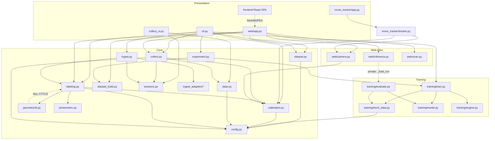

# Dependency Graph & Coupling Analysis

## Module Dependencies (Core + Satellites)

Legend: solid = regular import · dashed = problematic edge

## Edge Assessment

**Clean, intended directions (confirmed):**
- `config.py` is a pure sink — imported by everything, imports nothing domain-specific. ✓
- `state.py` (game logic) and `calibration.py` (geometry) are headless and depend only on config
  — the most stable building blocks of the system. ✓
- `cli.py` and `web/app.py` couple broadly to all layers as entrypoints — appropriate. ✓
- `move_tracker` is a pure consumer of the library (calibration, web.camera, python-chess),
  duplicates no logic. ✓

**Problematic edges:**

| Edge | Problem | Severity |
|---|---|---|
| `geometry3d → labeling` (lazy) together with `labeling → geometry3d` | Import cycle masked by lazy import; `_resize_keep_aspect` lives in the wrong module | Medium |
| `web/inference → training.evaluate._load_run` | Private symbol as a layer contract; no stable contract Training→Consumers | High |
| `web/app` ↛ `labeling` (Label→FEN reimplemented locally, app.py:60–84) | Missing edge that should exist — duplication instead of import | Medium |
| Inference paths ↛ `photometric` | `predict_arrays` does not apply photometry even though the run config requires it → Train/Serve-Skew | **Critical** (see C1) |
| `move_tracker → chesslab.calibration._square_to_col_row` | Another private symbol as an external contract | Low |

## Coupling Hotspots

1. **The "Crop Contract" is not a module, but distributed knowledge.** Four sites must reproduce the
   same geometry+photometry (labeling/slice, torch_data, web/inference, move_tracker).
   This is the most important missing abstraction in the system — a facade
   `crops_for_model(frame, corners, run_cfg)` would resolve three dashed edges.

2. **`web/app.py` (~1060 lines) is the God Module of the web layer.** Endpoints, global state,
   FEN helpers, subprocess management, and stream generators in one file. Splitting by
   feature (train/collect/inference/scan router) would make coupling visible and testable.

3. **File formats as interfaces** (session log, manifest, run config) are the most stable
   contracts of the system — but nowhere documented as schemas. Three JSONL reader implementations
   exist in parallel. A `schemas.py` (or docstring schema per writer) plus a shared
   `read_jsonl` helper would suffice.

4. **External system boundaries:** Blender/RealityScan (synth) and the Android IP cam are coupled
   by convention (paths, URL format) without validation at the boundary — errors propagate
   unnoticed deep into the pipeline (see C3/H5).
