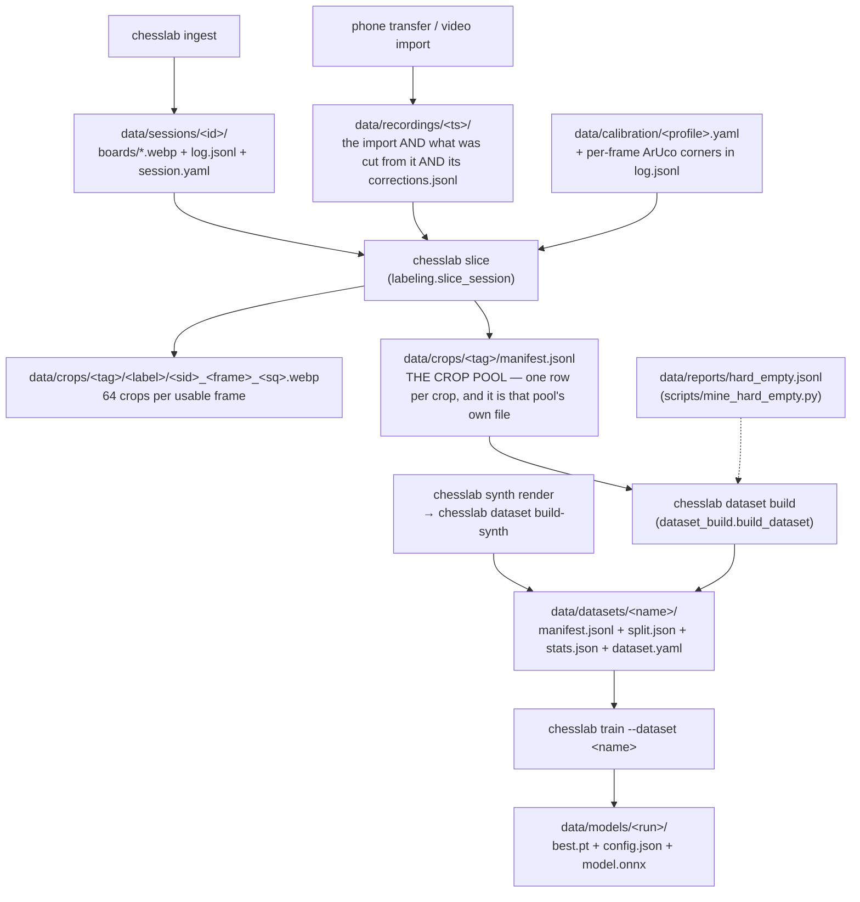

# The data pipeline — where a crop comes from

> Companion to `docs/synth-pipeline.md`, which covers the Blender half (renders → fused
> memmap). This document covers the **real-camera half** and the parts both halves share:
> the global crop pool, dataset builds, and everything that has surprised people.
>
> Measurements in this document were taken on **2026-07-27** and are marked as such. The
> structure is stable; the counts are a snapshot.

---

## 1. The map



**One sentence per stage.**

| Stage | Command | Writes | Key module |
|---|---|---|---|
| Import | phone transfer, `realgames export-session` | `data/recordings/<ts>/` | `realgames.py` |
| Import (external) | `chesslab ingest synthetic <dir>` | `data/sessions/<id>/` | `ingest.py` |
| Label | `chesslab slice --all` | `data/crops/default/` + its `manifest.jsonl` | `labeling.py` |
| Curate | `chesslab dataset build <name> …` | `data/datasets/<name>/` | `dataset_build.py` |
| Train | `chesslab train --dataset <name>` | `data/models/<run>/` | `training/train.py` |

Recording and labeling are deliberately separate: `slice` is a **pure, repeatable function** of
(board, FEN, mesh), so re-slicing a session reproduces its crops exactly.

The local capture rig — `chesslab collect` and its OpenCV dashboard — was deleted on 2026-08-20.
Sessions now come from the phone tracker or from `chesslab ingest`; `SessionWriter`
(`src/chesslab/session_writer.py`) is the piece of the rig that survived.

### 1.1 The tree — one rule (2026-08-20)

**A recording is one folder, and everything that only says something about it lives inside.**
Derived things — crops, datasets, reports — live outside and can be rebuilt from it.

| directory | holds |
|---|---|
| `data/recordings/<ts>/` | EVERYTHING about one recording: the import (`candidate.json`, `files/`, `video.mp4`, `review/`, `review-extra/`), what was cut from it (`session.yaml`, `log.jsonl`, `boards/`, `dirty/`, `mattes/`, `matte.jsonl`, `quad-fit.json`) and its own `corrections.jsonl` |
| `data/sessions/` | only sessions that are NOT recordings: what `chesslab ingest` imports. Empty today |
| `data/crops/<tag>/` | the crops **and that pool's own `manifest.jsonl`** — a pool describes itself. Default pool is `crops/default` |
| `data/datasets/<name>/` | packed snapshots |
| `data/models/<run>/` | training runs |
| `data/calibration/` | board profiles |
| `data/footage/` | raw video nothing writes: `turntable/`, `occluders/`, `phone-backups/` |
| `data/occluders/` | RGBA occluder tiles (hands), cut from `footage/occluders` |
| `data/reports/` | machine output: `audit-flags*`, `correction-violations.jsonl`, `hard_empty*.jsonl`, `split.json`, `augment.yaml`, `perf/` |
| `data/labels/` | only `review-notes.jsonl`, plus `_history/` |
| `data/inbox/` | the web app's runtime state |
| `data/_delete/` | retired material — moved, not deleted; the user deletes it themselves. What the 101 retired runs measured is in [`retired-runs.md`](retired-runs.md) before the directory goes |

Two consequences worth carrying:

- **The session id is not the directory name.** A recording's id keeps its `rg-` prefix — it is
  the join key in every manifest row — while the directory dropped it. `sessions.session_dir()`
  is the one place that maps one to the other; never join a path by hand.
- **A human verdict never lives in a derived tree.** `corrections.jsonl` sits next to its
  recording, `review-notes.jsonl` in `labels/`; a re-slice rebuilds crops, manifests, audit flags
  and violation reports and must not be able to take a decision with it.

Gone in the same move: `data/realgames/` (it became `recordings/`), `data/manifests/` (crop
manifests moved into their pool, everything else to `reports/`), `data/_backup/`, `data/_perf/`
(now `reports/perf/`), and the global `data/labels/corrections.jsonl` + `reviewed.jsonl`. Dated
sections further down still name the old paths — they describe the state at the time and stay.

### The board store — what a session actually keeps (2026-08-17)

A session no longer keeps its source frames. `boards/NNNNNN.webp` is the frame rectified under
that row's own quad, with the crop border, written by the export as it fits the grid
(`realgames.fit_rows_to_grid`) or retrofitted by `chesslab session boards`. It is the **same
raster `crop_square` cuts the training crop from**, so the label view and the training crop stopped
being two independent cuts of one frame: `/api/cell` reads it too (`lib/crops.ts` `cutSource`).

Measured: 115 KB against the frame's 3.3 MB — the session tree went from 96 GB to 4.5 GB — and the
extra WebP stage moves the model's softmax by 0.0006 with one argmax flip in 998 crops.

Two things the row has to carry beside the path, and both cost real time to learn:

- **`board_size` / `board_border`.** A homography lets board coordinates cancel against it; a
  stored raster does not. The candidate's geometry says 1008 where the export profile says 928, and
  a reader assuming its own number cut cells up to 59 px off on a 128 px crop. `usable_board`
  refuses a board whose numbers do not match the profile doing the cutting (`--pad-side` overrides).
- **The board is written STRAIGHT** (2026-08-21). `realgames.straighten_boards` pulls the whole
  raster through the row's mesh once and sets `board_straightened`; consumers cut plain rectangles
  and must never straighten again. The matte follows its board — it IS that raster.

`video -> webp -> labeling -> crop -> training`: the export decodes forward and warps in memory
(`realgames.stream_frames`), so no PNG is written on the way. Frames are still written for an
undistorted set (`frames/lens.json`, which the video cannot reproduce) and for `--no-fit`.

---

## 2. What a session is

An ingested session — the shape the rest of this section describes, and the shape every rig
capture had before `collect` went:

```
data/sessions/20260721-205618/
  session.yaml     # session_id, profile, mode, created_at, frame_size, reviewed, notes
  log.jsonl        # one row per captured position
  frames/0000.png  # the raw frame (undistorted if a lens calib was active)
```

A **recording** carries the same `session.yaml` + `log.jsonl` under its own folder, keeps
`boards/` instead of source frames (see the board store below), and adds everything the import
brought with it:

```
data/recordings/2026-08-08-00-39-57/          # session id: rg-2026-08-08-00-39-57
  candidate.json  video.mp4  reference.pgn  files/   # the import
  session.yaml  log.jsonl  boards/  dirty/           # what was cut from it
  mattes/  matte.jsonl  scan.jsonl
  review/  review-extra/                             # the review renders
  corrections.jsonl                                  # this recording's human verdicts
```

`review/` and `review-extra/` were called `frames/` and `frames-extra/` until 2026-08-20, and the
rename was not cosmetic: a merged `log.jsonl` stores `"frame": "frames/000150.png"` relative to
its own directory, while the recording's `frames/` held a 720x816 review render — so the merge
would have made the wrong image answer for the row.

A `log.jsonl` row:

```json
{"frame": "frames/0000.png", "ply": 1, "fen": "…", "ts": "…", "move_san": null,
 "corners": [[x,y],[x,y],[x,y],[x,y]], "unusable": true}
```

- `corners` is the board quad in **`[a8, h8, h1, a1]`** order, in image pixels. It is stored
  per frame, so slicing needs no camera and no marker re-detection. If it is absent, `slice`
  falls back to detecting ArUco markers in the frame and **skips the frame** if it cannot.
- `grid_lines` (the shape §2.1 spells out) is the frame's measured 18-line mesh. The EXPORT uses
  it, not the slice: it straightens the stored board once so the barrel never reaches a training
  crop. Written by `realgames export-session --fit` and by `chesslab session fit-mesh` (~0.05 s per
  frame); `chesslab session straighten` is the retrofit for a store written before this.
- `grid_lines_source` says whether that mesh was `measured` on the frame or `carried` from the
  median of the stable frames around it — a hand over the grid hides the lines, not the camera,
  which is not rebuilt mid-session. Carried meshes only claim a stage all their neighbours agree
  on, so a curvature measured on one frame alone never spreads.
- `unusable: true` makes `slice` skip the frame — see §5.3 for the trap.
- `mode` in `session.yaml` matters for interpretation: `play` and `track` are real games;
  **`lighting-capture` sessions hold an empty board** (`fen: 8/8/8/8/8/8/8/8`) and exist only
  to sample lighting variance over the 64 empty squares.

**Resolution is the property that decides a session's worth.** It is not recorded anywhere —
you compute it from the corners: mean quad edge length ÷ 8 = **px per square**. That is how many
real sensor pixels back each crop *at the sensor*. The sessions captured with the phone as a
1080p feed carry roughly **98 px/square**; anything materially below that is an upscale, and a
session at 49 px/square is being blown up 2.6×. This single number is why the 07.07. sessions were
parked (§6.2) and it should be checked on every new session.

⚠ **It is not the resolution the model is fed.** The warp goes through `profile.board_size`
first, so the crop is cut at `board_size / 8` px/square whatever the camera delivered — on the rig
profile that is 100, and a 173 px/square session loses 42 % of its linear resolution there. See
**§11**, which is the section to read before quoting any px/square number at a model.

### 2.1 Android "Stored" sessions carry a corrected quad beside their log

An Android Stored recording lands as `data/recordings/<bundle>/files/sessions/<id>/` with the same
`log.jsonl` shape plus sparse `frames/NNNN.jpg`. Its `corners` are the raw **MARKER** quad, and
every consumer turns it into a playing field with one constant outset (`DEFAULT_MARKER_MARGIN`
0.045). The best outset varies per session and per corner — measured 2026-08-15 across the 28
stored sessions at ±6–14 px, and on `20260812-222357` at 35 px on the h8 marker alone, which no
single number can express. The consequence is identical in training and in labelling: every crop
of that session sits a fifth of a cell off its square.

`chesslab realgames fit-stored <bundle> [--all]` measures each stored JPEG against the board's own
grid (`alignment.improve_quad`, the same fit `export-session` runs per frame) and writes the
result beside the log:

```json
{"margin": 0.0, "frames": {"0000": {"corners": [[x,y],[x,y],[x,y],[x,y]], "align_worst_px": 1.8}},
 "failed": ["0007"], "method": "grid-fit over printed field edges", "source_margin": 0.045,
 "written_at": "…"}
```

- `corners` are **playing-field** corners in JPEG pixels, `[a8, h8, h1, a1]`, margin **0** — a
  consumer warps them directly and applies no outset of its own.
- `align_worst_px` is the worst square-edge offset in rectified pixels at the board size the pack
  warps in (`measuredBoardSize`), i.e. the same units §12 flags a session in.
- A frame whose grid could not be read (a hand over the board) is named in `failed` and gets no
  entry. The consumer keeps the logged marker quad for it — the failure is visible, never patched.
- `grid_lines` (`{"x": [9], "y": [9], "tx": [9], "ty": [9], "cx": [9], "cy": [9]}`, white POV) is
  the frame's measured 18-line mesh: per line `pos(t) = x + tx·(t−0.5) + cx·(t−0.5)²` in fractions
  of the field side. Written only when **every** line was located, offsets strictly monotone,
  every |tilt| < 0.05; the curvature pair is all-or-nothing on top (|curv| < 0.08 — measured
  004251 outer lines reach 0.046, a ~10 px sagitta at 928 — its `d` folded into the offsets)
  and drops alone when unmeasurable. `mesh_point` maps the ideal board onto the measured one —
  offsets, tilts and parabolas together, a missing stage carried as zero — and `straighten_board`
  remaps the whole raster through it. Lens-agnostic, no undistortion. Parity twins `meshPoint`
  (CropBox.kt, `lib/warp.ts`), pinned on 100 shared points.
- The file is **derived**: re-running overwrites it atomically, and deleting it only returns the
  session to the uncorrected marker quad.

---

## 3. The crop pool — `data/crops/<tag>/manifest.jsonl`

> **Umbenannt 2026-08-20:** der Pool hieß `data/squares/` und `squares__<tag>/`, die Manifeste
> `squares*.jsonl` unter `data/manifests/`. Jetzt liegt jeder Pool als `data/crops/<tag>/`
> beisammen **und trägt sein Manifest selbst** — `data/crops/<tag>/manifest.jsonl`, Default
> `crops/default`. `data/manifests/` gibt es nicht mehr: Maschinenausgabe (`split.json`,
> `augment.yaml`, `hard_empty*.jsonl`, `audit-flags*`, `correction-violations.jsonl`, `perf/`)
> steht in `data/reports/`. Ältere, datierte Abschnitte weiter unten nennen noch die alten Pfade —
> sie beschreiben den damaligen Stand und bleiben so stehen.

> **Menschenurteile 2026-08-20:** sie sind das Einzige hier, das nichts nachproduziert — ein
> Neuschnitt baut Crops, Manifeste, Audit-Flags und Violation-Reports neu und darf dabei keine
> Entscheidung mitnehmen können. Deshalb liegt `corrections.jsonl` **bei seiner Aufnahme**
> (`data/recordings/<ts>/corrections.jsonl`), nicht mehr global unter `data/labels/`; dort steht
> nur noch `review-notes.jsonl` plus `_history/`. `reviewed.jsonl` ist ersatzlos weg, und
> `corrections.jsonl` trägt seit dem 13-Klassen-Schema nur noch Identitäten — `occluded` ist keine
> Klasse mehr, sondern die gemessene `coverage` (`docs/class-scheme.md`).

One JSON row per crop. This is the **single source of truth** for what real training data
exists; the pool's `<label>/` directories are just its pixel backing.

```json
{"path": "data/crops/default/wR/20260630-080531_0000_a1.png", "label": "wR",
 "session_id": "20260630-080531", "frame": "0000", "ply": 1, "square": "a1",
 "square_color": "dark", "fen": "…", "out_size": [128,128],
 "pad_side": 0.05, "pad_up": 0.0, "ts": "…"}
```

Facts worth knowing before you touch it:

- **Nothing appends to it.** Every writer is a read-modify-**rewrite** of the whole file.
  `slice_session` calls `_replace_session_in_manifest` (`labeling.py:233`), which drops all rows
  of that `session_id` and rewrites the file — that is what makes re-slicing idempotent. The
  old spec text ("one line per crop (append)", `specs/03-capture-labeling.md:87`) is stale.
- **Variant pools exist.** `chesslab slice --variant-tag X` and `chesslab ingest --tag X` write
  `data/crops/X/` with its own `manifest.jsonl` instead, so experiments do not pollute the real
  pool. `dataset build --source-manifest` takes those manifest paths and accepts several at once.
- **Web reads go through `manifest_cache.py`** (mtime-keyed). Never re-read the whole manifest
  per request.
- It is only consistent with `data/crops/` if every mutation went through the code. As of
  2026-07-27 it is: 14,720 rows, 14,720 files, zero missing, zero orphans.

---

## 4. What a dataset is

A dataset is a **view** on the pool: a session selection plus a dedup and split policy. It
copies no pixels for `rot=0` — `manifest.jsonl` rows point back at `data/crops/`.

```
data/datasets/occ-real/
  dataset.yaml    # the recipe: session_ids, dedup params, split params, counts
  manifest.jsonl  # the selected + deduplicated rows
  split.json      # train/val/test session lists, per-class counts, class weights
  stats.json
```

The build (`dataset_build.build_dataset`) runs strictly in this order:

1. **Filter** the pool to `session_ids`.
2. **Assign whole sessions to splits** on the RAW rows (`dataset.assign_sessions_to_splits`).
3. **Dedup — TRAIN ONLY.** `dedup_metadata` (≤ `per_cell_cap` per `(session, square, label)`,
   default 4). `dedup_phash` runs first *when enabled*, but it is **OFF by default since
   2026-07-30** — see §5.13. The order matters and was the other way round until 2026-07-29 —
   see §5.11.
4. **Collapse labels** to the target class list (`pieces13`, the default, drops `occluded` rows).
5. Write manifest + split + stats, then **pack** into a memmap if ≥ 100,000 crops.

A variant whose manifest only re-SELECTS rows another dataset already packed does not get a second
copy: `chesslab dataset pack <name> --from <owner>` writes `packed_from` into `packed_meta.json`
and reads the owner's raster. Measured 2026-08-20: 17 `xval` variants held 8.89 GB each of two
distinct rasters — 118 GB for differing row selections. The link is refused when the owner lacks a
crop the variant needs, and the digest still comes from the variant's own manifest.

Rotation augmentation is a **train-time transform** (`torch_data._RandomRot90`), never
materialized — `dataset.yaml`'s `rotations` field only switches it on.

---

## 5. Behaviours that have cost people hours

### 5.1 Dedup applies to the train split only — so `final` measures the split, not the data

`dataset_build.build_dataset`, the dedup block. The holdout passes through untouched, deliberately: `board_accuracy`
needs complete 64-crop boards, and deduplicated boards would make it meaningless.

The consequence is unintuitive and it has bitten twice: **a dataset's reported `counts.final`
is a property of the split, not of the corpus.** A *larger* train split makes `final`
*smaller*, because more of the data is exposed to dedup. The same session list has produced
10,123 and 5,030 final crops from an identical raw 13,376 purely by moving the split boundary.

Never compare `final` across datasets with different splits. To compare corpora, compare the
raw pool or the phash-unique count.

### 5.2 The split assigner is subtle, and its docstring is the specification

`dataset.assign_sessions_to_splits` (`src/chesslab/dataset.py:177`). Sessions are never split
across train/val/test — frames within one session are near-identical, so splitting one leaks.
That constraint makes the arithmetic awkward, and a naive largest-first greedy produced
**train 550 / val 2,432 / test 2,048** on a real corpus (fixed 2026-07-27).

Read the docstring before changing it. It records both failure modes it now guards against
(targets sized off the wrong pool; oversized sessions landing in holdout) and, importantly,
why targeting deliberately uses **raw** crop counts rather than post-dedup "effective" sizes —
weighting by unique content was measured and is *worse*.

### 5.3 `unusable: true` does not retroactively remove anything

The flag is read by `slice_session` at slice time only. Flagging a frame in the review UI
changes **future** slices; the crops and manifest rows produced by earlier slices stay exactly
where they are and keep feeding datasets.

To make a flag take effect you must either re-slice the session (`chesslab slice --session <id>`,
which rewrites all of that session's rows) or remove the rows and files by hand. A frame flagged
on 2026-07-27 was still in `squares.jsonl` until its 64 rows were deleted manually — see
`data/_parked/20260727-occluded-frame/README.md`.

### 5.4 `data/` is gitignored — a delete there is unrecoverable

Hence the standing rule: **park, never delete.** There is no backup, no history, no undo.
`synth_pieces/` (415 MB of scanned meshes) is the extreme case — read-only, no backup, never move.

### 5.5 Session size ranks almost inversely to information content

A fixed camera photographing a board where most pieces never move produces enormous redundancy,
and it is not distributed the way file sizes suggest. Measured 2026-07-27 with the pipeline's own
dhash (Hamming ≤ 6):

| session | raw rows | phash-unique | unique share |
|---|---:|---:|---:|
| 20260630-080531 | 1,024 | 767 | 74.9 % |
| 20260630-081608 | 1,024 | 766 | 74.8 % |
| 20260709-141209 | 832 | 201 | 24.2 % |
| 20260721-200810 | 1,600 | 169 | 10.6 % |
| 20260721-205618 | 3,456 | 471 | 13.6 % |
| 20260721-212830 | 4,992 | 652 | 13.1 % |

The largest session in the corpus carries fewer unique crops than one 1/5 its size. **The whole
active pool is 14,720 rows → 3,414 phash-unique (23.2 %)**; through the real pipeline order
(`per_cell_cap=4` then phash) it is 2,480.

The binding constraint on this project is unique crops, so judge a session by its unique count,
never by its row count or its size on disk.

### 5.6 Parking a session directory does NOT remove it from the pool

There are two parking mechanisms and only one of them is complete:

- `sessions.archive_session` (`chesslab session archive <sid> --reason ...`) moves the directory to
  `data/sessions_archive/` **and** purges the session's crops and manifest rows. Reversible via
  `restore_session` + re-slice. This is the intended mechanism, and since 2026-07-27 it
  **requires a reason** (§5.8).
- Moving the directory to `data/_parked/…` by hand moves **pixels only**. The rows stay in
  `squares.jsonl` and keep feeding every subsequent build.

That was live until 2026-07-27: the four 07.07. sessions had been parked under
`data/_parked/20260727-lowres-0707/` and their 1,408 rows were still in `squares.jsonl`. They have
since been put through `archive_session` properly — the pool went **14,720 → 13,312 rows, 11 → 7
sessions**, and the reason is in `data/sessions_archive/index.jsonl`.

`data/datasets/occ-real` **still carries those 1,408 rows** and still lists the four sessions in
`session_ids`, because a dataset is a snapshot and archiving does not reach into it (§5.9).
That is deliberate: `occ-real` is the baseline every `specs/18-occupancy-model/` number was measured
against and must stay byte-identical. The next occupancy dataset is built under a new name from the
7 remaining sessions.

If you park by hand, either re-slice afterwards or state in the README that the rows remain.

### 5.7 Two files named `split.json` mean different things

- `data/reports/split.json` — the **legacy global** split over the whole pool. Written only by
  `chesslab split` (`dataset.run_split`, which drops `augment.yaml` beside it). Read by legacy
  (`--dataset`-less) training, `eval`, `quantize`, `gradcam` and `dataset verify`.
- `data/datasets/<name>/split.json` — the **per-dataset** split, written by every dataset build.
  This is what `chesslab train --dataset <name>` uses.

The current pipeline is the per-dataset one. The global file is a leftover (§7).

Note also that `data/reports/hard_empty.jsonl` protection is wired into **`dataset_build.build_dataset` only**
— the legacy `dataset.run_split` calls `make_split` without `priority_paths`, so mined hard
negatives are *not* protected in the global split.

### 5.8 Archiving requires a reason, and writes it twice

`archive_session(session_id, reason, paths)` — `reason` is a **required positional argument**. An
empty or whitespace-only reason raises `ValueError`; nothing is moved.

Four parked directories in three conventions, two of them with no explanation at all, cost a full
day of archaeology in July 2026. A session that leaves the corpus and takes its manifest rows with
it changes every dataset built afterwards, and by the time anyone notices, the only person who
knew why is gone. So the reason is written in two places on purpose:

| where | what | who reads it |
|---|---|---|
| `data/sessions_archive/<sid>/session.yaml` | `archived_at`, `archived_reason` | a human opening the directory; travels with the pixels even if the tree is moved |
| `data/sessions_archive/index.jsonl` | one row per archive: `session_id`, `archived_at`, `reason`, `removed_crops` | scripts, and anyone who wants to read the whole archive without opening 19 directories |

Write the reason a stranger can act on — the measurement, not the verdict. "blurry" is useless;
"59 px/square against the device's 119, superseded by the 21.07 captures" is a decision someone
can re-check and reverse.

`chesslab session archive` REQUIRES `--reason`, so a parked session always carries its motive.
Prefer a specific one when you have
something to say; if you used the button, edit the `session.yaml` afterwards.

Two guarantees the implementation makes, both regression-tested in
`tests/test_sessions.py::test_archiving_records_why` and
`::test_archiving_never_overwrites_an_existing_archive`:

- **A refused archive moves nothing.** If the reason is empty, the live session is untouched.
- **Archiving never destroys an archive.** Archiving an id that already exists under
  `sessions_archive/` raises `FileExistsError` — it used to `shutil.rmtree` the old one. Archiving
  is the safe half of the API; `delete_session` is the other half and is the only place allowed to
  remove pixels.

`restore_session` moves the directory back but does **not** restore the crops or the manifest rows
— re-slice afterwards, then rebuild (§5.9).

### 5.9 Datasets are snapshots. New sessions do not appear in them — rebuild.

**This is the one to remember.** Nothing in the pipeline is incremental. A dataset is a *view*
frozen at build time (§4): `manifest.jsonl` holds the rows that existed on the day it was built,
and `dataset.yaml`'s `session_ids` is a hardcoded list. Recording, slicing, archiving, flagging and
restoring all change the pool **underneath** every existing dataset without touching it.

`data/datasets/occ-real` was built **2026-07-26** over **11 sessions**. Every session recorded
since is invisible to it, and it still contains the 1,408 rows of the four 07.07 sessions that were
parked by hand afterwards. `chesslab train --dataset occ-real` today trains on July 26th's world.

After **any** of these — rebuild:

| you did | what it changed | what is still stale |
|---|---|---|
| recorded a new session | nothing yet — a session is frames + log, not crops | everything |
| `chesslab slice --session <id>` | added/rewrote that session's rows in the pool's `manifest.jsonl` | every dataset |
| flagged frames `unusable` (§5.3) | nothing until you re-slice | every dataset |
| `archive_session` | removed the crops **and** the pool rows | every dataset built before it |
| moved a session to `_parked/` by hand (§5.6) | pixels only — the rows still feed builds | every dataset, permanently |

The rebuild, end to end:

```bash
# 1. crops for the new sessions (slicing is pure and repeatable; re-slicing an old session is safe)
uv run chesslab slice --session 20260727-...

# 2. the session list is NOT derived — name every session the dataset should contain
uv run chesslab dataset build real13-<date> --sessions <sid1>,<sid2>,...   # --classes pieces13 by default

# 3. train against the new name
uv run chesslab train --dataset real13-<date> ...
```

**Build under a new name, never in place.** Every published number was measured against a named
dataset; overwriting one makes those numbers unreproducible
and the comparison meaningless. Date-suffix the new one and record in `STATUS`/commit message which
dataset a checkpoint was trained on.

Two traps that follow from "the session list is not derived":

- **A dataset does not shrink by itself.** Archiving a session removes its rows from the pool, but
  a dataset built earlier still lists it in `session_ids` and still carries its rows in
  `manifest.jsonl`. Only a rebuild drops them.
- **`--sessions` is the whole selection, not a delta.** Omitting a session removes it. There is no
  "add to dataset" command, and no CLI that lists sessions — assemble the list from the previous
  `dataset.yaml`'s `session_ids` plus whatever `data/recordings/` and `data/sessions/` have gained
  since (`chesslab session list` is the readable view). Name the **id**, not the directory: a
  recording's id carries the `rg-` prefix its folder dropped (§1.1).

### 5.10 `per_cell_cap`, not phash, is what decides how much data you get

`dedup_metadata` runs FIRST and keeps at most `per_cell_cap` crops per **(session, square, label)**
— default **4**. phash only sees what survives it.

For a game session that is roughly harmless. For a `lighting-capture` it is fatal: the session
holds one label (`empty`) on all 64 squares across hundreds of frames, so the whole tuple space is
64 buckets and a **297-frame session collapses to 256 crops**. The thing the capture was recorded
for — the same square under many lighting conditions — is exactly what the cap discards.

Measured 2026-07-27 over the 20-session pool (49,856 raw), occupancy, both lighting captures in
`force_train`:

| `per_cell_cap` | train crops | train `empty` |
|---:|---:|---:|
| 4 (default) | 3,747 | 1,643 |
| 16 | 5,413 | 3,248 |
| 64 | 5,445 | 3,267 |
| 256 | 8,712 | 6,534 |

Above 16 the binding constraint changes to `max_empty_ratio=1.5` (empty ≤ 1.5 × occupied); with
that lifted to 3.0 the 256 row is what you see, and with no cap at all train reaches 13,320 /
11,142 empties. So there are **three** stacked filters and the default of each is tuned for
game sessions:

1. `per_cell_cap` — crude, per tuple, runs first
2. `phash_hamming` — the principled one, near-duplicate pixels
3. `max_empty_ratio` — class balance, applied to the train split

If a build returns far less data than the corpus suggests, check them in that order. `occ-real3`
uses `per_cell_cap=256, max_empty_ratio=3.0` for this reason.

---

---

## 6. Parked data — the inventory

Everything below is preserved, nothing here is deleted.

### 6.1 The conventions in use (there are four, and that is the problem)

| # | Location | Created by | Prunes `squares.jsonl`? | README? |
|---|---|---|---|---|
| 1 | `data/sessions_archive/<sid>/` | `chesslab session archive` | **yes** | n/a — carries its own reason in `session.yaml` + `index.jsonl` (§5.8) |
| 2 | `data/session_rejects/<sid>/` | `trim_session` (cut tails) | yes, for the cut frames | n/a (code-supported, does not exist yet) |
| 3 | `data/_parked/<date>-<reason>/` | by hand | **no** | yes, all three |
| 4 | `C:/Users/mariu/project/chesslab-parked-20260725/` | by hand, **outside the repo** | n/a (took the pool with it) | added 2026-07-27 |

**Proposed single convention** (not executed — see §8):

> Park by hand into **`data/_parked/<YYYYMMDD>-<short-reason>/`**, always with a `README.md`
> stating what, when, why and how to restore. Use `archive_session` instead whenever the unit
> being parked is a single session that should also leave the pool.

Consolidating #4 into #3 would cost **nothing but time to write the note**: both trees are on the
same volume (`C:`, 406 GB free), so the move is a filesystem rename, not a copy — 13.66 GB moved
instantly, and `data/` is gitignored so nothing enters git. `data/_parked/` is invisible to the
pipeline (`sessions.all_sessions` walks `recordings/` and `sessions/`, nothing else). The reason it may have been put outside
the repo deliberately is exactly that: distance from anything that walks `data/`. **Ask before
moving it.**

### 6.2 `data/_parked/` (0.05 GB, in-repo)

| directory | contents | note |
|---|---|---|
| `20260727-orphan-synth-v2-diverse/` | 260 session dirs, **pointers only** — the renders were deleted | FENs salvaged to `data/fens_v2_diverse.txt` |
| `20260727-lowres-0707/` | 4 sessions, 22 frames | 49–82 px/square. **Rows still in the pool** (§5.6) |
| `20260727-occluded-frame/` | one frame's 64 crops | flag + rows already removed by hand |

All three carry a README.

### 6.3 `C:/Users/mariu/project/chesslab-parked-20260725/` (13.66 GB, outside the repo)

This is the **previous state of the whole labeling stage**, parked wholesale on 25.07:

```
sessions/    19 session directories (30.06 – 21.07)          4.51 GB
squares/     the old data/squares, per-class dirs            9.01 GB
manifests/   the old squares.jsonl (378,752 rows) +          0.14 GB
             corrections.jsonl, hard_empty*.jsonl
```

The old `squares.jsonl` is a **superset**: it contains the 19 parked sessions, the sessions that
are still active today, one session with no surviving directory (`20260630-083659`, 1,024 rows at
a different `out_size` of 128×176), and 320,000 rows of a `pretrain-synth` set. It is the pool the
deleted `real-all` / `real-all2` / `real-all4` piece datasets were built from — those names survive
only in `data/models/{p3-*,tiny-*}/config.json`.

See §9 for what the 19 sessions are worth.

---

## 7. Stray artefacts — what they are and whether anything reads them

Traced across `src/`, `scripts/`, `tests/`, `synth/` and the (since deleted) FastAPI backend and
React frontend. The paths below are the pre-2026-08-20 tree: `data/manifests/*` now lives in
`data/reports/`, and `corrections.jsonl` next to its recording (§1.1). The verdicts are what was
traced then — `corrections.jsonl` in particular has had a writer again since `platform/app`
(`POST /api/corrections`).

| file | written by | read by | verdict |
|---|---|---|---|
| `data/manifests/squares.jsonl.bak` | **no code** — created by hand 26.07 | nothing | orphan. Nothing in the repo creates or cleans `*.jsonl.bak`; the only `.bak` writer is `CalibrationProfile.save`, for YAML profiles. |
| `data/manifests/split.json` (02.07) | `dataset.run_split` | legacy training / `eval` / `quantize` / `gradcam` / `dataset verify` | **live code path, stale content.** It names sessions that no longer exist (`20260630-083659`, `-010216`, `-014453`) and predates every current dataset. Harmless while everything runs `--dataset`, misleading the moment someone does not. |
| `data/manifests/augment.yaml` (02.07) | `dataset.write_augment_yaml`, as a side effect of every `run_split` | **nothing** | documentation artifact by design — its own header says "generated from `config.AUGMENT` — edit the dataclass, not this file". The on-disk copy is stale w.r.t. the current dataclass (it lacks `noise_std`, `erase_*`, `bg_*`). |
| `corrections.jsonl` | **no writer at all** since the relabel tab went in `f31d933`; `upsert_corrections` was deleted with the web tests on 2026-08-07. Pruning in `delete_session` / `trim_session` remains | `run_slice` → `label_overrides` (`experiment.slice_variant` was the second reader until `experiment.py` was deleted on 2026-08-20) | read path is live, write path is not wired to any UI or CLI. Human relabels currently cannot be recorded. Note `archive_session` prunes the manifest but *not* corrections — an asymmetry vs `delete_session`. |
| `hard_empty.jsonl` | `scripts/mine_hard_empty.py` | `dataset_build.build_dataset` → `priority_paths` (protects mined hard empties from the `empty` cap) | live and useful. Not honoured by the legacy `run_split` (§5.7). |
| `hard_empty.synthetic.jsonl` | `scripts/mine_hard_empty.py` (quarantine dump for legacy non-camera rows) | **nothing** | pure quarantine; never consumed. |
| `hard_empty.jsonl.bak` (parked tree) | by hand | nothing | orphan, same as above. |
| `data/fens_*.txt` | `synth/fens.py` / salvage scripts | `chesslab synth render` | live inputs to the render pipeline, see `docs/synth-pipeline.md`. |

Nothing above has been deleted or moved. The two genuine orphans are the `.bak` files and
`hard_empty.synthetic.jsonl`; `augment.yaml` regenerates itself on the next `split`.

---

## 8. If you are tidying

- Park, never delete. `data/` is gitignored.
- Prefer `archive_session` over a manual move when the unit is one session — it keeps the pool
  consistent and forces you to record **why** (§5.8). After any manual move, re-slice or write down
  that the rows remain.
- **Rebuild the dataset afterwards, under a new name** — archiving, slicing and flagging never
  reach into a dataset that already exists (§5.9).
- Never touch `synth_pieces/` (scanned meshes, no backup).
- `data/datasets/occ-real` is the baseline the shipped occupancy model was measured against.
  Leave it byte-identical; build new datasets under new names.
- Before removing a session, measure its **unique** contribution, not its size (§5.5).

---

## 9. Measured 2026-07-27 — what the 19 parked sessions are worth

Method: dhash of every crop, deduplicated with `dataset_build`'s own LSH banding at the
configured `phash_hamming=6`, per class. "Marginal" = crops that survive when added on top of
the current active pool, i.e. genuinely new content.

**Headline: the 19 sessions would take the pool from 3,414 to 17,470 unique crops — 5.1×.**

| group | raw rows | marginal unique | of which `empty` | of which pieces |
|---|---:|---:|---:|---:|
| active pool today | 14,720 | 3,414 | 1,776 | 1,638 |
| **all 19 parked** | 43,328 | **14,056** | 12,352 | 1,704 |
| — the two 21.07 lighting captures | 26,240 | 8,839 | 8,839 | 0 |
| — rest at ≥ 98 px/square | 4,736 | 1,872 | 1,057 | 815 |
| — below 98 px/square (7 sessions) | 12,352 | 3,517 | 2,620 | 897 |

Per session, with the resolution figure that decides whether it is wanted:

| session | px/sq | frames | raw | marginal unique | mode |
|---|---:|---:|---:|---:|---|
| 20260721-194538 | 127.1 | 297 | 14,528 | 5,322 | lighting-capture |
| 20260721-193821 | 119.3 | 191 | 11,712 | 4,385 | lighting-capture |
| 20260708-021722 | 97.0 | 74 | 4,736 | 1,089 | track |
| 20260706-130834 | 60.7 | 55 | 3,520 | 956 | track |
| 20260630-014453 | 214.1 | 16 | 1,024 | 769 | play |
| 20260706-215008 | 55.1 | 15 | 960 | 507 | track |
| 20260708-195420 | 103.5 | 30 | 1,792 | 495 | track |
| 20260630-010216 | 214.1 | 8 | 512 | 375 | play |
| 20260708-012317 | 82.1 | 20 | 1,280 | 374 | track |
| 20260706-190522 | 47.1 | 9 | 576 | 358 | track |
| 20260708-020419 | 96.7 | 13 | 832 | 226 | track |
| 20260709-195159 | 102.4 | 10 | 576 | 108 | track |
| 20260721-220149 | 87.5 | 7 | 448 | 83 | track |
| 20260710-001623 | 102.8 | 3 | 128 | 76 | track |
| 20260709-212059 | 103.1 | 4 | 128 | 68 | track |
| 20260709-201444 | 103.1 | 5 | 192 | 59 | track |
| 20260709-202406 | 103.1 | 1 | 64 | 44 | track |
| 20260709-132058 | 102.7 | 5 | 320 | 31 | track |
| 20260719-175329 | 138.4 | 56 | **0** | — | track, **never sliced** |

`20260719-175329` has 56 frames and a log, but 30 of its 91 log rows are flagged `unusable` and
it has **no rows in any manifest** — it was never ingested. It is the only session in either tree
in that state.

Reading of the table:

- The gain is overwhelmingly `empty` (12,352 of 14,056). For the shipped **occupancy** model that
  is precisely the scarce class — unique empties go 1,776 → 14,128, an 8× on the class the model
  actually confuses, and the two lighting captures alone supply 8,839 of them at 119–127 px/square.
  They are `mode: lighting-capture` (empty board), so they belong in `force_train` — `build_dataset`
  has that parameter for exactly this case, since an all-empty session in val/test distorts board
  metrics.
- For the **14-class piece** model the gain is 1,704 unique piece crops on top of 1,638 — roughly
  2×, and 897 of those come from sessions below device resolution.
- Seven sessions sit at 47–87 px/square, i.e. below the ~98 px/square the phone sees. Taking them
  back repeats the decision that parked the 07.07. set; they are the ones to leave parked unless
  `--scales` training is being used to compensate.

Restoring is `slice`, not `ingest`: move the session directory into `data/sessions/`, then
`chesslab slice --session <id>`, which regenerates the crops and the manifest rows from the frames
and stored corners. The parked `squares/` tree and its `squares.jsonl` do not need to be merged —
they are reproducible outputs, not inputs.

---

## 10. See also

- `docs/synth-pipeline.md` — Blender renders → `chesslab dataset build-synth` (fused memmap).
  Its `mm://` manifest rows have no files; consumers must read the packed memmap.
- `docs/architecture-review/architecture-overview.md` — component map.
- `README.md` — every CLI command, per stage.
- `src/chesslab/dataset.py:177` — the split assigner's docstring, which is its specification.
- **§13** — the alignment graveyard: every approach measured and rejected, so nobody re-tries the
  saddle-point detector. This is what `src/chesslab/alignment.py`'s "see what lost" pointers mean.
- **§11** — what the camera delivers vs. what the network is fed (`board_size`, `out_size`,
  `infer_size`), and what the splits actually are. `specs/22-inference-resolution/STATUS.md` holds
  the raw measurement.

### 5.11 The visual filter runs BEFORE the cap — and that is what lets the cap be raised

Until 2026-07-29 the per-cell cap ran first. It cut a cell's 227 crops down to 4 before anything
checked whether they differ, so `dedup_phash` only ever saw the survivors. From the cap's side
"the piece never moved" and "the light moved instead" are the same picture — which is precisely
what a **lighting capture** consists of, and why the earlier ones contributed almost nothing.

MEASURED on the 49,856-row real pool (2026-07-29):

| | rows kept | vs. the old order |
|---|---|---|
| old: cap 4 → phash | 4,172 | — |
| new: phash → cap 4 | 4,827 | 1.16× |
| new: phash → cap 16 | 7,422 | **1.78×** |

Only 14,807 of the 49,856 rows (29.7 %) are visually distinct at all, so the filter earns its
keep either way. The point of the order is what it unlocks: running first, the cap is no longer
the duplicate defence and only limits genuine variety, so **it can be raised without re-admitting
near-identical crops**. Under the old order a cap of 16 would simply have let them back in.

Cost: one hash pass over the uncapped train split — 41 s for the whole real pool, once per build.

What is left after the filter bounds the gain, and is worth knowing before planning a capture:
a cell holds **2** distinct crops at the median, 7 at p90, 145 at most, and only 363 of 2,339
cells have more than four. The headroom sits in a few well-populated cells.

### 5.12 A `pieces13` build DROPS `occluded` rows

`collapse_labels` used to refuse the build outright. That was right while a hand label on a real
session was the only way such a row could appear — there it means something went wrong upstream.
Renders with `--occlusion-p` produce them deliberately and in bulk (3,128 rows in one isolate
stage, 15,239 in a boards stage), so refusing protected nothing and made occluders unusable.

They are **dropped, not mapped**: a covered square may hold a piece or nothing, so either class
is a guess. The count and its share of the pool are printed — the guard's real purpose was that
the drop not be silent.

### 5.13 The perceptual dedup threw away half the corpus, and none of it was a duplicate

**`phash_enabled` is `False` by default since 2026-07-30** (`config.DedupDefaults`). It was `True`
with `phash_hamming = 6`, and the CLI made it unreachable: `--no-phash` defaulted to `False` and
the command passed `phash_enabled = not no_phash`, so the config's own setting was never read.

What it cost, one variable changed, both finetunes otherwise identical (`occ-v4-f5` vs
`occ-v4-f5nd`, measured on the occ-real6 test split):

| | rows kept | misses | phantoms |
|---|---:|---:|---:|
| `phash` hamming 6 | 19,365 of 42,816 | 42 | 4 |
| `phash` off | 42,816 | **17** | **2** |

**And the discarded crops were not duplicates.** `dhash` reduces a crop to a 9×8 grey thumbnail
and stores 64 yes/no comparisons between neighbouring pixels — absolute brightness, contrast,
noise and colour are gone. Two images collide as soon as that *sign pattern* matches, which a
smooth empty square or a piece body reliably does. Measured over five sessions: of 3,432 crops in
exact-hash collision groups, **0 were pixel-identical**, and **no frame was ever delivered twice**
by the camera. What hamming 6 removed was 54.8% of the corpus differing in noise, exposure and
sub-pixel shift — the variation the model has to become robust against.

What the threshold costs, measured on the same 15 sessions:

| setting | after dedup | discarded |
|---|---:|---:|
| hamming 6 (the old default) | 19,365 | 54.8% |
| hamming 2 | 33,292 | 22.2% |
| hamming 0 (dhash-identical only) | 40,260 | 6.0% |
| off | 42,816 | 0% |

⚠ **Only 6-vs-off was tested against a trained model.** Hamming 2 and 0 may well be a sensible
middle ground and nobody has measured them. Note that even at 0 the discarded crops are only
*dhash*-identical, never identical.

`per_cell_cap` (default 4) still bounds the case this policy exists for — a piece that never
moved across a long session. That cap is metadata-based and exact; it needs no visual guess.

### 5.14 The recorded splits do not reproduce, and the cause is still unknown

`specs/33` tested the standing explanation ("dict ordering") and **refuted** it: the mechanism is
real but needs equally-sized sessions, and over **400 random manifest orders this corpus yields
exactly one split**. The recorded splits of `occ-real5nd` / `occ-real6` still do not reproduce
from their own parameters (verified against the raw pre-dedup pool, not the stored manifest), and
the last change to `assign_sessions_to_splits` predates both builds. No candidate cause is on
record. The rule stands and is the only defence: reuse `split.json`, build twins with `--like`.

### 5.15 A packed memmap can serve the pixels of a previous geometry — `occ-real5nd-13c` did

`_manifest_digest` covers path + label + `out_size`, so it cannot see a crop whose **pixels**
changed under an unchanged path — which is exactly what a corpus re-slice does to every row at
once. Audited by mtime over all 12 packed datasets (`specs/33`): `occ-real6a`, `occ-real7a`,
`occ-warm`, `occ-orange` clean; **`occ-real5nd-13c` poisoned** — packed 2026-07-31 00:45, all 400
sampled crops rewritten after, digest still matching, and `load_packed` was still serving it.
No conclusion of record rests on it (its `specs/29` numbers are void under §12 anyway), but it was
live.

Closed since: `load_packed` stats `_STALE_SAMPLE = 256` evenly spread rows against the **memmap's
own** mtime, not the sidecar's (`src/chesslab/training/pack.py:195`, `_rewritten_since_pack`).
Miss probability for a re-slice touching 5 % of rows is 0.95^256 ~ 2e-6. A false positive costs the
slower per-PNG loader; a false negative trains a model on the previous geometry with no warning.

---

## 11. Resolution: what the camera delivers, and what the net is fed

> Measured **2026-07-29 / 30**, `specs/22-inference-resolution/STATUS.md` (phase 00; tool
> `scripts/sweep_infer_size.py`). Three numbers are involved and they are three *different*
> numbers: what the sensor delivers, what the warp keeps of it, and what the network is fed.
> Only the last one decides accuracy.

### 11.1 The chain — the warp decides, not the camera

```
corner quad in log.jsonl        mean edge / 8  = px/square AT THE SENSOR
   │
   │  labeling.warp_board_for_crops  →  profile.board_size      ← resolution is decided HERE
   ▼
rectified board                  board_size / 8 = px/square in the warp
   │
   │  calibration.square_to_crop_box →  cell * (1 + 2*pad_side) = THE CROP BOX, in px
   ▼
crop box
   │  imgops.resize_keep_aspect      →  out_size    = 128x128, what lands in data/squares/
   │  serving / eval resize          →  infer_size  = what the exported graph takes
   ▼
network input
```

`labeling.crops_for_frame` computes `cell = profile.board_size / 8.0` and warps to it **before**
any square is cut, so **the sensor's resolution never reaches the model**. The quantity that
decides how much real detail a crop carries is

```
board_size / 8 * (1 + 2 * pad_side)
```

and it depends only on the profile, never on the camera. The two values that are live today:

| where | `board_size` | `pad_side` | cell | crop box | vs. a 128 px input |
|---|---:|---:|---:|---:|---|
| rig profile `data/calibration/phone.yaml` | 800 | 0.05 | 100 | **110 px** | **upsamples** 1.16× |
| `config.DEFAULT_BOARD_SIZE` = the `BoardGeometry` / `TrackerConfig` default | 1600 | 0.05 | 200 | **220 px** | **downsamples** 1.7× |
| Android, **calibrated** — `measuredBoardSize` | 320…1280 | 0.05 | 40…160 | **44…176 px** | either way |

The `pad_side` column read **0.10** in the last two rows until 2026-08-06 while no profile in the
corpus had ever used it; §11.4 says what changed and why the model's own declaration is the part
that actually settles it.

⚠ **The 1600 row is the default, not what the running app uses.** `measuredBoardSize`
(`android/app/src/main/kotlin/com/chesslab/tracker/geometry/CalibrationStore.kt:133`) derives
`boardSize` from the longest edge of the detected corner quad, rounds it to a multiple of 16 and
clamps it to `320…1280` — so a calibrated Android profile warps at *the board's actual pixel size*,
by design: "the warp neither throws real pixels away nor fabricates any". **Android already does what
the rig profile does not.** The fixed 800 in `phone.yaml` is the outlier, and it is why the 4K session
below loses resolution that the phone would have kept.

Check it against the code rather than trusting the table:

```bash
.venv/Scripts/python.exe -c "from chesslab.calibration import load_profile, square_to_crop_box as box; \
p = load_profile('phone'); x0, y0, x1, y1 = box('e4', p, clamp=False); \
print(p.board_size, p.crop.pad_side, x1 - x0)"       # -> 800 0.05 110
```

So on the fixed rig **every** crop is a 110 px box, from every session, and 128 px input
interpolates it upwards. The 4K session (`20260721-212830`, 173.2 px/square at the sensor) and the
1080p session (`20260708-021722`, 96.9) both arrive at the crop stage at **100.0 px/square** — the
4K one loses **42 %** of its linear resolution at the warp and nothing downstream gets it back.
The phone runs the same code with `board_size = 1600` and therefore *downsamples* where the rig
upsamples. That, and not the sensor, is why the inference size has to be a per-model,
per-deployment value (§11.4).

This is also why re-cutting a crop at the target size recovers nothing: cut straight from the frame
at 96 px it scores 19 misses / 0 phantoms, resized from the 128 px crop on disk 21 / 0 — the same
110 px box either way.

### 11.2 Measuring a session's native resolution — still worth it, for a different reason

Not recorded anywhere; compute it from the first logged quad (this is exactly what
`scripts/sweep_infer_size.py`'s `px_per_square` does):

```bash
.venv/Scripts/python.exe -c "import json, math, sys; \
from chesslab.sessions import session_dir; \
c = json.loads((session_dir(sys.argv[1])[0] / 'log.jsonl').open().readline())['corners']; \
print(sum(math.dist(c[i], c[(i + 1) % 4]) for i in range(4)) / 4 / 8)" 20260708-021722
```

The number still matters — it **bounds** what `board_size` can deliver, since warping above the
sensor's resolution invents detail rather than adding it (`config.py:68-71`). It is simply the wrong
number to reason about a model's input size with.

The quad can drift within a session. The game sessions are stable to under 1 % between the first
frame and the mean over all frames; the two 21.07 lighting captures are not (`-194538` 114.7 first
frame vs 125.4 mean, `-193821` 116.0 vs 122.9), which is why §9's table — measured over all frames
on 2026-07-27 — lists 127.1 and 119.3 for the same two sessions. Say which frame you measured.

### 11.3 Each split is exactly one session — and val is not a clean holdout

`data/datasets/occ-real3/split.json` (the current occupancy dataset):

| session | px/square at the sensor | role | crops | boards |
|---|---:|---|---:|---:|
| `20260708-021722` | **96.9** | **the entire test split** | 4,736 | 74 |
| `20260721-212830` | **173.2** | **the entire val split** | 4,992 | 78 |
| `20260721-193821` | 116.0 | train (lighting-capture) | — | — |
| `20260721-194538` | 114.7 | train (lighting-capture) | — | — |
| `20260630-080531` | 213.8 | train | — | — |
| `20260630-014453` | 214.0 | train | — | — |
| `20260708-195420` | 103.3 | train | — | — |
| `20260709-141209` | 102.3 | train | — | — |

Two consequences, both invisible in `split.json`:

- **Every "real holdout" number this project has quoted is a number about one camera framing**,
  through one profile's `board_size`. Test is 74 boards of a single 1080p recording; val is 78
  boards of a single 4K one (its log has 79 rows, one flagged `unusable`, which `slice_session`
  skips — §5.3).
- **Val doubles as the checkpoint-selection set.** `best.pt` is the epoch that maximised
  `checkpoint_score` on val (`training/train.py`, the `evaluate_dataset` call in the epoch loop
  followed by `if score > best_score`), and that call passes no `input_size`, i.e. it scores at the
  crops' own 128 px. So "val prefers 128 px" is partly what checkpoint selection alone produces;
  val@128 *is* the selection objective. Do not read a val-only resolution result as evidence.

### 11.4 `out_size` is where the crops were built, `infer_size` is what the net is fed

Two keys in a run's `config.json`, deliberately not one (`specs/22-inference-resolution/`):

- **`out_size`** — the size the crops on disk were built at, 128×128. It stays in every manifest
  row and every dataset; dataset building, training and `chesslab eval` all use it. Do not
  repurpose it.
- **`infer_size`** — the size the exported graph takes and the size a consumer must resize crops
  to. Read in exactly one place, `training.torch_data.infer_size_of`, which falls back to
  `out_size` when the key is absent, so every model exported before this key existed keeps working.
  The exported `model.onnx` input shape is the ground truth; `config.json` describes it, and a
  consumer that finds a disagreement must fail loudly rather than resize to what it prefers.

Changing a model's serving resolution is therefore: edit that model's `infer_size`, re-export,
ship. Not a flag at a call site, and not a constant in the app.

Since **2026-08-06** (`specs/45-the-crop-belongs-to-the-model/`) two more keys sit beside them:

- **`pad_side` / `pad_up`** — what the crop CONTAINS, in cells around the square. `infer_size`
  says the picture is 80 px; the pads say whether those 80 px hold 1.10 or 1.20 of a cell, which
  is a different photograph of the same square. Written by `train` from the dataset's rows (all of
  them — a dataset whose sessions disagree declares nothing) and by `run_export` for older runs;
  read by `serving.run_spec` → `crops_for_model` and by the app's `ModelSpec` → `withCropOf`.
- Absence means **legacy**, never a default: the consumer keeps its own profile's pads and has to
  say so (`[LEGACY]` from the exporter, `declaredPads: null` in the device's `run_start` row,
  `(LEGACY: the model declares no crop)` on the debug screen).

The row a crop is written with now carries the pads too, next to `out_size` — before that the
composition of a crop was recoverable only from a calibration profile that had already changed
under it.

⚠ The table above still shows the historical divergence that motivated this: 0.05 in the corpus,
0.10 as everybody's default. `config.CROP.pad_side` and the two Android mirrors are **0.05** since
the same date, so a freshly created profile now agrees with the corpus — but a profile STORED
before it still says 0.10, and only the model's declaration overrides that.

### 11.5 An untrained input size fails silently — pick one of the run's `scales`

The resolution curve is violently non-monotone, and the damage sits exactly at sizes the run never
trained. `occ-v4-f3e20` (the multi-scale GroupNorm champion, `scales: [32, 64, 96, 128]`) on the
test split, misses (occupied read as `empty`) / phantoms (`empty` read as occupied), crops cut from
the frames at each size:

| input | 48 | 64 | **80** | 96 | 112 | 128 | 160 |
|---|---:|---:|---:|---:|---:|---:|---:|
| test | 916 / 0 | 38 / 0 | **133 / 1** | **19 / 0** | 17 / 1 | 43 / 0 | 53 / 0 |
| val | 501 / 100 | 6 / 55 | 101 / 45 | 14 / 23 | 2 / 59 | **29 / 0** | 67 / 1 |

80 px and 112 px are not trained scales, and 80 px is worse than *both* its neighbours: **133**
misses against 64 px's 38 and 96 px's 19. There is no exception, no warning and no log line — the
model simply reads a hundred occupied squares as empty. A plausibility band like "between 32 and
512" accepts it. So **`infer_size` must be one of the run's own `scales`**, and misses are the
dangerous direction: a square read as empty licenses a fabricated capture, and the tracker's
recovery cascades a whole fantasy game out of it.

Two further things this measurement settled:

- `--scales` has to stay in the training recipe. Serving at 96 px is only possible *because* 96 px
  was trained; single-scale GroupNorm at a 64 px input goes to 347 misses / 599 phantoms.
- **96 px is not universally better.** It is `occ-v4-f3e20`'s preference on the 1080p session. The
  currently bundled run `occ-r3s-f3` runs the other way on the *same* session — 95 misses / 152
  phantoms at 128 px against 74 / 243 at 96 px, and worse at the matched operating point (275
  phantoms at ≤ 43 misses, against 201 at 128 px and 145 at 160 px). Per model, per deployment.

### 11.6 The trap, in one sentence

A test split that is one session measures **one camera framing, through one profile's
`board_size`, at one input size** — so before comparing two accuracy numbers, check that all three
are the same, and before deploying one, check that the size it was measured at is a size the run
was trained at.

---

## 12. Geometry: the crop box was in the wrong place, corpus-wide (2026-07-31)

This section is the most consequential thing in this document. Every number measured before
2026-07-31 18:00 was measured on crops cut a few pixels off the squares they claim to contain.

### 12.1 What was wrong

`slice` cuts a crop per square from the warp that `log.jsonl`'s corner quad defines. If that quad is
a little off, every crop is a little off — the pipeline reports nothing, because there is nothing to
report: 64 crops come out, the counts are healthy, and the labels are still right. Only the pixels
are wrong.

Surveyed with `scripts/survey_alignment.py`, all 19 sessions, worst square-edge offset per frame in
rectified pixels (one cell = 100 px):

| | median | p90 | max | over 7.7 px |
|---|---:|---:|---:|---:|
| before | 3.2 – 6.5 per session | up to 8.9 | **14.8** | 14 of 447 sampled |
| after | 2.0 – 3.3 | up to 3.3 | **4.3** | 0 of 447 |

> ⚠ **Those numbers are on the PINNED ruler and are misleading today.** `line_positions` pinned
> line index 0 and 8 at 0 and `board_size` — the values the warp puts there by construction — so a
> uniform SCALE error read 25 % short and the metric was partly a statement about its own
> assumption. `specs/41` (2026-08-03) unpinned it — `grid_lines` reads all 9 lines per axis in a
> padded warp, and `line_positions` / `board_lattice` / `line_geometry` are gone from both
> languages — and re-read the **same eight already-realigned sessions**, worst square offset per
> frame, median (max):
>
> | ruler | as recorded | after `correct_quad` |
> |---|---|---|
> | pinned (the table above) | 2.0 – 3.3 | — |
> | **unpinned (today's)** | **3.0 (3.2) – 5.8 (9.3)** | **2.0 (2.2) – 3.3 (4.9)** |
>
> The corpus did not get worse; the ruler got longer. Every session still improves under the fit,
> none regresses. **Any offset recorded before 2026-08-03 is not comparable to one recorded
> after**, and the flag counts in the tables of this section moved on that account alone (39 → 42
> on the same 267 frames, `specs/30`).

Note what the "before" column is not: it is not a few broken frames. **No session sat near zero.**
The two largest sessions of 2026-07-21, which dominate the training corpus, were the worst
(median 5.4 and 6.5, max 12.2 and 14.8).

**Where 7.7 px comes from** (`specs/30` entry, derived once, do not re-derive): the reference board
has 2 mm grooves and a 29.3 cm playing field including the outer grooves; warped to `board_size`
800 that is 1 px = 0.364 mm, a groove is 5.5 px, and a crop tolerates
`pad_side (5 px) + half a groove (2.7 px)` = **7.7 px**. The user independently eyeballed 9 px.
The code has since moved off the absolute number: `alignment.MAX_OFFSET_FRAC = 0.04`
(`src/chesslab/alignment.py:115`, `Alignment.kt:66`) — a **fraction of a cell**, so it means the
same at cell 100 and cell 200, and the verdict additionally requires all 18 grid lines read.
7.7 px on an 800 board is 7.7 %; the 4 % gate is argued from the repaired band of this section
(damage starts at 3.2 %, repaired sessions reach 3.3 % median / 4.3 max) and has **never been
swept against phantom count** — `specs/41` flags that as owed.

### 12.2 Why it went unnoticed for so long

Because the instrument was blind. Until 2026-07-31 `alignment.square_offsets` collapsed the whole
board along each axis, which measures a line's position exactly and averages its **tilt** away
completely: 0.01 px reported for a 3.05 px shear, 0.00 for a 3.07 px rotation. It passed its tests,
because its tests were directional (`assert loud > quiet`) and a metric reporting a third of the
error passes those. See `specs/30-sharper-alignment/STATUS.md` for the calibration against analytic
truth, and `tests/test_alignment.py` for the version that now pins it.

### 12.3 What it cost — measured on the veto metric, same run, same code

`sweep_infer_size.py --runs occ-v6-f5nd --splits test --sizes 80 --paths a --dataset occ-real6`.
The only variable changed between the two rows is the corner quads in `log.jsonl`; restoring the
backups reproduced the "before" row exactly, so this is not drift.

| geometry | phantoms | misses @ 0 phantoms | margin empty p99.9 / max |
|---|---:|---:|---|
| as recorded | 1 | 13 | 0.316 / 0.512 |
| **re-aligned** | **0** | **3** | **0.050 / 0.093** |

Per session: the anchor `20260721-212830` goes 0 → 0 phantoms, the phone session
`20260730-145846` 1 → 0 phantoms and 3 → 0 misses.

**The margin moved 5.5x.** That is the number that had not moved through the whole normalization
programme (specs/25), the architecture sweep (specs/26), the width experiments (specs/28) or the
hard-negative fine-tune (specs/29) — nine measured negative results, and the thing holding it was
where the crop box sat.

The argmax miss count rises 12 → 19, which is not a regression: at the operating point that decides
(the tightest phantom-free threshold), misses fall 13 → 3. A sharper model has a steeper curve.

### 12.4 What this invalidates

- **Every dataset under `data/datasets/` holds crops cut on the old geometry.** They are not
  incrementally fixable; a dataset is a snapshot (§5.9). Re-slice the sessions, then rebuild under a
  new name, reusing the old `split.json` verbatim (§5.2 — a split is not reproducible from its own
  parameters).
- **Every path-A number on record.** Path A re-cuts from the session frames through the current
  profile *and the logged corners*, so all of them shifted the moment the corners did. Re-measure
  the reference in the same run as any candidate; never carry a row over.
  `specs/26` hit this from the other side and it is the cleanest proof on file: its reference row
  (0 phantoms / 11 misses / margin 0.238 / 0.343) failed to reproduce — same frozen command, same
  checkpoint, **empty `git diff` over `src/` and `scripts/`** — returning 1 / 12 / 0.316 / 0.512.
  Cause: `data/calibration/phone.yaml` was recalibrated at 15:17 while `occ-real6` was built at
  15:11. A recalibration silently invalidates every earlier path-A number. Hence the rule
  **every phase measures its own baseline in the same run as its candidate**, same command, same
  day, both rows reported side by side.
- **The hard-negative mining of 2026-07-21 and 2026-07-31.** 9 260 of 9 290 mined errors sat on
  **dark** squares, diagnosed since July as "neighbour-crown bleed" — which is what a crop box
  displaced across a groove produces. Those keep-lists mine a geometry artefact and should be
  re-mined, not reused.

### 12.5 How to redo it

```bash
# survey first — the numbers below are the corpus as of 2026-07-31, not a constant
uv run python scripts/survey_alignment.py --sample 40

# per session: measure every frame, re-fit every frame, keep only what improves.
# --max-off 0.5 means "consider all of them"; the fit still refuses to make a frame worse.
uv run python scripts/check_alignment.py --session <sid> --sample 0 --max-off 0.5 --fix
```

`log.jsonl` is backed up as `log.jsonl.bak-<stamp>` before anything is written and the corrected
rows are marked `corners_source: "auto-corrected"`, so the review UI keeps showing what was measured
and what was computed. Re-slice afterwards — the crops do not follow the log on their own.

---

## 13. The alignment graveyard — what was measured and LOST

> Source: `specs/30-sharper-alignment/STATUS.md` (session `20260731-102458`, `board_size` 800,
> 1 cell = 100 px, pinned ruler) and `specs/41-the-board-is-its-own-ruler/STATUS.md`
> (`VID_20260802_222741.mp4`, unpinned ruler). **This is the section `src/chesslab/alignment.py`'s
> "see what lost" pointers mean.** What SHIPPED is in that module's own docstring; what is here is
> the list of things already tried, so nobody re-tries them.
>
> ⚠ The two packs use different rulers (§12). Within one row the instrument is the same on both
> sides, so the ranking holds; absolute values across packs do not compare.

### 13.1 The losers

| approach | measured | why it lost | spec |
|---|---|---|---|
| **`cv2.findChessboardCornersSB`** for the 81 intersections (Duda & Frese, BMVC 2018) | **0 of 30 configurations** found the 7×7 interior lattice: {raw frame, rectified warp} × {blur σ 0, 0.8, 1.5, 3.0, 5.0} × {NORMALIZE+EXHAUSTIVE+ACCURACY, NORMALIZE, no flags}. `CALIB_CB_LARGER` reaches a 3×3/4×4 sub-grid on the raw frame at 1.2–1.6 s/frame, 7×3 on the piece-free middle strip | The groove is a hard valley wider than SB's ±4 px box kernel, and its occlusion cliff sits at blob ≈ 0.8 × cell — exactly where real pieces sit | `41` |
| **2-D saddle-point detector** as an addition to the band fit | 27–38 of 49 interior crossings found; lattice residual rms **2.32 px vs the collapsed profile's 1.10**; against the human 7.89 px vs the band lattice's 5.14; *adding* it makes things **worse** (5.73 vs 5.14). `cv2.cornerSubPix` seeded at nominal lands between (1.80 px at a 15 px window, 2.38 at 11) | A whole-board collapse averages 800 rows; a corner window averages 45×45 px. Narrow, low-contrast grooves, often under a piece | `30` |
| **RANSAC instead of Huber** | **7.28 px vs 5.35** on perturb-and-recover | The bad samples are not sparse outliers but a systematic minority (grooves under pieces); a hard inlier/outlier cut throws away good data with them | `30` |
| **Weighting by notch depth** | **5.37 vs 5.35** — nothing | `_groove_centre` (today `_notch_centre`) was discarding a confidence signal that carries no information | `30` |
| **Number of bands** 2 / 4 / 8 | **5.26 / 5.13 / 5.23** — flat | As the noise algebra predicts: B bands cost sqrt(B) per sample and buy B samples | `30` |
| **Similarity fit instead of affine** | best in the small-error regime (**2.66**) and worst from the real recorded quads (**7.37**) | The error it refuses to model is really there | `30` |
| **Removing the leftover bias as a constant** | residual after correction is 97 % systematic per frame (4.07 px systematic vs 0.28 px random over 5 draws) — but subtracting the leave-one-out mean over the 14 hand frames made it **worse, 5.47 vs 5.13** | Systematic per frame, not constant across frames | `30` |
| **Undistorting first** | lattice residual **1.48 → 4.24 px** | These frames are already corrected. `session.yaml` says `undistorted: true` while `scripts/ingest_video_session.py` says it stores frames raw — the flag is right, the ingest comment is not | `30` |
| **Blur before measuring** | 5.25 vs 5.13 | The notch is 3–5 px wide; blurring it discards the signal | `30` |
| **Symmetrising the notch estimator** | bit-identical | The shipped half-depth segment centroid is already symmetric | `30` |
| **Every other notch estimator** (old p90-baseline centroid, plain linear-baseline centroid, 3-point parabola, half-depth parabola) | 5.13 / 5.28 / 5.28 / 5.13 / 5.23 against the human; 4.49 vs 4.45 on the noise floor | All inside the noise. **The estimator was never the problem** | `30` |
| **Modelling the board's own line irregularity** | real and stable (per-line offsets from two disjoint session halves agree to 0.17 px) but only ±0.75 px peak-to-peak after what a homography absorbs; changed nothing | The grooves genuinely are not at exact eighths, and it is far too small to matter | `30` |
| **CLAHE before the line search** | 3.04 / 2.22 / 1.93 / 2.37 / 2.67 / 2.32 px **against** 3.12 / 2.21 / 1.80 / 2.24 / 2.46 / 2.25 without | `_notch_centre` already removes a *local* baseline over a third of a cell, so the 6× illumination gradient (per-square mean luma 25 → 168 in one frame) never reaches it | `41` |
| **Affine fit over 2-D lattice intersections** (fix the lattice, keep the fit) | 22.60 / 21.19 / 8.31 / 19.75 / 13.11 / 21.14 px — worse than the affine fit over 1-D samples | The DOF, not the correspondences, was the limit | `41` |
| **Per-line slope regression** (9 independent 8-sample fits) | frame 900: **36 mrad of invented tilt** on the rank-7/8 line, 16.3 px at the board edge, on a quad that was correct | Pooled `a + b·k` per axis instead: nine 8-sample regressions invent tilt, two parameters over ~70 samples do not | `41` |
| **Direct 7×7 lattice refit over `line_positions`** (the since-deleted pinned reader; 2026-08-03, pre-pack) | 11.1–18.0 px, and 14.1–31.7 px including the pinned outer lines | The fix was 2-D correspondences + a projective fit, not a better 1-D fit | `41` |
| **Mean band collapse instead of median** | within 0.1 px on clean frames | Median kept, but the win is small — the bands and the notch-width test do the work | `41` |

Literature already consulted, so it does not have to be again (`specs/41`): Duda & Frese BMVC 2018;
chesscog (Wölflein & Arandjelović, *J. Imaging* 2021 — its "rectify first, then recover the lines in
the rectified frame" IS the architecture in use); ChESS (Bennett & Lasenby 2014); ROCHADE; OCPAD
(no public implementation); libcbdetect / PyCBD; LSD; ELSED; Steger; Frangi/Sato/Meijering valley
filters (**scikit-image not installed**); phase congruency (`phasepack`, not installed); ChessReD2K
(2 078 real smartphone images with hand-annotated corners — the obvious external benchmark, unused).
The environment has `opencv-python`, **not** contrib: no `ximgproc`, no `createFastLineDetector`,
no `createStructuredEdgeDetection`.

### 13.2 `quad_spread` is PRECISION, not accuracy — never read it as a correctness gate

It compares each frame's quad against the **median of the same quads**. On
`VID_20260802_222741.mp4` it scored **p90 0.93 rectified px with 99.9 % "detected" while every quad
in the video was 27–33 px out**, and it hid that for a day (`specs/41`). It is kept only as a
board-**movement** check and is labelled as such in the report and in `candidate.json`
(`GeometryScan.kt:270`). The absolute per-frame verdict is `alignment_of` / `alignmentOf`
(`src/chesslab/alignment.py:434`, pinned by
`tests/test_alignment.py:348`): worst offset ≤ `MAX_OFFSET_FRAC` **and** all 18 lines read.

### 13.3 The one corpus-wide component the per-frame fit does NOT remove

The signed per-line residuals say the error is systematic per setup, not noise: two sessions of the
same setup agree to 0.1 px, different setups disagree in **sign**, and the between-session spread
(1.1–2.5 % of a cell) is as large as the corpus mean. A single global constant would therefore have
been wrong — but one component is shared. The **y residual runs `+1.2 +3.1 +1.8 −1.6 −0.7 −1.1 0.0`
% of a cell on every rig, the phone included** (`specs/30`, after the 19-session re-fit).

That is a candidate for a **profile-level** fix, it is not what the per-frame fit removes, and
**nobody has taken it**. Also untried, and named in `specs/30` as the most promising remaining lead:
giving `improve_quad` the FEN, so grooves under a piece can be **excluded** instead of down-weighted
— the residual 5.1 px to the human is bias, not noise (the fit converges to within 0.28 px), so a
better estimator is proven not to close it.
