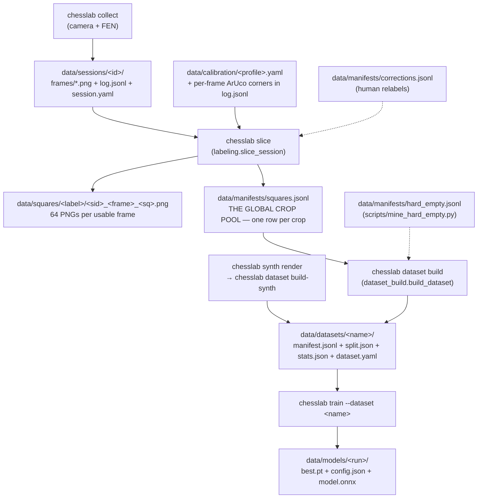

# The data pipeline — where a crop comes from

> Companion to `docs/synth-pipeline.md`, which covers the Blender half (renders → fused
> memmap). This document covers the **real-camera half** and the parts both halves share:
> the global crop pool, dataset builds, and everything that has surprised people.
>
> Measurements in this document were taken on **2026-07-27** and are marked as such. The
> structure is stable; the counts are a snapshot.

---

## 1. The map



**One sentence per stage.**

| Stage | Command | Writes | Key module |
|---|---|---|---|
| Capture | `chesslab collect` | `data/sessions/<id>/` | `collect.py` |
| Label | `chesslab slice --all` | `data/squares/`, `data/manifests/squares.jsonl` | `labeling.py` |
| Curate | `chesslab dataset build <name> …` | `data/datasets/<name>/` | `dataset_build.py` |
| Train | `chesslab train --dataset <name>` | `data/models/<run>/` | `training/train.py` |

Capture and labeling are deliberately separate: `slice` is a **pure, repeatable function** of
(frame, FEN, corners), so re-slicing a session reproduces its crops exactly.

---

## 2. What a session is

```
data/sessions/20260721-205618/
  session.yaml     # session_id, profile, mode, created_at, frame_size, reviewed, notes
  log.jsonl        # one row per captured position
  frames/0000.png  # the raw frame (undistorted if a lens calib was active)
```

A `log.jsonl` row:

```json
{"frame": "frames/0000.png", "ply": 1, "fen": "…", "ts": "…", "move_san": null,
 "corners": [[x,y],[x,y],[x,y],[x,y]], "unusable": true}
```

- `corners` is the board quad in **`[a8, h8, h1, a1]`** order, in image pixels. It is stored
  per frame, so slicing needs no camera and no marker re-detection. If it is absent, `slice`
  falls back to detecting ArUco markers in the frame and **skips the frame** if it cannot.
- `unusable: true` makes `slice` skip the frame — see §5.3 for the trap.
- `mode` in `session.yaml` matters for interpretation: `play` and `track` are real games;
  **`lighting-capture` sessions hold an empty board** (`fen: 8/8/8/8/8/8/8/8`) and exist only
  to sample lighting variance over the 64 empty squares.

**Resolution is the property that decides a session's worth.** It is not recorded anywhere —
you compute it from the corners: mean quad edge length ÷ 8 = **px per square**. That is how many
real sensor pixels back each crop before it is resized to 128×128. The deployed Android device
sees roughly **98 px/square**; anything materially below that is an upscale, and a session at
49 px/square is being blown up 2.6×. This single number is why the 07.07. sessions were parked
(§6.2) and it should be checked on every new session.

---

## 3. The global crop pool — `data/manifests/squares.jsonl`

One JSON row per crop. This is the **single source of truth** for what real training data
exists; `data/squares/**.png` is just its pixel backing.

```json
{"path": "data/squares/wR/20260630-080531_0000_a1.png", "label": "wR",
 "session_id": "20260630-080531", "frame": "0000", "ply": 1, "square": "a1",
 "square_color": "dark", "fen": "…", "out_size": [128,128],
 "geometry": "warp", "photometry": "none", "ts": "…"}
```

Facts worth knowing before you touch it:

- **Nothing appends to it.** Every writer is a read-modify-**rewrite** of the whole file.
  `slice_session` calls `_replace_session_in_manifest` (`labeling.py:233`), which drops all rows
  of that `session_id` and rewrites the file — that is what makes re-slicing idempotent. The
  old spec text ("one line per crop (append)", `specs/03-capture-labeling.md:87`) is stale.
- **Variant pools exist.** `chesslab slice --variant-tag X` and `chesslab ingest --tag X` write
  `data/manifests/squares__X.jsonl` + `data/squares__X/` instead, so experiments do not pollute
  the real pool. `dataset build --source-manifest` accepts several pools at once.
- **Web reads go through `manifest_cache.py`** (mtime-keyed). Never re-read the whole manifest
  per request.
- It is only consistent with `data/squares/` if every mutation went through the code. As of
  2026-07-27 it is: 14,720 rows, 14,720 files, zero missing, zero orphans.

---

## 4. What a dataset is

A dataset is a **view** on the pool: a session selection plus a dedup and split policy. It
copies no pixels for `rot=0` — `manifest.jsonl` rows point back at `data/squares/`.

```
data/datasets/occ-real/
  dataset.yaml    # the recipe: session_ids, dedup params, split params, counts
  manifest.jsonl  # the selected + deduplicated rows
  split.json      # train/val/test session lists, per-class counts, class weights
  stats.json
```

The build (`dataset_build.build_dataset`) runs strictly in this order:

1. **Filter** the pool to `session_ids`.
2. **Assign whole sessions to splits** on the RAW rows (`dataset.assign_sessions_to_splits`).
3. **Dedup — TRAIN ONLY.** `dedup_metadata` (≤ `per_cell_cap` per `(session, square, label)`,
   default 4) then `dedup_phash` (dhash, Hamming ≤ 6, LSH-banded, within each class).
4. **Collapse labels** if `class_mode=occupancy` (14 classes → `empty`/`occupied`).
5. Write manifest + split + stats, then **pack** into a memmap if ≥ 100,000 crops.

Rotation augmentation is a **train-time transform** (`torch_data._RandomRot90`), never
materialized — `dataset.yaml`'s `rotations` field only switches it on.

---

## 5. Behaviours that have cost people hours

### 5.1 Dedup applies to the train split only — so `final` measures the split, not the data

`dataset_build.py:311-317`. The holdout passes through untouched, deliberately: `board_accuracy`
needs complete 64-crop boards, and deduplicated boards would make it meaningless.

The consequence is unintuitive and it has bitten twice: **a dataset's reported `counts.final`
is a property of the split, not of the corpus.** A *larger* train split makes `final`
*smaller*, because more of the data is exposed to dedup. The same session list has produced
10,123 and 5,030 final crops from an identical raw 13,376 purely by moving the split boundary.

Never compare `final` across datasets with different splits. To compare corpora, compare the
raw pool or the phash-unique count.

### 5.2 The split assigner is subtle, and its docstring is the specification

`dataset.assign_sessions_to_splits` (`src/chesslab/dataset.py:177`). Sessions are never split
across train/val/test — frames within one session are near-identical, so splitting one leaks.
That constraint makes the arithmetic awkward, and a naive largest-first greedy produced
**train 550 / val 2,432 / test 2,048** on a real corpus (fixed 2026-07-27).

Read the docstring before changing it. It records both failure modes it now guards against
(targets sized off the wrong pool; oversized sessions landing in holdout) and, importantly,
why targeting deliberately uses **raw** crop counts rather than post-dedup "effective" sizes —
weighting by unique content was measured and is *worse*.

### 5.3 `unusable: true` does not retroactively remove anything

The flag is read by `slice_session` at slice time only. Flagging a frame in the review UI
changes **future** slices; the crops and manifest rows produced by earlier slices stay exactly
where they are and keep feeding datasets.

To make a flag take effect you must either re-slice the session (`chesslab slice --session <id>`,
which rewrites all of that session's rows) or remove the rows and files by hand. A frame flagged
on 2026-07-27 was still in `squares.jsonl` until its 64 rows were deleted manually — see
`data/_parked/20260727-occluded-frame/README.md`.

### 5.4 `data/` is gitignored — a delete there is unrecoverable

Hence the standing rule: **park, never delete.** There is no backup, no history, no undo.
`synth_pieces/` (415 MB of scanned meshes) is the extreme case — read-only, no backup, never move.

### 5.5 Session size ranks almost inversely to information content

A fixed camera photographing a board where most pieces never move produces enormous redundancy,
and it is not distributed the way file sizes suggest. Measured 2026-07-27 with the pipeline's own
dhash (Hamming ≤ 6):

| session | raw rows | phash-unique | unique share |
|---|---:|---:|---:|
| 20260630-080531 | 1,024 | 767 | 74.9 % |
| 20260630-081608 | 1,024 | 766 | 74.8 % |
| 20260709-141209 | 832 | 201 | 24.2 % |
| 20260721-200810 | 1,600 | 169 | 10.6 % |
| 20260721-205618 | 3,456 | 471 | 13.6 % |
| 20260721-212830 | 4,992 | 652 | 13.1 % |

The largest session in the corpus carries fewer unique crops than one 1/5 its size. **The whole
active pool is 14,720 rows → 3,414 phash-unique (23.2 %)**; through the real pipeline order
(`per_cell_cap=4` then phash) it is 2,480.

The binding constraint on this project is unique crops, so judge a session by its unique count,
never by its row count or its size on disk.

### 5.6 Parking a session directory does NOT remove it from the pool

There are two parking mechanisms and only one of them is complete:

- `sessions.archive_session` (web UI → `POST /api/sessions/{sid}/archive`) moves the directory to
  `data/sessions_archive/` **and** purges the session's crops and manifest rows. Reversible via
  `restore_session` + re-slice. This is the intended mechanism, and since 2026-07-27 it
  **requires a reason** (§5.8).
- Moving the directory to `data/_parked/…` by hand moves **pixels only**. The rows stay in
  `squares.jsonl` and keep feeding every subsequent build.

That is live right now: the four 07.07. sessions are parked under
`data/_parked/20260727-lowres-0707/`, and their **1,408 rows are still in `squares.jsonl`** and
still in `data/datasets/occ-real`. `occ-real2` excludes them only because its `session_ids` list
was written without them.

If you park by hand, either re-slice afterwards or state in the README that the rows remain.

### 5.7 Two files named `split.json` mean different things

- `data/manifests/split.json` — the **legacy global** split over the whole pool. Written only by
  `chesslab split` / `POST /api/split`. Read by legacy (`--dataset`-less) training, `eval`,
  `quantize`, `gradcam` and `dataset verify`.
- `data/datasets/<name>/split.json` — the **per-dataset** split, written by every dataset build.
  This is what `chesslab train --dataset <name>` uses.

The current pipeline is the per-dataset one. The global file is a leftover (§7).

Note also that `hard_empty.jsonl` protection is wired into **`dataset_build.build_dataset` only**
— the legacy `dataset.run_split` calls `make_split` without `priority_paths`, so mined hard
negatives are *not* protected in the global split.

### 5.8 Archiving requires a reason, and writes it twice

`archive_session(session_id, reason, paths)` — `reason` is a **required positional argument**. An
empty or whitespace-only reason raises `ValueError`; nothing is moved.

Four parked directories in three conventions, two of them with no explanation at all, cost a full
day of archaeology in July 2026. A session that leaves the corpus and takes its manifest rows with
it changes every dataset built afterwards, and by the time anyone notices, the only person who
knew why is gone. So the reason is written in two places on purpose:

| where | what | who reads it |
|---|---|---|
| `data/sessions_archive/<sid>/session.yaml` | `archived_at`, `archived_reason` | a human opening the directory; travels with the pixels even if the tree is moved |
| `data/sessions_archive/index.jsonl` | one row per archive: `session_id`, `archived_at`, `reason`, `removed_crops` | scripts, and anyone who wants to read the whole archive without opening 19 directories |

Write the reason a stranger can act on — the measurement, not the verdict. "blurry" is useless;
"59 px/square against the device's 119, superseded by the 21.07 captures" is a decision someone
can re-check and reverse.

The web UI's archive button has no free-text field yet, so it sends the fixed reason
`"archived from the web UI"` (`web/routers/sessions.py`). Prefer the API or a script when you have
something to say; if you used the button, edit the `session.yaml` afterwards.

Two guarantees the implementation makes, both regression-tested in
`tests/test_sessions.py::test_archiving_records_why` and
`::test_archiving_never_overwrites_an_existing_archive`:

- **A refused archive moves nothing.** If the reason is empty, the live session is untouched.
- **Archiving never destroys an archive.** Archiving an id that already exists under
  `sessions_archive/` raises `FileExistsError` — it used to `shutil.rmtree` the old one. Archiving
  is the safe half of the API; `delete_session` is the other half and is the only place allowed to
  remove pixels.

`restore_session` moves the directory back but does **not** restore the crops or the manifest rows
— re-slice afterwards, then rebuild (§5.9).

### 5.9 Datasets are snapshots. New sessions do not appear in them — rebuild.

**This is the one to remember.** Nothing in the pipeline is incremental. A dataset is a *view*
frozen at build time (§4): `manifest.jsonl` holds the rows that existed on the day it was built,
and `dataset.yaml`'s `session_ids` is a hardcoded list. Recording, slicing, archiving, flagging and
restoring all change the pool **underneath** every existing dataset without touching it.

`data/datasets/occ-real` was built **2026-07-26** over **11 sessions**. Every session recorded
since is invisible to it, and it still contains the 1,408 rows of the four 07.07 sessions that were
parked by hand afterwards. `chesslab train --dataset occ-real` today trains on July 26th's world.

After **any** of these — rebuild:

| you did | what it changed | what is still stale |
|---|---|---|
| recorded a new session | nothing yet — a session is frames + log, not crops | everything |
| `chesslab slice --session <id>` | added/rewrote that session's rows in `squares.jsonl` | every dataset |
| flagged frames `unusable` (§5.3) | nothing until you re-slice | every dataset |
| `archive_session` | removed the crops **and** the pool rows | every dataset built before it |
| moved a session to `_parked/` by hand (§5.6) | pixels only — the rows still feed builds | every dataset, permanently |

The rebuild, end to end:

```bash
# 1. crops for the new sessions (slicing is pure and repeatable; re-slicing an old session is safe)
uv run chesslab slice --session 20260727-...

# 2. the session list is NOT derived — name every session the dataset should contain
uv run chesslab dataset build occ-real-<date> --sessions <sid1>,<sid2>,... --classes occupancy

# 3. train against the new name
uv run chesslab train --dataset occ-real-<date> ...
```

**Build under a new name, never in place.** `occ-real` is the baseline every occupancy number in
`specs/18-occupancy-model/` was measured against; overwriting it makes those numbers unreproducible
and the comparison meaningless. Date-suffix the new one and record in `STATUS`/commit message which
dataset a checkpoint was trained on.

Two traps that follow from "the session list is not derived":

- **A dataset does not shrink by itself.** Archiving a session removes its rows from the pool, but
  a dataset built earlier still lists it in `session_ids` and still carries its rows in
  `manifest.jsonl`. Only a rebuild drops them.
- **`--sessions` is the whole selection, not a delta.** Omitting a session removes it. There is no
  "add to dataset" command, and no CLI that lists sessions — assemble the list from the previous
  `dataset.yaml`'s `session_ids` plus whatever `data/sessions/` has gained since (the web UI's
  session page, `chesslab web`, is the readable view).

---

## 6. Parked data — the inventory

Everything below is preserved, nothing here is deleted.

### 6.1 The conventions in use (there are four, and that is the problem)

| # | Location | Created by | Prunes `squares.jsonl`? | README? |
|---|---|---|---|---|
| 1 | `data/sessions_archive/<sid>/` | `archive_session` (web UI) | **yes** | n/a — carries its own reason in `session.yaml` + `index.jsonl` (§5.8) |
| 2 | `data/session_rejects/<sid>/` | `trim_session` (cut tails) | yes, for the cut frames | n/a (code-supported, does not exist yet) |
| 3 | `data/_parked/<date>-<reason>/` | by hand | **no** | yes, all three |
| 4 | `C:/Users/mariu/project/chesslab-parked-20260725/` | by hand, **outside the repo** | n/a (took the pool with it) | added 2026-07-27 |

**Proposed single convention** (not executed — see §8):

> Park by hand into **`data/_parked/<YYYYMMDD>-<short-reason>/`**, always with a `README.md`
> stating what, when, why and how to restore. Use `archive_session` instead whenever the unit
> being parked is a single session that should also leave the pool.

Consolidating #4 into #3 would cost **nothing but time to write the note**: both trees are on the
same volume (`C:`, 406 GB free), so the move is a filesystem rename, not a copy — 13.66 GB moved
instantly, and `data/` is gitignored so nothing enters git. `data/_parked/` is invisible to the
pipeline (`list_sessions` reads `data/sessions` only). The reason it may have been put outside
the repo deliberately is exactly that: distance from anything that walks `data/`. **Ask before
moving it.**

### 6.2 `data/_parked/` (0.05 GB, in-repo)

| directory | contents | note |
|---|---|---|
| `20260727-orphan-synth-v2-diverse/` | 260 session dirs, **pointers only** — the renders were deleted | FENs salvaged to `data/fens_v2_diverse.txt` |
| `20260727-lowres-0707/` | 4 sessions, 22 frames | 49–82 px/square. **Rows still in the pool** (§5.6) |
| `20260727-occluded-frame/` | one frame's 64 crops | flag + rows already removed by hand |

All three carry a README.

### 6.3 `C:/Users/mariu/project/chesslab-parked-20260725/` (13.66 GB, outside the repo)

This is the **previous state of the whole labeling stage**, parked wholesale on 25.07:

```
sessions/    19 session directories (30.06 – 21.07)          4.51 GB
squares/     the old data/squares, per-class dirs            9.01 GB
manifests/   the old squares.jsonl (378,752 rows) +          0.14 GB
             corrections.jsonl, hard_empty*.jsonl
```

The old `squares.jsonl` is a **superset**: it contains the 19 parked sessions, the sessions that
are still active today, one session with no surviving directory (`20260630-083659`, 1,024 rows at
a different `out_size` of 128×176), and 320,000 rows of a `pretrain-synth` set. It is the pool the
deleted `real-all` / `real-all2` / `real-all4` piece datasets were built from — those names survive
only in `data/models/{p3-*,tiny-*}/config.json`.

See §9 for what the 19 sessions are worth.

---

## 7. Stray artefacts — what they are and whether anything reads them

Traced across `src/`, `scripts/`, `tests/`, `synth/`, the FastAPI backend and the React frontend.

| file | written by | read by | verdict |
|---|---|---|---|
| `data/manifests/squares.jsonl.bak` | **no code** — created by hand 26.07 | nothing | orphan. Nothing in the repo creates or cleans `*.jsonl.bak`; the only `.bak` writer is `CalibrationProfile.save`, for YAML profiles. |
| `data/manifests/split.json` (02.07) | `dataset.run_split` | legacy training / `eval` / `quantize` / `gradcam` / `dataset verify` | **live code path, stale content.** It names sessions that no longer exist (`20260630-083659`, `-010216`, `-014453`) and predates every current dataset. Harmless while everything runs `--dataset`, misleading the moment someone does not. |
| `data/manifests/augment.yaml` (02.07) | `dataset.write_augment_yaml`, as a side effect of every `run_split` | **nothing** | documentation artifact by design — its own header says "generated from `config.AUGMENT` — edit the dataclass, not this file". The on-disk copy is stale w.r.t. the current dataclass (it lacks `noise_std`, `erase_*`, `bg_*`). |
| `corrections.jsonl` | `upsert_corrections` — **no production caller**, only `tests/test_web.py`; plus pruning in `delete_session` / `trim_session` | `run_slice` → `label_overrides`, `experiment.slice_variant` | read path is live, write path is not wired to any UI or CLI. Human relabels currently cannot be recorded. Note `archive_session` prunes the manifest but *not* corrections — an asymmetry vs `delete_session`. |
| `hard_empty.jsonl` | `scripts/mine_hard_empty.py` | `dataset_build.build_dataset` → `priority_paths` (protects mined hard empties from the `empty` cap) | live and useful. Not honoured by the legacy `run_split` (§5.7). |
| `hard_empty.synthetic.jsonl` | `scripts/mine_hard_empty.py` (quarantine dump for legacy non-camera rows) | **nothing** | pure quarantine; never consumed. |
| `hard_empty.jsonl.bak` (parked tree) | by hand | nothing | orphan, same as above. |
| `data/fens_*.txt` | `synth/fens.py` / salvage scripts | `chesslab synth render` | live inputs to the render pipeline, see `docs/synth-pipeline.md`. |

Nothing above has been deleted or moved. The two genuine orphans are the `.bak` files and
`hard_empty.synthetic.jsonl`; `augment.yaml` regenerates itself on the next `split`.

---

## 8. If you are tidying

- Park, never delete. `data/` is gitignored.
- Prefer `archive_session` over a manual move when the unit is one session — it keeps the pool
  consistent and forces you to record **why** (§5.8). After any manual move, re-slice or write down
  that the rows remain.
- **Rebuild the dataset afterwards, under a new name** — archiving, slicing and flagging never
  reach into a dataset that already exists (§5.9).
- Never touch `synth_pieces/` (scanned meshes, no backup).
- `data/datasets/occ-real` is the baseline the shipped occupancy model was measured against.
  Leave it byte-identical; build new datasets under new names.
- Before removing a session, measure its **unique** contribution, not its size (§5.5).

---

## 9. Measured 2026-07-27 — what the 19 parked sessions are worth

Method: dhash of every crop, deduplicated with `dataset_build`'s own LSH banding at the
configured `phash_hamming=6`, per class. "Marginal" = crops that survive when added on top of
the current active pool, i.e. genuinely new content.

**Headline: the 19 sessions would take the pool from 3,414 to 17,470 unique crops — 5.1×.**

| group | raw rows | marginal unique | of which `empty` | of which pieces |
|---|---:|---:|---:|---:|
| active pool today | 14,720 | 3,414 | 1,776 | 1,638 |
| **all 19 parked** | 43,328 | **14,056** | 12,352 | 1,704 |
| — the two 21.07 lighting captures | 26,240 | 8,839 | 8,839 | 0 |
| — rest at ≥ 98 px/square | 4,736 | 1,872 | 1,057 | 815 |
| — below 98 px/square (7 sessions) | 12,352 | 3,517 | 2,620 | 897 |

Per session, with the resolution figure that decides whether it is wanted:

| session | px/sq | frames | raw | marginal unique | mode |
|---|---:|---:|---:|---:|---|
| 20260721-194538 | 127.1 | 297 | 14,528 | 5,322 | lighting-capture |
| 20260721-193821 | 119.3 | 191 | 11,712 | 4,385 | lighting-capture |
| 20260708-021722 | 97.0 | 74 | 4,736 | 1,089 | track |
| 20260706-130834 | 60.7 | 55 | 3,520 | 956 | track |
| 20260630-014453 | 214.1 | 16 | 1,024 | 769 | play |
| 20260706-215008 | 55.1 | 15 | 960 | 507 | track |
| 20260708-195420 | 103.5 | 30 | 1,792 | 495 | track |
| 20260630-010216 | 214.1 | 8 | 512 | 375 | play |
| 20260708-012317 | 82.1 | 20 | 1,280 | 374 | track |
| 20260706-190522 | 47.1 | 9 | 576 | 358 | track |
| 20260708-020419 | 96.7 | 13 | 832 | 226 | track |
| 20260709-195159 | 102.4 | 10 | 576 | 108 | track |
| 20260721-220149 | 87.5 | 7 | 448 | 83 | track |
| 20260710-001623 | 102.8 | 3 | 128 | 76 | track |
| 20260709-212059 | 103.1 | 4 | 128 | 68 | track |
| 20260709-201444 | 103.1 | 5 | 192 | 59 | track |
| 20260709-202406 | 103.1 | 1 | 64 | 44 | track |
| 20260709-132058 | 102.7 | 5 | 320 | 31 | track |
| 20260719-175329 | 138.4 | 56 | **0** | — | track, **never sliced** |

`20260719-175329` has 56 frames and a log, but 30 of its 91 log rows are flagged `unusable` and
it has **no rows in any manifest** — it was never ingested. It is the only session in either tree
in that state.

Reading of the table:

- The gain is overwhelmingly `empty` (12,352 of 14,056). For the shipped **occupancy** model that
  is precisely the scarce class — unique empties go 1,776 → 14,128, an 8× on the class the model
  actually confuses, and the two lighting captures alone supply 8,839 of them at 119–127 px/square.
  They are `mode: lighting-capture` (empty board), so they belong in `force_train` — `build_dataset`
  has that parameter for exactly this case, since an all-empty session in val/test distorts board
  metrics.
- For the **14-class piece** model the gain is 1,704 unique piece crops on top of 1,638 — roughly
  2×, and 897 of those come from sessions below device resolution.
- Seven sessions sit at 47–87 px/square, i.e. below the ~98 px/square the phone sees. Taking them
  back repeats the decision that parked the 07.07. set; they are the ones to leave parked unless
  `--scales` training is being used to compensate.

Restoring is `slice`, not `ingest`: move the session directory into `data/sessions/`, then
`chesslab slice --session <id>`, which regenerates the crops and the manifest rows from the frames
and stored corners. The parked `squares/` tree and its `squares.jsonl` do not need to be merged —
they are reproducible outputs, not inputs.

---

## 10. See also

- `docs/synth-pipeline.md` — Blender renders → `chesslab dataset build-synth` (fused memmap).
  Its `mm://` manifest rows have no files; consumers must read the packed memmap.
- `docs/architecture-review/architecture-overview.md` — component map.
- `README.md` — every CLI command, per stage.
- `src/chesslab/dataset.py:177` — the split assigner's docstring, which is its specification.
