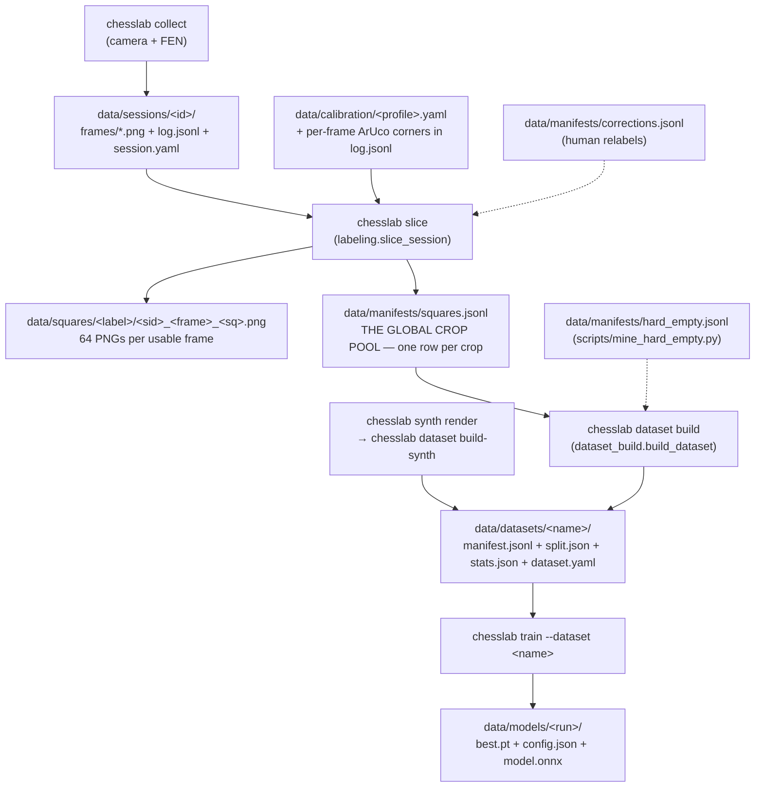

# The data pipeline — where a crop comes from

> Companion to `docs/synth-pipeline.md`, which covers the Blender half (renders → fused
> memmap). This document covers the **real-camera half** and the parts both halves share:
> the global crop pool, dataset builds, and everything that has surprised people.
>
> Measurements in this document were taken on **2026-07-27** and are marked as such. The
> structure is stable; the counts are a snapshot.

---

## 1. The map



**One sentence per stage.**

| Stage | Command | Writes | Key module |
|---|---|---|---|
| Capture | `chesslab collect` | `data/sessions/<id>/` | `collect.py` |
| Label | `chesslab slice --all` | `data/squares/`, `data/manifests/squares.jsonl` | `labeling.py` |
| Curate | `chesslab dataset build <name> …` | `data/datasets/<name>/` | `dataset_build.py` |
| Train | `chesslab train --dataset <name>` | `data/models/<run>/` | `training/train.py` |

Capture and labeling are deliberately separate: `slice` is a **pure, repeatable function** of
(frame, FEN, corners), so re-slicing a session reproduces its crops exactly.

---

## 2. What a session is

```
data/sessions/20260721-205618/
  session.yaml     # session_id, profile, mode, created_at, frame_size, reviewed, notes
  log.jsonl        # one row per captured position
  frames/0000.png  # the raw frame (undistorted if a lens calib was active)
```

A `log.jsonl` row:

```json
{"frame": "frames/0000.png", "ply": 1, "fen": "…", "ts": "…", "move_san": null,
 "corners": [[x,y],[x,y],[x,y],[x,y]], "unusable": true}
```

- `corners` is the board quad in **`[a8, h8, h1, a1]`** order, in image pixels. It is stored
  per frame, so slicing needs no camera and no marker re-detection. If it is absent, `slice`
  falls back to detecting ArUco markers in the frame and **skips the frame** if it cannot.
- `unusable: true` makes `slice` skip the frame — see §5.3 for the trap.
- `mode` in `session.yaml` matters for interpretation: `play` and `track` are real games;
  **`lighting-capture` sessions hold an empty board** (`fen: 8/8/8/8/8/8/8/8`) and exist only
  to sample lighting variance over the 64 empty squares.

**Resolution is the property that decides a session's worth.** It is not recorded anywhere —
you compute it from the corners: mean quad edge length ÷ 8 = **px per square**. That is how many
real sensor pixels back each crop *at the sensor*. The sessions captured with the phone as a
1080p feed carry roughly **98 px/square**; anything materially below that is an upscale, and a
session at 49 px/square is being blown up 2.6×. This single number is why the 07.07. sessions were
parked (§6.2) and it should be checked on every new session.

⚠ **It is not the resolution the model is fed.** The warp goes through `profile.board_size`
first, so the crop is cut at `board_size / 8` px/square whatever the camera delivered — on the rig
profile that is 100, and a 173 px/square session loses 42 % of its linear resolution there. See
**§11**, which is the section to read before quoting any px/square number at a model.

---

## 3. The global crop pool — `data/manifests/squares.jsonl`

One JSON row per crop. This is the **single source of truth** for what real training data
exists; `data/squares/**.png` is just its pixel backing.

```json
{"path": "data/squares/wR/20260630-080531_0000_a1.png", "label": "wR",
 "session_id": "20260630-080531", "frame": "0000", "ply": 1, "square": "a1",
 "square_color": "dark", "fen": "…", "out_size": [128,128],
 "geometry": "warp", "photometry": "none", "ts": "…"}
```

Facts worth knowing before you touch it:

- **Nothing appends to it.** Every writer is a read-modify-**rewrite** of the whole file.
  `slice_session` calls `_replace_session_in_manifest` (`labeling.py:233`), which drops all rows
  of that `session_id` and rewrites the file — that is what makes re-slicing idempotent. The
  old spec text ("one line per crop (append)", `specs/03-capture-labeling.md:87`) is stale.
- **Variant pools exist.** `chesslab slice --variant-tag X` and `chesslab ingest --tag X` write
  `data/manifests/squares__X.jsonl` + `data/squares__X/` instead, so experiments do not pollute
  the real pool. `dataset build --source-manifest` accepts several pools at once.
- **Web reads go through `manifest_cache.py`** (mtime-keyed). Never re-read the whole manifest
  per request.
- It is only consistent with `data/squares/` if every mutation went through the code. As of
  2026-07-27 it is: 14,720 rows, 14,720 files, zero missing, zero orphans.

---

## 4. What a dataset is

A dataset is a **view** on the pool: a session selection plus a dedup and split policy. It
copies no pixels for `rot=0` — `manifest.jsonl` rows point back at `data/squares/`.

```
data/datasets/occ-real/
  dataset.yaml    # the recipe: session_ids, dedup params, split params, counts
  manifest.jsonl  # the selected + deduplicated rows
  split.json      # train/val/test session lists, per-class counts, class weights
  stats.json
```

The build (`dataset_build.build_dataset`) runs strictly in this order:

1. **Filter** the pool to `session_ids`.
2. **Assign whole sessions to splits** on the RAW rows (`dataset.assign_sessions_to_splits`).
3. **Dedup — TRAIN ONLY.** `dedup_metadata` (≤ `per_cell_cap` per `(session, square, label)`,
   default 4). `dedup_phash` runs first *when enabled*, but it is **OFF by default since
   2026-07-30** — see §5.12. The order matters and was the other way round until 2026-07-29 —
   see §5.11.
4. **Collapse labels** if `class_mode=occupancy` (14 classes → `empty`/`occupied`).
5. Write manifest + split + stats, then **pack** into a memmap if ≥ 100,000 crops.

Rotation augmentation is a **train-time transform** (`torch_data._RandomRot90`), never
materialized — `dataset.yaml`'s `rotations` field only switches it on.

---

## 5. Behaviours that have cost people hours

### 5.1 Dedup applies to the train split only — so `final` measures the split, not the data

`dataset_build.build_dataset`, the dedup block. The holdout passes through untouched, deliberately: `board_accuracy`
needs complete 64-crop boards, and deduplicated boards would make it meaningless.

The consequence is unintuitive and it has bitten twice: **a dataset's reported `counts.final`
is a property of the split, not of the corpus.** A *larger* train split makes `final`
*smaller*, because more of the data is exposed to dedup. The same session list has produced
10,123 and 5,030 final crops from an identical raw 13,376 purely by moving the split boundary.

Never compare `final` across datasets with different splits. To compare corpora, compare the
raw pool or the phash-unique count.

### 5.2 The split assigner is subtle, and its docstring is the specification

`dataset.assign_sessions_to_splits` (`src/chesslab/dataset.py:177`). Sessions are never split
across train/val/test — frames within one session are near-identical, so splitting one leaks.
That constraint makes the arithmetic awkward, and a naive largest-first greedy produced
**train 550 / val 2,432 / test 2,048** on a real corpus (fixed 2026-07-27).

Read the docstring before changing it. It records both failure modes it now guards against
(targets sized off the wrong pool; oversized sessions landing in holdout) and, importantly,
why targeting deliberately uses **raw** crop counts rather than post-dedup "effective" sizes —
weighting by unique content was measured and is *worse*.

### 5.3 `unusable: true` does not retroactively remove anything

The flag is read by `slice_session` at slice time only. Flagging a frame in the review UI
changes **future** slices; the crops and manifest rows produced by earlier slices stay exactly
where they are and keep feeding datasets.

To make a flag take effect you must either re-slice the session (`chesslab slice --session <id>`,
which rewrites all of that session's rows) or remove the rows and files by hand. A frame flagged
on 2026-07-27 was still in `squares.jsonl` until its 64 rows were deleted manually — see
`data/_parked/20260727-occluded-frame/README.md`.

### 5.4 `data/` is gitignored — a delete there is unrecoverable

Hence the standing rule: **park, never delete.** There is no backup, no history, no undo.
`synth_pieces/` (415 MB of scanned meshes) is the extreme case — read-only, no backup, never move.

### 5.5 Session size ranks almost inversely to information content

A fixed camera photographing a board where most pieces never move produces enormous redundancy,
and it is not distributed the way file sizes suggest. Measured 2026-07-27 with the pipeline's own
dhash (Hamming ≤ 6):

| session | raw rows | phash-unique | unique share |
|---|---:|---:|---:|
| 20260630-080531 | 1,024 | 767 | 74.9 % |
| 20260630-081608 | 1,024 | 766 | 74.8 % |
| 20260709-141209 | 832 | 201 | 24.2 % |
| 20260721-200810 | 1,600 | 169 | 10.6 % |
| 20260721-205618 | 3,456 | 471 | 13.6 % |
| 20260721-212830 | 4,992 | 652 | 13.1 % |

The largest session in the corpus carries fewer unique crops than one 1/5 its size. **The whole
active pool is 14,720 rows → 3,414 phash-unique (23.2 %)**; through the real pipeline order
(`per_cell_cap=4` then phash) it is 2,480.

The binding constraint on this project is unique crops, so judge a session by its unique count,
never by its row count or its size on disk.

### 5.6 Parking a session directory does NOT remove it from the pool

There are two parking mechanisms and only one of them is complete:

- `sessions.archive_session` (web UI → `POST /api/sessions/{sid}/archive`) moves the directory to
  `data/sessions_archive/` **and** purges the session's crops and manifest rows. Reversible via
  `restore_session` + re-slice. This is the intended mechanism, and since 2026-07-27 it
  **requires a reason** (§5.8).
- Moving the directory to `data/_parked/…` by hand moves **pixels only**. The rows stay in
  `squares.jsonl` and keep feeding every subsequent build.

That was live until 2026-07-27: the four 07.07. sessions had been parked under
`data/_parked/20260727-lowres-0707/` and their 1,408 rows were still in `squares.jsonl`. They have
since been put through `archive_session` properly — the pool went **14,720 → 13,312 rows, 11 → 7
sessions**, and the reason is in `data/sessions_archive/index.jsonl`.

`data/datasets/occ-real` **still carries those 1,408 rows** and still lists the four sessions in
`session_ids`, because a dataset is a snapshot and archiving does not reach into it (§5.9).
That is deliberate: `occ-real` is the baseline every `specs/18-occupancy-model/` number was measured
against and must stay byte-identical. The next occupancy dataset is built under a new name from the
7 remaining sessions.

If you park by hand, either re-slice afterwards or state in the README that the rows remain.

### 5.7 Two files named `split.json` mean different things

- `data/manifests/split.json` — the **legacy global** split over the whole pool. Written only by
  `chesslab split` / `POST /api/split`. Read by legacy (`--dataset`-less) training, `eval`,
  `quantize`, `gradcam` and `dataset verify`.
- `data/datasets/<name>/split.json` — the **per-dataset** split, written by every dataset build.
  This is what `chesslab train --dataset <name>` uses.

The current pipeline is the per-dataset one. The global file is a leftover (§7).

Note also that `hard_empty.jsonl` protection is wired into **`dataset_build.build_dataset` only**
— the legacy `dataset.run_split` calls `make_split` without `priority_paths`, so mined hard
negatives are *not* protected in the global split.

### 5.8 Archiving requires a reason, and writes it twice

`archive_session(session_id, reason, paths)` — `reason` is a **required positional argument**. An
empty or whitespace-only reason raises `ValueError`; nothing is moved.

Four parked directories in three conventions, two of them with no explanation at all, cost a full
day of archaeology in July 2026. A session that leaves the corpus and takes its manifest rows with
it changes every dataset built afterwards, and by the time anyone notices, the only person who
knew why is gone. So the reason is written in two places on purpose:

| where | what | who reads it |
|---|---|---|
| `data/sessions_archive/<sid>/session.yaml` | `archived_at`, `archived_reason` | a human opening the directory; travels with the pixels even if the tree is moved |
| `data/sessions_archive/index.jsonl` | one row per archive: `session_id`, `archived_at`, `reason`, `removed_crops` | scripts, and anyone who wants to read the whole archive without opening 19 directories |

Write the reason a stranger can act on — the measurement, not the verdict. "blurry" is useless;
"59 px/square against the device's 119, superseded by the 21.07 captures" is a decision someone
can re-check and reverse.

The web UI's archive button has no free-text field yet, so it sends the fixed reason
`"archived from the web UI"` (`web/routers/sessions.py`). Prefer the API or a script when you have
something to say; if you used the button, edit the `session.yaml` afterwards.

Two guarantees the implementation makes, both regression-tested in
`tests/test_sessions.py::test_archiving_records_why` and
`::test_archiving_never_overwrites_an_existing_archive`:

- **A refused archive moves nothing.** If the reason is empty, the live session is untouched.
- **Archiving never destroys an archive.** Archiving an id that already exists under
  `sessions_archive/` raises `FileExistsError` — it used to `shutil.rmtree` the old one. Archiving
  is the safe half of the API; `delete_session` is the other half and is the only place allowed to
  remove pixels.

`restore_session` moves the directory back but does **not** restore the crops or the manifest rows
— re-slice afterwards, then rebuild (§5.9).

### 5.9 Datasets are snapshots. New sessions do not appear in them — rebuild.

**This is the one to remember.** Nothing in the pipeline is incremental. A dataset is a *view*
frozen at build time (§4): `manifest.jsonl` holds the rows that existed on the day it was built,
and `dataset.yaml`'s `session_ids` is a hardcoded list. Recording, slicing, archiving, flagging and
restoring all change the pool **underneath** every existing dataset without touching it.

`data/datasets/occ-real` was built **2026-07-26** over **11 sessions**. Every session recorded
since is invisible to it, and it still contains the 1,408 rows of the four 07.07 sessions that were
parked by hand afterwards. `chesslab train --dataset occ-real` today trains on July 26th's world.

After **any** of these — rebuild:

| you did | what it changed | what is still stale |
|---|---|---|
| recorded a new session | nothing yet — a session is frames + log, not crops | everything |
| `chesslab slice --session <id>` | added/rewrote that session's rows in `squares.jsonl` | every dataset |
| flagged frames `unusable` (§5.3) | nothing until you re-slice | every dataset |
| `archive_session` | removed the crops **and** the pool rows | every dataset built before it |
| moved a session to `_parked/` by hand (§5.6) | pixels only — the rows still feed builds | every dataset, permanently |

The rebuild, end to end:

```bash
# 1. crops for the new sessions (slicing is pure and repeatable; re-slicing an old session is safe)
uv run chesslab slice --session 20260727-...

# 2. the session list is NOT derived — name every session the dataset should contain
uv run chesslab dataset build occ-real-<date> --sessions <sid1>,<sid2>,... --classes occupancy

# 3. train against the new name
uv run chesslab train --dataset occ-real-<date> ...
```

**Build under a new name, never in place.** `occ-real` is the baseline every occupancy number in
`specs/18-occupancy-model/` was measured against; overwriting it makes those numbers unreproducible
and the comparison meaningless. Date-suffix the new one and record in `STATUS`/commit message which
dataset a checkpoint was trained on.

Two traps that follow from "the session list is not derived":

- **A dataset does not shrink by itself.** Archiving a session removes its rows from the pool, but
  a dataset built earlier still lists it in `session_ids` and still carries its rows in
  `manifest.jsonl`. Only a rebuild drops them.
- **`--sessions` is the whole selection, not a delta.** Omitting a session removes it. There is no
  "add to dataset" command, and no CLI that lists sessions — assemble the list from the previous
  `dataset.yaml`'s `session_ids` plus whatever `data/sessions/` has gained since (the web UI's
  session page, `chesslab web`, is the readable view).

### 5.10 `per_cell_cap`, not phash, is what decides how much data you get

`dedup_metadata` runs FIRST and keeps at most `per_cell_cap` crops per **(session, square, label)**
— default **4**. phash only sees what survives it.

For a game session that is roughly harmless. For a `lighting-capture` it is fatal: the session
holds one label (`empty`) on all 64 squares across hundreds of frames, so the whole tuple space is
64 buckets and a **297-frame session collapses to 256 crops**. The thing the capture was recorded
for — the same square under many lighting conditions — is exactly what the cap discards.

Measured 2026-07-27 over the 20-session pool (49,856 raw), occupancy, both lighting captures in
`force_train`:

| `per_cell_cap` | train crops | train `empty` |
|---:|---:|---:|
| 4 (default) | 3,747 | 1,643 |
| 16 | 5,413 | 3,248 |
| 64 | 5,445 | 3,267 |
| 256 | 8,712 | 6,534 |

Above 16 the binding constraint changes to `max_empty_ratio=1.5` (empty ≤ 1.5 × occupied); with
that lifted to 3.0 the 256 row is what you see, and with no cap at all train reaches 13,320 /
11,142 empties. So there are **three** stacked filters and the default of each is tuned for
game sessions:

1. `per_cell_cap` — crude, per tuple, runs first
2. `phash_hamming` — the principled one, near-duplicate pixels
3. `max_empty_ratio` — class balance, applied to the train split

If a build returns far less data than the corpus suggests, check them in that order. `occ-real3`
uses `per_cell_cap=256, max_empty_ratio=3.0` for this reason.

---

---

## 6. Parked data — the inventory

Everything below is preserved, nothing here is deleted.

### 6.1 The conventions in use (there are four, and that is the problem)

| # | Location | Created by | Prunes `squares.jsonl`? | README? |
|---|---|---|---|---|
| 1 | `data/sessions_archive/<sid>/` | `archive_session` (web UI) | **yes** | n/a — carries its own reason in `session.yaml` + `index.jsonl` (§5.8) |
| 2 | `data/session_rejects/<sid>/` | `trim_session` (cut tails) | yes, for the cut frames | n/a (code-supported, does not exist yet) |
| 3 | `data/_parked/<date>-<reason>/` | by hand | **no** | yes, all three |
| 4 | `C:/Users/mariu/project/chesslab-parked-20260725/` | by hand, **outside the repo** | n/a (took the pool with it) | added 2026-07-27 |

**Proposed single convention** (not executed — see §8):

> Park by hand into **`data/_parked/<YYYYMMDD>-<short-reason>/`**, always with a `README.md`
> stating what, when, why and how to restore. Use `archive_session` instead whenever the unit
> being parked is a single session that should also leave the pool.

Consolidating #4 into #3 would cost **nothing but time to write the note**: both trees are on the
same volume (`C:`, 406 GB free), so the move is a filesystem rename, not a copy — 13.66 GB moved
instantly, and `data/` is gitignored so nothing enters git. `data/_parked/` is invisible to the
pipeline (`list_sessions` reads `data/sessions` only). The reason it may have been put outside
the repo deliberately is exactly that: distance from anything that walks `data/`. **Ask before
moving it.**

### 6.2 `data/_parked/` (0.05 GB, in-repo)

| directory | contents | note |
|---|---|---|
| `20260727-orphan-synth-v2-diverse/` | 260 session dirs, **pointers only** — the renders were deleted | FENs salvaged to `data/fens_v2_diverse.txt` |
| `20260727-lowres-0707/` | 4 sessions, 22 frames | 49–82 px/square. **Rows still in the pool** (§5.6) |
| `20260727-occluded-frame/` | one frame's 64 crops | flag + rows already removed by hand |

All three carry a README.

### 6.3 `C:/Users/mariu/project/chesslab-parked-20260725/` (13.66 GB, outside the repo)

This is the **previous state of the whole labeling stage**, parked wholesale on 25.07:

```
sessions/    19 session directories (30.06 – 21.07)          4.51 GB
squares/     the old data/squares, per-class dirs            9.01 GB
manifests/   the old squares.jsonl (378,752 rows) +          0.14 GB
             corrections.jsonl, hard_empty*.jsonl
```

The old `squares.jsonl` is a **superset**: it contains the 19 parked sessions, the sessions that
are still active today, one session with no surviving directory (`20260630-083659`, 1,024 rows at
a different `out_size` of 128×176), and 320,000 rows of a `pretrain-synth` set. It is the pool the
deleted `real-all` / `real-all2` / `real-all4` piece datasets were built from — those names survive
only in `data/models/{p3-*,tiny-*}/config.json`.

See §9 for what the 19 sessions are worth.

---

## 7. Stray artefacts — what they are and whether anything reads them

Traced across `src/`, `scripts/`, `tests/`, `synth/`, the FastAPI backend and the React frontend.

| file | written by | read by | verdict |
|---|---|---|---|
| `data/manifests/squares.jsonl.bak` | **no code** — created by hand 26.07 | nothing | orphan. Nothing in the repo creates or cleans `*.jsonl.bak`; the only `.bak` writer is `CalibrationProfile.save`, for YAML profiles. |
| `data/manifests/split.json` (02.07) | `dataset.run_split` | legacy training / `eval` / `quantize` / `gradcam` / `dataset verify` | **live code path, stale content.** It names sessions that no longer exist (`20260630-083659`, `-010216`, `-014453`) and predates every current dataset. Harmless while everything runs `--dataset`, misleading the moment someone does not. |
| `data/manifests/augment.yaml` (02.07) | `dataset.write_augment_yaml`, as a side effect of every `run_split` | **nothing** | documentation artifact by design — its own header says "generated from `config.AUGMENT` — edit the dataclass, not this file". The on-disk copy is stale w.r.t. the current dataclass (it lacks `noise_std`, `erase_*`, `bg_*`). |
| `corrections.jsonl` | `upsert_corrections` — **no production caller**, only `tests/test_web.py`; plus pruning in `delete_session` / `trim_session` | `run_slice` → `label_overrides`, `experiment.slice_variant` | read path is live, write path is not wired to any UI or CLI. Human relabels currently cannot be recorded. Note `archive_session` prunes the manifest but *not* corrections — an asymmetry vs `delete_session`. |
| `hard_empty.jsonl` | `scripts/mine_hard_empty.py` | `dataset_build.build_dataset` → `priority_paths` (protects mined hard empties from the `empty` cap) | live and useful. Not honoured by the legacy `run_split` (§5.7). |
| `hard_empty.synthetic.jsonl` | `scripts/mine_hard_empty.py` (quarantine dump for legacy non-camera rows) | **nothing** | pure quarantine; never consumed. |
| `hard_empty.jsonl.bak` (parked tree) | by hand | nothing | orphan, same as above. |
| `data/fens_*.txt` | `synth/fens.py` / salvage scripts | `chesslab synth render` | live inputs to the render pipeline, see `docs/synth-pipeline.md`. |

Nothing above has been deleted or moved. The two genuine orphans are the `.bak` files and
`hard_empty.synthetic.jsonl`; `augment.yaml` regenerates itself on the next `split`.

---

## 8. If you are tidying

- Park, never delete. `data/` is gitignored.
- Prefer `archive_session` over a manual move when the unit is one session — it keeps the pool
  consistent and forces you to record **why** (§5.8). After any manual move, re-slice or write down
  that the rows remain.
- **Rebuild the dataset afterwards, under a new name** — archiving, slicing and flagging never
  reach into a dataset that already exists (§5.9).
- Never touch `synth_pieces/` (scanned meshes, no backup).
- `data/datasets/occ-real` is the baseline the shipped occupancy model was measured against.
  Leave it byte-identical; build new datasets under new names.
- Before removing a session, measure its **unique** contribution, not its size (§5.5).

---

## 9. Measured 2026-07-27 — what the 19 parked sessions are worth

Method: dhash of every crop, deduplicated with `dataset_build`'s own LSH banding at the
configured `phash_hamming=6`, per class. "Marginal" = crops that survive when added on top of
the current active pool, i.e. genuinely new content.

**Headline: the 19 sessions would take the pool from 3,414 to 17,470 unique crops — 5.1×.**

| group | raw rows | marginal unique | of which `empty` | of which pieces |
|---|---:|---:|---:|---:|
| active pool today | 14,720 | 3,414 | 1,776 | 1,638 |
| **all 19 parked** | 43,328 | **14,056** | 12,352 | 1,704 |
| — the two 21.07 lighting captures | 26,240 | 8,839 | 8,839 | 0 |
| — rest at ≥ 98 px/square | 4,736 | 1,872 | 1,057 | 815 |
| — below 98 px/square (7 sessions) | 12,352 | 3,517 | 2,620 | 897 |

Per session, with the resolution figure that decides whether it is wanted:

| session | px/sq | frames | raw | marginal unique | mode |
|---|---:|---:|---:|---:|---|
| 20260721-194538 | 127.1 | 297 | 14,528 | 5,322 | lighting-capture |
| 20260721-193821 | 119.3 | 191 | 11,712 | 4,385 | lighting-capture |
| 20260708-021722 | 97.0 | 74 | 4,736 | 1,089 | track |
| 20260706-130834 | 60.7 | 55 | 3,520 | 956 | track |
| 20260630-014453 | 214.1 | 16 | 1,024 | 769 | play |
| 20260706-215008 | 55.1 | 15 | 960 | 507 | track |
| 20260708-195420 | 103.5 | 30 | 1,792 | 495 | track |
| 20260630-010216 | 214.1 | 8 | 512 | 375 | play |
| 20260708-012317 | 82.1 | 20 | 1,280 | 374 | track |
| 20260706-190522 | 47.1 | 9 | 576 | 358 | track |
| 20260708-020419 | 96.7 | 13 | 832 | 226 | track |
| 20260709-195159 | 102.4 | 10 | 576 | 108 | track |
| 20260721-220149 | 87.5 | 7 | 448 | 83 | track |
| 20260710-001623 | 102.8 | 3 | 128 | 76 | track |
| 20260709-212059 | 103.1 | 4 | 128 | 68 | track |
| 20260709-201444 | 103.1 | 5 | 192 | 59 | track |
| 20260709-202406 | 103.1 | 1 | 64 | 44 | track |
| 20260709-132058 | 102.7 | 5 | 320 | 31 | track |
| 20260719-175329 | 138.4 | 56 | **0** | — | track, **never sliced** |

`20260719-175329` has 56 frames and a log, but 30 of its 91 log rows are flagged `unusable` and
it has **no rows in any manifest** — it was never ingested. It is the only session in either tree
in that state.

Reading of the table:

- The gain is overwhelmingly `empty` (12,352 of 14,056). For the shipped **occupancy** model that
  is precisely the scarce class — unique empties go 1,776 → 14,128, an 8× on the class the model
  actually confuses, and the two lighting captures alone supply 8,839 of them at 119–127 px/square.
  They are `mode: lighting-capture` (empty board), so they belong in `force_train` — `build_dataset`
  has that parameter for exactly this case, since an all-empty session in val/test distorts board
  metrics.
- For the **14-class piece** model the gain is 1,704 unique piece crops on top of 1,638 — roughly
  2×, and 897 of those come from sessions below device resolution.
- Seven sessions sit at 47–87 px/square, i.e. below the ~98 px/square the phone sees. Taking them
  back repeats the decision that parked the 07.07. set; they are the ones to leave parked unless
  `--scales` training is being used to compensate.

Restoring is `slice`, not `ingest`: move the session directory into `data/sessions/`, then
`chesslab slice --session <id>`, which regenerates the crops and the manifest rows from the frames
and stored corners. The parked `squares/` tree and its `squares.jsonl` do not need to be merged —
they are reproducible outputs, not inputs.

---

## 10. See also

- `docs/synth-pipeline.md` — Blender renders → `chesslab dataset build-synth` (fused memmap).
  Its `mm://` manifest rows have no files; consumers must read the packed memmap.
- `docs/architecture-review/architecture-overview.md` — component map.
- `README.md` — every CLI command, per stage.
- `src/chesslab/dataset.py:177` — the split assigner's docstring, which is its specification.
- **§11** — what the camera delivers vs. what the network is fed (`board_size`, `out_size`,
  `infer_size`), and what the splits actually are. `specs/22-inference-resolution/STATUS.md` holds
  the raw measurement.

### 5.11 The visual filter runs BEFORE the cap — and that is what lets the cap be raised

Until 2026-07-29 the per-cell cap ran first. It cut a cell's 227 crops down to 4 before anything
checked whether they differ, so `dedup_phash` only ever saw the survivors. From the cap's side
"the piece never moved" and "the light moved instead" are the same picture — which is precisely
what a **lighting capture** consists of, and why the earlier ones contributed almost nothing.

MEASURED on the 49,856-row real pool (2026-07-29):

| | rows kept | vs. the old order |
|---|---|---|
| old: cap 4 → phash | 4,172 | — |
| new: phash → cap 4 | 4,827 | 1.16× |
| new: phash → cap 16 | 7,422 | **1.78×** |

Only 14,807 of the 49,856 rows (29.7 %) are visually distinct at all, so the filter earns its
keep either way. The point of the order is what it unlocks: running first, the cap is no longer
the duplicate defence and only limits genuine variety, so **it can be raised without re-admitting
near-identical crops**. Under the old order a cap of 16 would simply have let them back in.

Cost: one hash pass over the uncapped train split — 41 s for the whole real pool, once per build.

What is left after the filter bounds the gain, and is worth knowing before planning a capture:
a cell holds **2** distinct crops at the median, 7 at p90, 145 at most, and only 363 of 2,339
cells have more than four. The headroom sits in a few well-populated cells.

### 5.12 An occupancy build DROPS `occluded` rows

`collapse_labels` used to refuse the build outright. That was right while a hand label on a real
session was the only way such a row could appear — there it means something went wrong upstream.
Renders with `--occlusion-p` produce them deliberately and in bulk (3,128 rows in one isolate
stage, 15,239 in a boards stage), so refusing protected nothing and made occluders unusable for
occupancy training.

They are **dropped, not mapped**: a covered square may hold a piece or nothing, so either class
is a guess. The count and its share of the pool are printed — the guard's real purpose was that
the drop not be silent.

### 5.13 The perceptual dedup threw away half the corpus, and none of it was a duplicate

**`phash_enabled` is `False` by default since 2026-07-30** (`config.DedupDefaults`). It was `True`
with `phash_hamming = 6`, and the CLI made it unreachable: `--no-phash` defaulted to `False` and
the command passed `phash_enabled = not no_phash`, so the config's own setting was never read.

What it cost, one variable changed, both finetunes otherwise identical (`occ-v4-f5` vs
`occ-v4-f5nd`, measured on the occ-real6 test split):

| | rows kept | misses | phantoms |
|---|---:|---:|---:|
| `phash` hamming 6 | 19,365 of 42,816 | 42 | 4 |
| `phash` off | 42,816 | **17** | **2** |

**And the discarded crops were not duplicates.** `dhash` reduces a crop to a 9×8 grey thumbnail
and stores 64 yes/no comparisons between neighbouring pixels — absolute brightness, contrast,
noise and colour are gone. Two images collide as soon as that *sign pattern* matches, which a
smooth empty square or a piece body reliably does. Measured over five sessions: of 3,432 crops in
exact-hash collision groups, **0 were pixel-identical**, and **no frame was ever delivered twice**
by the camera. What hamming 6 removed was 54.8% of the corpus differing in noise, exposure and
sub-pixel shift — the variation the model has to become robust against.

What the threshold costs, measured on the same 15 sessions:

| setting | after dedup | discarded |
|---|---:|---:|
| hamming 6 (the old default) | 19,365 | 54.8% |
| hamming 2 | 33,292 | 22.2% |
| hamming 0 (dhash-identical only) | 40,260 | 6.0% |
| off | 42,816 | 0% |

⚠ **Only 6-vs-off was tested against a trained model.** Hamming 2 and 0 may well be a sensible
middle ground and nobody has measured them. Note that even at 0 the discarded crops are only
*dhash*-identical, never identical.

`per_cell_cap` (default 4) still bounds the case this policy exists for — a piece that never
moved across a long session. That cap is metadata-based and exact; it needs no visual guess.

---

## 11. Resolution: what the camera delivers, and what the net is fed

> Measured **2026-07-29 / 30**, `specs/22-inference-resolution/STATUS.md` (phase 00; tool
> `scripts/sweep_infer_size.py`). Three numbers are involved and they are three *different*
> numbers: what the sensor delivers, what the warp keeps of it, and what the network is fed.
> Only the last one decides accuracy.

### 11.1 The chain — the warp decides, not the camera

```
corner quad in log.jsonl        mean edge / 8  = px/square AT THE SENSOR
   │
   │  labeling.warp_board_for_crops  →  profile.board_size      ← resolution is decided HERE
   ▼
rectified board                  board_size / 8 = px/square in the warp
   │
   │  calibration.square_to_crop_box →  cell * (1 + 2*pad_side) = THE CROP BOX, in px
   ▼
crop box
   │  imgops.resize_keep_aspect      →  out_size    = 128x128, what lands in data/squares/
   │  serving / eval resize          →  infer_size  = what the exported graph takes
   ▼
network input
```

`labeling.crops_for_frame` computes `cell = profile.board_size / 8.0` and warps to it **before**
any square is cut, so **the sensor's resolution never reaches the model**. The quantity that
decides how much real detail a crop carries is

```
board_size / 8 * (1 + 2 * pad_side)
```

and it depends only on the profile, never on the camera. The two values that are live today:

| where | `board_size` | `pad_side` | cell | crop box | vs. a 128 px input |
|---|---:|---:|---:|---:|---|
| rig profile `data/calibration/phone.yaml` | 800 | 0.05 | 100 | **110 px** | **upsamples** 1.16× |
| `config.DEFAULT_BOARD_SIZE` = the `BoardGeometry` / `TrackerConfig` default | 1600 | 0.10 | 200 | **240 px** | **downsamples** 1.9× |
| Android, **calibrated** — `measuredBoardSize` | 320…1280 | 0.10 | 40…160 | **48…192 px** | either way |

⚠ **The 1600 row is the default, not what the running app uses.** `measuredBoardSize`
(`android/app/src/main/kotlin/com/chesslab/tracker/geometry/CalibrationStore.kt:133`) derives
`boardSize` from the longest edge of the detected corner quad, rounds it to a multiple of 16 and
clamps it to `320…1280` — so a calibrated Android profile warps at *the board's actual pixel size*,
by design: "the warp neither throws real pixels away nor fabricates any". **Android already does what
the rig profile does not.** The fixed 800 in `phone.yaml` is the outlier, and it is why the 4K session
below loses resolution that the phone would have kept.

Check it against the code rather than trusting the table:

```bash
.venv/Scripts/python.exe -c "from chesslab.calibration import load_profile, square_to_crop_box as box; \
p = load_profile('phone'); x0, y0, x1, y1 = box('e4', p, clamp=False); \
print(p.board_size, p.crop.pad_side, x1 - x0)"       # -> 800 0.05 110
```

So on the fixed rig **every** crop is a 110 px box, from every session, and 128 px input
interpolates it upwards. The 4K session (`20260721-212830`, 173.2 px/square at the sensor) and the
1080p session (`20260708-021722`, 96.9) both arrive at the crop stage at **100.0 px/square** — the
4K one loses **42 %** of its linear resolution at the warp and nothing downstream gets it back.
The phone runs the same code with `board_size = 1600` and therefore *downsamples* where the rig
upsamples. That, and not the sensor, is why the inference size has to be a per-model,
per-deployment value (§11.4).

This is also why re-cutting a crop at the target size recovers nothing: cut straight from the frame
at 96 px it scores 19 misses / 0 phantoms, resized from the 128 px crop on disk 21 / 0 — the same
110 px box either way.

### 11.2 Measuring a session's native resolution — still worth it, for a different reason

Not recorded anywhere; compute it from the first logged quad (this is exactly what
`scripts/sweep_infer_size.py`'s `px_per_square` does):

```bash
.venv/Scripts/python.exe -c "import json, math, sys; \
c = json.loads(open(f'data/sessions/{sys.argv[1]}/log.jsonl').readline())['corners']; \
print(sum(math.dist(c[i], c[(i + 1) % 4]) for i in range(4)) / 4 / 8)" 20260708-021722
```

The number still matters — it **bounds** what `board_size` can deliver, since warping above the
sensor's resolution invents detail rather than adding it (`config.py:68-71`). It is simply the wrong
number to reason about a model's input size with.

The quad can drift within a session. The game sessions are stable to under 1 % between the first
frame and the mean over all frames; the two 21.07 lighting captures are not (`-194538` 114.7 first
frame vs 125.4 mean, `-193821` 116.0 vs 122.9), which is why §9's table — measured over all frames
on 2026-07-27 — lists 127.1 and 119.3 for the same two sessions. Say which frame you measured.

### 11.3 Each split is exactly one session — and val is not a clean holdout

`data/datasets/occ-real3/split.json` (the current occupancy dataset):

| session | px/square at the sensor | role | crops | boards |
|---|---:|---|---:|---:|
| `20260708-021722` | **96.9** | **the entire test split** | 4,736 | 74 |
| `20260721-212830` | **173.2** | **the entire val split** | 4,992 | 78 |
| `20260721-193821` | 116.0 | train (lighting-capture) | — | — |
| `20260721-194538` | 114.7 | train (lighting-capture) | — | — |
| `20260630-080531` | 213.8 | train | — | — |
| `20260630-014453` | 214.0 | train | — | — |
| `20260708-195420` | 103.3 | train | — | — |
| `20260709-141209` | 102.3 | train | — | — |

Two consequences, both invisible in `split.json`:

- **Every "real holdout" number this project has quoted is a number about one camera framing**,
  through one profile's `board_size`. Test is 74 boards of a single 1080p recording; val is 78
  boards of a single 4K one (its log has 79 rows, one flagged `unusable`, which `slice_session`
  skips — §5.3).
- **Val doubles as the checkpoint-selection set.** `best.pt` is the epoch that maximised
  `checkpoint_score` on val (`training/train.py`, the `evaluate_dataset` call in the epoch loop
  followed by `if score > best_score`), and that call passes no `input_size`, i.e. it scores at the
  crops' own 128 px. So "val prefers 128 px" is partly what checkpoint selection alone produces;
  val@128 *is* the selection objective. Do not read a val-only resolution result as evidence.

### 11.4 `out_size` is where the crops were built, `infer_size` is what the net is fed

Two keys in a run's `config.json`, deliberately not one (`specs/22-inference-resolution/`):

- **`out_size`** — the size the crops on disk were built at, 128×128. It stays in every manifest
  row and every dataset; dataset building, training and `chesslab eval` all use it. Do not
  repurpose it.
- **`infer_size`** — the size the exported graph takes and the size a consumer must resize crops
  to. Read in exactly one place, `training.torch_data.infer_size_of`, which falls back to
  `out_size` when the key is absent, so every model exported before this key existed keeps working.
  The exported `model.onnx` input shape is the ground truth; `config.json` describes it, and a
  consumer that finds a disagreement must fail loudly rather than resize to what it prefers.

Changing a model's serving resolution is therefore: edit that model's `infer_size`, re-export,
ship. Not a flag at a call site, and not a constant in the app.

### 11.5 An untrained input size fails silently — pick one of the run's `scales`

The resolution curve is violently non-monotone, and the damage sits exactly at sizes the run never
trained. `occ-v4-f3e20` (the multi-scale GroupNorm champion, `scales: [32, 64, 96, 128]`) on the
test split, misses (occupied read as `empty`) / phantoms (`empty` read as occupied), crops cut from
the frames at each size:

| input | 48 | 64 | **80** | 96 | 112 | 128 | 160 |
|---|---:|---:|---:|---:|---:|---:|---:|
| test | 916 / 0 | 38 / 0 | **133 / 1** | **19 / 0** | 17 / 1 | 43 / 0 | 53 / 0 |
| val | 501 / 100 | 6 / 55 | 101 / 45 | 14 / 23 | 2 / 59 | **29 / 0** | 67 / 1 |

80 px and 112 px are not trained scales, and 80 px is worse than *both* its neighbours: **133**
misses against 64 px's 38 and 96 px's 19. There is no exception, no warning and no log line — the
model simply reads a hundred occupied squares as empty. A plausibility band like "between 32 and
512" accepts it. So **`infer_size` must be one of the run's own `scales`**, and misses are the
dangerous direction: a square read as empty licenses a fabricated capture, and the tracker's
recovery cascades a whole fantasy game out of it.

Two further things this measurement settled:

- `--scales` has to stay in the training recipe. Serving at 96 px is only possible *because* 96 px
  was trained; single-scale GroupNorm at a 64 px input goes to 347 misses / 599 phantoms.
- **96 px is not universally better.** It is `occ-v4-f3e20`'s preference on the 1080p session. The
  currently bundled run `occ-r3s-f3` runs the other way on the *same* session — 95 misses / 152
  phantoms at 128 px against 74 / 243 at 96 px, and worse at the matched operating point (275
  phantoms at ≤ 43 misses, against 201 at 128 px and 145 at 160 px). Per model, per deployment.

### 11.6 The trap, in one sentence

A test split that is one session measures **one camera framing, through one profile's
`board_size`, at one input size** — so before comparing two accuracy numbers, check that all three
are the same, and before deploying one, check that the size it was measured at is a size the run
was trained at.
