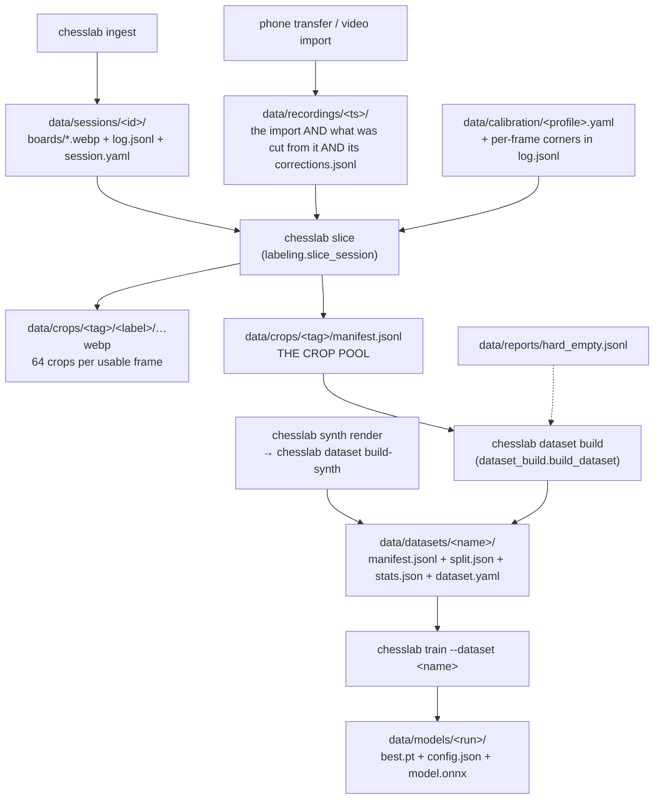

# The data pipeline — where a crop comes from

> The **real-camera half** and what both halves share: the crop pool, dataset builds, and the
> traps. The Blender half is `docs/synth-pipeline.md`; the register of source recordings is
> `docs/recordings.md`. Section numbers are cited from code and are
> kept stable; 6, 7, 9 and 10 (the July 2026 parking inventory) were dropped on 2026-09-23.

---

## 1. The map



| Stage | Command | Writes | Key module |
|---|---|---|---|
| Import | phone transfer, `realgames export-session` | `data/recordings/<ts>/` | `realgames/export.py` |
| Import (external) | `chesslab ingest synthetic <dir>` | `data/sessions/<id>/` | `ingest.py` |
| Label | `chesslab slice --all` | `data/crops/default/` + its `manifest.jsonl` | `labeling.py` |
| Curate | `chesslab dataset build <name> …` | `data/datasets/<name>/` | `dataset_build.py` |
| Train | `chesslab train --dataset <name>` | `data/models/<run>/` | `training/train.py` |

`slice` is a **pure, repeatable function** of (board, FEN, mesh): re-slicing reproduces a
session's crops exactly. The local capture rig (`chesslab collect`) went on 2026-08-20;
`SessionWriter` is what survived of it.

### 1.1 The tree — one rule (2026-08-20)

**A recording is one folder, and everything that only says something about it lives inside.**
Derived things — crops, datasets, reports — live outside and can be rebuilt from it.

| directory | holds |
|---|---|
| `data/recordings/<ts>/` | EVERYTHING about one recording: the import (`candidate.json`, `files/`, `video.mp4`, `review/`, `review-extra/`), what was cut from it (`session.yaml`, `log.jsonl`, `boards/`, `dirty/`, `mattes/`, `matte.jsonl`, `quad-fit.json`) and its own `corrections.jsonl` |
| `data/sessions/` | only sessions that are NOT recordings (`chesslab ingest`). Empty today |
| `data/crops/<tag>/` | the crops **and that pool's own `manifest.jsonl`**. Default pool `crops/default` |
| `data/datasets/<name>/` | packed snapshots |
| `data/packs/<pack>/` | session packs (§4.1) |
| `data/models/<run>/` | training runs |
| `data/calibration/` | board profiles |
| `data/footage/` | raw video nothing writes: `turntable/`, `occluders/`, `phone-backups/` |
| `data/occluders/` | RGBA occluder tiles (hands), cut from `footage/occluders` |
| `data/reports/` | machine output: `audit-flags*`, `correction-violations.jsonl`, `hard_empty*.jsonl`, `split.json`, `augment.yaml`, `perf/` |
| `data/labels/` | only `review-notes.jsonl`, plus `_history/` |
| `data/inbox/` | the web app's runtime state |
| `data/_delete/` | retired material — moved, not deleted; the user deletes it. What the retired runs measured: [`evaluation.md`](evaluation.md) |

- **The session id is not the directory name.** A recording's id keeps its `rg-` prefix — the
  join key in every manifest row — while the directory dropped it. `sessions.session_dir()` is the
  one place that maps one to the other; never join a path by hand.
- **A human verdict never lives in a derived tree.** `corrections.jsonl` sits next to its
  recording, `review-notes.jsonl` in `labels/`; a re-slice rebuilds crops, manifests, audit flags
  and violation reports and must not be able to take a decision with it. `corrections.jsonl` is
  written by the web app (`POST /api/corrections`) only — no Python writes it — and holds
  identities only; `occluded` is the measured `coverage`, not a class (`docs/class-scheme.md`).
- Older dated docs still name the pre-2026-08-20 paths (`data/realgames/`, `data/squares/`,
  `data/manifests/`, `squares.jsonl`).

### The board store — what a session keeps (2026-08-17)

`boards/NNNNNN.webp` is the frame rectified under that row's own quad, with the crop border,
written by the export as it fits the grid (`realgames.fit_rows_to_grid`) or retrofitted by
`chesslab session boards`. It is the **same raster `crop_square` cuts the training crop from** and
`/api/cell` reads (through the Python worker, `web_cuts.cut_cell`). 115 KB against the frame's 3.3 MB (96 GB → 4.5 GB);
the WebP stage moves the softmax by 0.0006, one argmax flip in 998 crops. The export decodes
forward and warps in memory (`realgames.stream_frames`); frames are written only for `--no-fit`
and an undistorted set.

- **`board_size` / `board_border` ride on the row.** A stored raster does not cancel against a
  homography: the candidate's geometry says 1008 where the export profile says 928, and a reader
  assuming its own number cut cells up to 59 px off. `usable_board` refuses a board whose numbers
  do not match the cutting profile (`--pad-side` overrides).
- **The board is written STRAIGHT** (2026-08-21). `realgames.straighten_boards` pulls the raster
  through the mesh once and sets `board_straightened`; consumers cut plain rectangles and never
  straighten again. The matte follows its board — it IS that raster.
- **One pooled mesh.** A hand over the grooves makes a frame's own mesh worse than none (15.6 px
  against 16.1 raw), so `meshes_for_boards` pools ONE per-line median mesh over every frame with
  `grid_lines` and without `hand_seen` and hands it to all of them — the camera does not move.
- **Lens: not worth a fit.** Measured 2026-08-21 over three rig recordings, hold-out: raw
  15.2–16.6 px bow, grid mesh alone 0.9–1.1, fitted lens alone 3.0–4.4, both 0.4–0.7. On a 116 px
  cell the mesh's 1 px is under a percent. The wiring exists (`alignment.warp_for_grid`,
  `realgames.grid_line_fracs`, `LensModel.from_receipt`); no `lens.json` does.
- **Re-export moves the matte's basis:** stored `coverage` stays while the corners move; run
  `occluders recut-coverage --all` (`docs/session-mattes.md` §1).

---

## 2. What a session is

```
data/recordings/2026-08-08-00-39-57/          # session id: rg-2026-08-08-00-39-57
  candidate.json  video.mp4  reference.pgn  files/   # the import
  session.yaml  log.jsonl  boards/  dirty/           # what was cut from it
  mattes/  matte.jsonl  scan.jsonl
  review/  review-extra/                             # review renders, NOT source frames
  corrections.jsonl                                  # this recording's human verdicts
```

An ingested session under `data/sessions/<id>/` has the same `session.yaml` + `log.jsonl`.
`review/` was called `frames/` until 2026-08-20; the rename mattered because a merged `log.jsonl`
stores `"frame": "frames/000150.png"` relative to its own directory.

```json
{"frame": "frames/0000.png", "ply": 1, "fen": "…", "ts": "…", "move_san": null,
 "corners": [[x,y],[x,y],[x,y],[x,y]], "unusable": true}
```

- `corners` is the board quad in **`[a8, h8, h1, a1]`** order, image pixels, per frame. Absent,
  `slice` falls back to ArUco detection and **skips the frame** if it cannot.
- `grid_lines` (shape in §2.1) is the frame's measured 18-line mesh; the EXPORT uses it to
  straighten the stored board once. Written by `realgames export-session --fit` and
  `chesslab session fit-mesh`; `chesslab session straighten` retrofits an older store.
- `grid_lines_source`: `measured` on the frame or `carried` from stable neighbours. A carried
  mesh only claims a stage all neighbours agree on.
- `unusable: true` makes `slice` skip the frame — see §5.3.
- `mode` in `session.yaml`: `play`/`track` are games; **`lighting-capture` holds an empty board**.

**px per square at the sensor** = mean quad edge / 8. It bounds what a session can deliver, but
it is **not what the model is fed** — the warp through `board_size` decides that (§11).

### 2.1 Android "Stored" sessions carry a corrected quad beside their log

A Stored recording lands as `data/recordings/<bundle>/files/sessions/<id>/` with the same
`log.jsonl` plus sparse `frames/NNNN.jpg`. Its `corners` are the raw **MARKER** quad, which every
consumer outsets by one constant (`DEFAULT_MARKER_MARGIN` 0.045). The right outset varies per
session and corner — ±6–14 px across 28 sessions (2026-08-15), 35 px on one h8 marker — so every
crop of such a session sat up to a fifth of a cell off.

`chesslab realgames fit-stored <bundle> [--all]` fits each JPEG against the board's own grid
(`alignment.improve_quad`) and writes `quad-fit.json` beside the log:

```json
{"margin": 0.0, "frames": {"0000": {"corners": [[x,y],[x,y],[x,y],[x,y]], "align_worst_px": 1.8}},
 "failed": ["0007"], "method": "grid-fit over printed field edges", "source_margin": 0.045,
 "written_at": "…"}
```

- `corners` are **playing-field** corners in JPEG pixels, `[a8, h8, h1, a1]`, margin **0** — the
  consumer warps them directly.
- `align_worst_px`: worst square-edge offset in rectified px at `measuredBoardSize` (§12 units).
- A frame whose grid could not be read is named in `failed` and keeps the logged marker quad — the
  failure is visible, never patched.
- `grid_lines` (`{"x": [9], "y": [9], "tx": [9], "ty": [9], "cx": [9], "cy": [9]}`, white POV):
  per line `pos(t) = x + tx·(t−0.5) + cx·(t−0.5)²` in fractions of the field side. Written only
  when **every** line was located, offsets strictly monotone, every |tilt| < 0.05; the curvature
  pair is all-or-nothing on top (|curv| < 0.08) and drops alone when unmeasurable. `mesh_point`
  maps the ideal board onto the measured one, `straighten_board` remaps the raster through it.
  Parity twin `meshPoint` (CropBox.kt), pinned on 100 shared points.
- The file is **derived**: re-running overwrites it atomically; deleting it returns the session
  to the marker quad.

---

## 3. The crop pool — `data/crops/<tag>/manifest.jsonl`

One JSON row per crop — the **single source of truth** for what real training data exists; the
`<label>/` directories are its pixel backing.

```json
{"path": "data/crops/default/wR/20260630-080531_0000_a1.png", "label": "wR",
 "session_id": "20260630-080531", "frame": "0000", "ply": 1, "square": "a1",
 "square_color": "dark", "fen": "…", "out_size": [128,128], "pad_side": 0.05, "ts": "…"}
```

- **Nothing appends to it.** `slice_session` drops all rows of its `session_id` and rewrites the
  file (`_replace_session_in_manifest`) — that is what makes re-slicing idempotent.
- **Variant pools:** `chesslab slice --variant-tag X` / `ingest --tag X` write `data/crops/X/`
  with their own manifest; `dataset build --source-manifest` takes several.
- It is only consistent with `data/crops/` if every mutation went through the code.

### 3.1 Zwei Verbraucher, zwei Groessen — und warum 128 (2026-08-23)

| | Groesse | Leser |
|---|---|---|
| `data/crops/<tag>/` | **128 px** | der MENSCH, in der Labeling-Lane |
| `packed_images.u8` | **Zielgroesse** (z. B. 80) | das MODELL |

Beide sollen **aus der Quelle** kommen, nicht auseinander. **Die 128 sind die native Crop-Box des
echten Exports:** `board_size` 928 ergibt Zelle 116, `pad_side` 0,05 macht 116 x 1,1 = **127,6 px**,
Faktor **1,000**. Fuer andere `board_size` gilt das nicht (`square_to_crop_box`):

| Pfad | `board_size` | Zelle | Box | Faktor auf 128 |
|---|---|---|---|---|
| echter Export | 928 | 116 | **128** | 1,000 |
| Composite 4K | 1280 | 160 | 176 | 0,727 herunter |
| Composite 1080p | 656 | 82 | 90 | **1,391 HOCH** |

Den Composite-Pool auf 128 zu zwingen skaliert einmal zu viel. **Der Fix ist NICHT, die
Pool-Groesse zu aendern** (versucht in `9a4b1d43`, zurueckgenommen mit `9d1bda44`): der Pool ist
das Artefakt fuer den Menschen. Stattdessen schneidet `pack_dataset` Composite-Zeilen aus der
QUELLE, sobald die Zielgroesse von der Dateigroesse abweicht — Kachel und Pose haengen an der
Frame-ID, `composite.json` traegt die Herkunft. Schaerfe 1,34x (1080p) bzw. 1,27x (4K); das Tempo
haelt NICHT (0,51x bzw. 2,80x), wer den Weg waehlt, waehlt ihn fuer die Schaerfe. Geschrieben wird
mit `seek`, nicht ueber `pack.row_window` — nach dem Split liegen die Zeilen eines Clips verstreut.

Merksatz: **die Zahl 128 gehoert zu `board_size` 928, nicht zum Pool.**

---

## 4. What a dataset is

A **view** on the pool: a session selection plus a dedup and split policy.

```
data/datasets/<name>/
  dataset.yaml    # the recipe: session_ids, dedup params, split params, counts
  manifest.jsonl  # the selected + deduplicated rows
  split.json      # train/val/test session lists, per-class counts, class weights
  stats.json
```

`dataset_build.build_dataset` runs strictly in this order:

1. **Filter** the pool to `session_ids` (optionally `--per-position`, before the split).
2. **Assign whole sessions to splits** on the RAW rows (`dataset.assign_sessions_to_splits`).
3. **Dedup — TRAIN ONLY.** `dedup_phash` (OFF by default, §5.13) runs before `dedup_metadata`
   (≤ `per_cell_cap` per `(session, square, label)`, `--cap`, default 0 = off) — §5.11.
4. **Collapse labels** to the target class list (`pieces13`, the default, drops `occluded` rows).
5. Write manifest + split + stats, then **pack** into a memmap if ≥ 2,000 crops
   (`_PACK_MIN_CROPS`).

A variant that only re-SELECTS rows another dataset packed gets no second copy:
`chesslab dataset pack <name> --from <owner>` writes `packed_from` into `packed_meta.json`
(measured 2026-08-20: 17 `xval` variants held 118 GB for two distinct rasters). Refused when the
owner lacks a crop the variant needs. Rotation is a **train-time transform**
(`torch_data._RandomRot90`), never materialized.

### 4.1 Session packs — the pixels once per session, not once per recipe

`chesslab session pack --session <sid> --size 80` cuts a recording once into
`data/packs/<sid>-<W>/` (`packed_images.u8`, `packed_meta.json`, `manifest.jsonl` with
`mm://<pack>/<frame>/<square>` paths); `dataset build … --from-packs --pack-size 80x80` cites it.
Format, writers, staleness and `--replace`: `docs/packs.md`.

- **The directory name IS the pack name** = the first `mm://` segment of its rows (Kotlin writers
  omit the `-<W>`); `packs.read_pack` refuses a directory whose rows disagree.
- **One resample instead of two**, so pool path and pack path differ in pixels by design:
  2026-09-05 on `rg-2026-08-08-11-59-12` at 80 px, 50,310 rows each, symmetric difference 0, mean
  absolute channel difference 1.684/255 (`scripts/pack_parity.py`).
- **`gradcam` and the legacy `scripts/*.py` readers cannot read a pack-built dataset**;
  `load_packed` refuses it by name instead of serving wrong pixels.

---

## 5. Behaviours that have cost people hours

### 5.1 Dedup applies to the train split only — so `final` measures the split, not the data

The holdout passes untouched (`board_accuracy` needs complete 64-crop boards). A larger train
split therefore makes `counts.final` *smaller*: one session list gave 10,123 and 5,030 final crops
from the same raw 13,376. Never compare `final` across datasets with different splits.

### 5.2 The split assigner is subtle, and its docstring is the specification

`dataset.assign_sessions_to_splits`. Sessions are never split across train/val/test (frames of
one session are near-identical). A naive largest-first greedy produced train 550 / val 2,432 /
test 2,048. Read the docstring before changing it: it records both guarded failure modes and why
targeting uses **raw** counts (weighting by unique content measured worse).

### 5.3 `unusable: true` does not retroactively remove anything

`slice_session` reads the flag at slice time only. Crops of earlier slices stay and keep feeding
datasets until the session is re-sliced (`chesslab slice --session <id>`).

### 5.4 `data/` is gitignored — a delete there is unrecoverable

Park, never delete. `synth_pieces/` (scanned meshes) is read-only, no backup, never move.

### 5.5 Session size ranks almost inversely to information content

A fixed camera over a still board repeats itself: in July the largest session carried fewer
unique crops than one a fifth its size. Judge a session by its unique contribution, never by rows
or disk size.

### 5.6 Parking a session directory does NOT remove it from the pool

- `chesslab session archive <sid> --reason …` (`sessions.archive_session`) moves the directory to
  `data/sessions_archive/` **and** purges its crops and manifest rows. Reversible via
  `restore_session` + re-slice.
- Moving the directory to `data/_parked/…` by hand moves **pixels only**; the rows keep feeding
  every build. Re-slice afterwards or write down that the rows remain.

### 5.7 Two files named `split.json` mean different things

- `data/reports/split.json` — the **legacy global** split, written by `chesslab split`, read by
  `--dataset`-less training, `eval`, `quantize`, `gradcam`, `dataset verify`. Stale content.
- `data/datasets/<name>/split.json` — the **per-dataset** split; what `train --dataset` uses.

`hard_empty.jsonl` protection (`priority_paths`) is wired into `build_dataset` only, not into the
legacy `run_split`.

### 5.8 Archiving requires a reason, and writes it twice

`archive_session(session_id, reason, paths)`: an empty reason raises `ValueError` and moves
nothing. The reason lands in `sessions_archive/<sid>/session.yaml` (`archived_at`,
`archived_reason`, travels with the pixels) and in `sessions_archive/index.jsonl` (one row per
archive, with `removed_crops`). Write the measurement, not the verdict: "59 px/square against the
device's 119" can be re-checked, "blurry" cannot. Archiving an id that already exists raises
`FileExistsError`; `delete_session` is the only place allowed to remove pixels. `restore_session`
does **not** restore crops or rows — re-slice, then rebuild (§5.9).

### 5.9 Datasets are snapshots. New sessions do not appear in them — rebuild.

**This is the one to remember.** Nothing in the pipeline is incremental. A dataset's
`manifest.jsonl` holds the rows of its build day, and `dataset.yaml`'s `session_ids` is a
hardcoded list. Recording, slicing, archiving, flagging and restoring change the pool
**underneath** every existing dataset without touching it.

| you did | what it changed | what is still stale |
|---|---|---|
| recorded a new session | nothing yet — a session is boards + log, not crops | everything |
| `chesslab slice --session <id>` | that session's rows in the pool's `manifest.jsonl` | every dataset |
| flagged frames `unusable` (§5.3) | nothing until you re-slice | every dataset |
| `archive_session` | removed the crops **and** the pool rows | every dataset built before it |
| moved a session to `_parked/` by hand (§5.6) | pixels only — the rows still feed builds | every dataset, permanently |

```bash
uv run chesslab slice --session <sid>                                   # 1. crops
uv run chesslab dataset build real13-<date> --sessions <sid1>,<sid2>,…  # 2. name EVERY session
uv run chesslab train --dataset real13-<date> …                         # 3. train on the new name
```

- **Build under a new name, never in place** — every published number was measured against a
  named dataset. Record which dataset a checkpoint was trained on.
- **A dataset does not shrink by itself**; only a rebuild drops archived rows.
- **`--sessions` is the whole selection, not a delta.** Assemble it from the previous
  `dataset.yaml` plus what `data/recordings/` gained (`chesslab session list`). Name the **id**,
  with its `rg-` prefix (§1.1).

### 5.10 `per_cell_cap`, not phash, is what decides how much data you get

`dedup_metadata` keeps at most `per_cell_cap` crops per (session, square, label). **Off by default**
(`config.DedupDefaults`, since `2232180e`): across positions it cut one game from 17,114 to 388
crops, and for a `lighting-capture` (64 buckets) a 297-frame session collapsed to 256.
`--max-class-ratio` is the instrument for balance. Check the stacked filters in this order when a
build returns far less than expected:

1. `per_cell_cap` (`--cap`) — per tuple
2. `phash_hamming` — near-duplicate pixels (off by default, §5.13)
3. `max_empty_ratio` — class balance on the train split (default 1.5)

### 5.11 The visual filter runs BEFORE the cap — and that is what lets the cap be raised

Until 2026-07-29 the cap ran first and cut a cell to 4 before anything checked whether the crops
differ — a lighting capture looked like "the piece never moved". With the filter first, the cap
only limits genuine variety and can be raised without re-admitting near-duplicates (49,856-row
pool, 2026-07-29: cap 4 → phash 4,172 rows; phash → cap 16 7,422, 1.78×). A cell holds 2 distinct
crops at the median, 7 at p90.

### 5.12 A `pieces13` build DROPS `occluded` rows

Renders with `--occlusion-p` produce them in bulk. They are **dropped, not mapped** — a covered
square may hold a piece or nothing — and the count is printed so the drop is never silent.

### 5.13 The perceptual dedup threw away half the corpus, and none of it was a duplicate

**`phash_enabled` is `False` by default since 2026-07-30** (`config.DedupDefaults`). Before, it
was `True` at `phash_hamming = 6`, and the CLI made the config unreachable.

| | rows kept | misses | phantoms |
|---|---:|---:|---:|
| `phash` hamming 6 | 19,365 of 42,816 | 42 | 4 |
| `phash` off | 42,816 | **17** | **2** |

(`occ-v4-f5` vs `occ-v4-f5nd`, one variable changed, occ-real6 test split.) `dhash` keeps 64
sign comparisons of a 9×8 grey thumbnail; brightness, contrast, noise and colour are gone. Over
five sessions, of 3,432 crops in exact-hash collision groups **0 were pixel-identical** and no
frame was delivered twice. Hamming 6 removed 54.8 % of the corpus differing in noise, exposure and
sub-pixel shift — the variation the model must become robust against. Hamming 2 (22.2 %
discarded) and 0 (6.0 %) were never tested against a trained model. `per_cell_cap` still bounds
the piece that never moved, exactly and without a visual guess.

### 5.14 The recorded splits do not reproduce, and the cause is still unknown

"Dict ordering" was refuted (`specs/33`: 400 random manifest orders yield exactly one split), yet
the recorded splits of `occ-real5nd` / `occ-real6` do not reproduce from their parameters. The
only defence: reuse `split.json`, build twins with `--like`.

### 5.15 A packed memmap can serve the pixels of a previous geometry

`_manifest_digest` cannot see pixels that changed under an unchanged path — `occ-real5nd-13c` was
served poisoned after a re-slice. Guard and its blind spots: `docs/packs.md` §3.

---

## 8. If you are tidying

- Park, never delete. `data/` is gitignored.
- Prefer `archive_session` over a manual move when the unit is one session — it keeps the pool
  consistent and records **why** (§5.8).
- **Rebuild the dataset afterwards, under a new name** (§5.9).
- Never touch `synth_pieces/`.
- **Nothing may be written into an existing dataset directory**; `data/datasets/occ-real` in
  particular stays byte-identical. Build new datasets under new names.
- Before removing a session, measure its **unique** contribution, not its size (§5.5).

---

## 11. Resolution: what the camera delivers, and what the net is fed

Three different numbers: what the sensor delivers, what the warp keeps, what the network is fed.
Only the last decides accuracy (measured 2026-07-29/30, `scripts/sweep_infer_size.py`).

### 11.1 The chain — the warp decides, not the camera

```
corner quad in log.jsonl        mean edge / 8  = px/square AT THE SENSOR
   │  labeling.warp_board_for_crops  →  profile.board_size      ← resolution is decided HERE
rectified board                  board_size / 8 = px/square in the warp
   │  calibration.square_to_crop_box →  cell * (1 + 2*pad_side) = THE CROP BOX, in px
crop box
   │  imgops.resize_keep_aspect      →  out_size    = what lands in the pool
   │  serving / eval resize          →  infer_size  = what the exported graph takes
network input
```

`labeling.crops_for_frame` warps to `board_size / 8` **before** any square is cut, so **the
sensor's resolution never reaches the model**. The detail a crop carries is
`board_size / 8 * (1 + 2 * pad_side)` — a property of the profile, not the camera. The real
export runs at 928 (box 128, §3.1). `config.DEFAULT_BOARD_SIZE` 1600 is a default, not what the
app uses: Android's `measuredBoardSize` derives it from the longest quad edge, rounded to 16 and
clamped to 320…1280, so the warp neither throws real pixels away nor fabricates any. Re-cutting a
crop at the target size from the frame recovers nothing when the box is the same.

### 11.2 Measuring a session's native resolution — still worth it, for a different reason

Mean quad edge / 8 from the log (`sweep_infer_size.py`'s `px_per_square`). It **bounds** what
`board_size` can deliver — warping above it invents detail — but is the wrong number for a model's
input size. The quad can drift within a session; say which frame you measured.

### 11.3 Each split is exactly one session — and val is not a clean holdout

A test split of one session measures one camera framing through one profile. Val doubles as the
checkpoint-selection set (`best.pt` maximises `checkpoint_score` on val at the crops' own size),
so a val-only resolution result is partly what selection produces. Do not read it as evidence.

### 11.4 `out_size` is where the crops were built, `infer_size` is what the net is fed

Keys in a run's `config.json`, deliberately separate (`specs/22`, `specs/45`):

- **`out_size`** — the size the crops were built at. In every manifest row; used by build,
  training and `chesslab eval`. Do not repurpose it.
- **`infer_size`** — what the exported graph takes; read only in
  `training.torch_data.infer_size_of`, falling back to `out_size`. The exported `model.onnx`
  input shape is the ground truth; a consumer that finds a disagreement fails loudly. Changing a
  model's serving resolution = edit `infer_size`, re-export, ship.
- **`pad_side`** (since 2026-08-06) — what the crop CONTAINS, in cells around the square. Written
  by `train` from the dataset's rows (a dataset whose sessions disagree declares nothing); read by
  `serving.run_spec` (`RunSpec.pad_side`) and by the app's `ModelSpec` → `withCropOf`. Absence
  means **legacy**, never a default, and the consumer says so (`[LEGACY]`, `declaredPads: null`).
  `config.CROP.pad_side` and the Android mirrors are 0.05; a profile STORED earlier may still say
  0.10, and only the model's declaration overrides it.

### 11.5 An untrained input size fails silently — pick one of the run's `scales`

`occ-v4-f3e20` (`scales: [32, 64, 96, 128]`), test split, misses / phantoms:

| input | 48 | 64 | **80** | 96 | 112 | 128 | 160 |
|---|---:|---:|---:|---:|---:|---:|---:|
| test | 916 / 0 | 38 / 0 | **133 / 1** | **19 / 0** | 17 / 1 | 43 / 0 | 53 / 0 |

80 px, untrained, is worse than *both* neighbours — no exception, no warning. So **`infer_size`
must be one of the run's own `scales`**, and `--scales` stays in the recipe. The best size is per
model and per deployment (`occ-r3s-f3` ran the other way on the same session).

### 11.6 The trap, in one sentence

A test split that is one session measures **one camera framing, through one profile's
`board_size`, at one input size** — check all three match before comparing two numbers, and
check the deployed size was trained.

---

## 12. Geometry: the crop box was in the wrong place, corpus-wide (2026-07-31)

Every number measured before 2026-07-31 18:00 was measured on crops cut a few pixels off.

### 12.1 What was wrong

A slightly wrong corner quad makes every crop slightly wrong while counts and labels stay healthy.
Surveyed with `scripts/survey_alignment.py`, 19 sessions, worst square-edge offset per frame (one
cell = 100 px): median 3.2–6.5 px per session, max 14.8 before; 2.0–3.3, max 4.3 after the re-fit.
**No session sat near zero**; the two largest sessions of 2026-07-21 were the worst.

⚠ Those are **pinned-ruler** numbers. `specs/41` (2026-08-03) unpinned the ruler (all 9 lines per
axis in a padded warp); on it the same realigned sessions read 3.0–5.8 as recorded and 2.0–3.3
after `correct_quad`. **Offsets from before 2026-08-03 are not comparable to later ones.**

The gate is `alignment.MAX_OFFSET_FRAC = 0.04` — a **fraction of a cell** (`Alignment.kt`) — plus
all 18 grid lines read. It is argued from the repaired band here (damage from 3.2 %, repaired
sessions 3.3 % median / 4.3 max) and has **never been swept against phantom count**.

### 12.2 Why it went unnoticed

`alignment.square_offsets` averaged **tilt** away (0.01 px for a 3.05 px shear), and its
directional tests passed a metric reporting a third of the error. `tests/test_alignment.py` now
pins it against analytic truth.

### 12.3 What it cost — veto metric, same run, only the quads changed (`occ-v6-f5nd`, 80 px, `occ-real6` test)

| geometry | phantoms | misses @ 0 phantoms | margin empty p99.9 / max |
|---|---:|---:|---|
| as recorded | 1 | 13 | 0.316 / 0.512 |
| **re-aligned** | **0** | **3** | **0.050 / 0.093** |

The margin moved 5.5x, after nine negative results elsewhere (normalization, architecture, width,
hard-negative fine-tuning).

### 12.4 What this invalidates

- **Datasets on the old geometry:** re-slice, rebuild under a new name, reuse the old `split.json`
  verbatim (§5.2, §5.9).
- **Every path-A number on record** (path A re-cuts through the current profile; a recalibration
  broke a reference row with an empty `git diff`): **every phase measures its own baseline in the
  same run as its candidate.**
- **The hard-negative mining of 2026-07-21 and 2026-07-31:** 9 260 of 9 290 mined errors sat on
  dark squares — the signature of a displaced box. Re-mine, do not reuse.

### 12.5 How to redo it

```bash
uv run python scripts/survey_alignment.py --sample 40
uv run python scripts/check_alignment.py --session <sid> --sample 0 --max-off 0.5 --fix
```

The fit never makes a frame worse. `log.jsonl` is backed up as `log.jsonl.bak-<stamp>`, corrected
rows carry `corners_source: "auto-corrected"`. Re-slice afterwards.

---

## 13. The alignment graveyard — what was measured and LOST

What SHIPPED is in `src/chesslab/alignment.py`'s docstring; this is what was tried, so nobody
re-tries it. Sources `specs/30` (pinned ruler, cell 100 px) and `specs/41` (unpinned) — rankings
hold within a row, absolute values across the two do not compare. Error in px against the human
quad unless noted.

### 13.1 The losers

| approach | measured | why it lost |
|---|---|---|
| `cv2.findChessboardCornersSB` | 0 of 30 configurations found the 7×7 lattice | groove wider than SB's kernel; occlusion cliff where pieces sit |
| 2-D saddle-point detector added to the band fit | 5.73 vs 5.14 | corner window averages 45×45 px of narrow grooves, often under a piece |
| RANSAC instead of Huber | 7.28 vs 5.35 | bad samples are a systematic minority, not sparse outliers |
| weighting by notch depth | 5.37 vs 5.35 | no information |
| 2 / 4 / 8 bands | 5.26 / 5.13 / 5.23 | flat, as the noise algebra predicts |
| similarity fit instead of affine | 2.66 small-error, 7.37 on real quads | the error it refuses to model is there |
| subtracting leftover bias as a constant | 5.47 vs 5.13 | systematic per frame, not across frames |
| undistorting first | lattice residual 1.48 → 4.24 | frames already corrected |
| blur before measuring | 5.25 vs 5.13 | the notch is 3–5 px wide |
| other notch estimators | all within noise | the estimator was never the problem |
| modelling the board's own line irregularity | ±0.75 px, changed nothing | real but too small |
| CLAHE before the line search | no better | `_notch_centre` already removes a local baseline |
| affine fit over 2-D lattice intersections | 8.3–22.6 | the DOF, not the correspondences, was the limit |
| per-line slope regression | 36 mrad invented tilt, 16.3 px at the edge | nine 8-sample fits invent tilt; pooled `a + b·k` per axis does not |
| direct 7×7 lattice refit (pinned reader) | 11.1–18.0, 14.1–31.7 incl. outer lines | the fix was 2-D correspondences + a projective fit |
| mean band collapse instead of median | within 0.1 px | median kept; bands and notch-width test do the work |

Literature consulted (`specs/41`): Duda & Frese BMVC 2018; chesscog (its "rectify first, then
recover the lines" IS the architecture in use); ChESS; ROCHADE; OCPAD; libcbdetect / PyCBD; LSD;
ELSED; Steger; Frangi/Sato/Meijering; phase congruency; ChessReD2K (unused external benchmark).
The environment has `opencv-python`, **not** contrib (no `ximgproc`).

### 13.2 `quad_spread` is PRECISION, not accuracy — never read it as a correctness gate

It compares each frame's quad against the median of the same quads: p90 0.93 px with 99.9 %
"detected" on a video where every quad was 27–33 px out. Kept only as a board-**movement** check.
The absolute per-frame verdict is `alignment_of` / `alignmentOf`: worst offset ≤
`MAX_OFFSET_FRAC` **and** all 18 lines read.

### 13.3 The one corpus-wide component the per-frame fit does NOT remove

The residual is systematic per setup: two sessions of one setup agree to 0.1 px, different setups
disagree in **sign**, and the between-session spread (1.1–2.5 % of a cell) is as large as the
mean. But one component is shared: the **y residual runs `+1.2 +3.1 +1.8 −1.6 −0.7 −1.1 0.0` % of
a cell on every rig, the phone included** (`specs/30`). A candidate for a **profile-level** fix
that nobody has taken. Also untried and named the most promising lead: giving `improve_quad` the
FEN, so grooves under a piece are **excluded** instead of down-weighted — the residual 5.1 px to
the human is bias, not noise.
