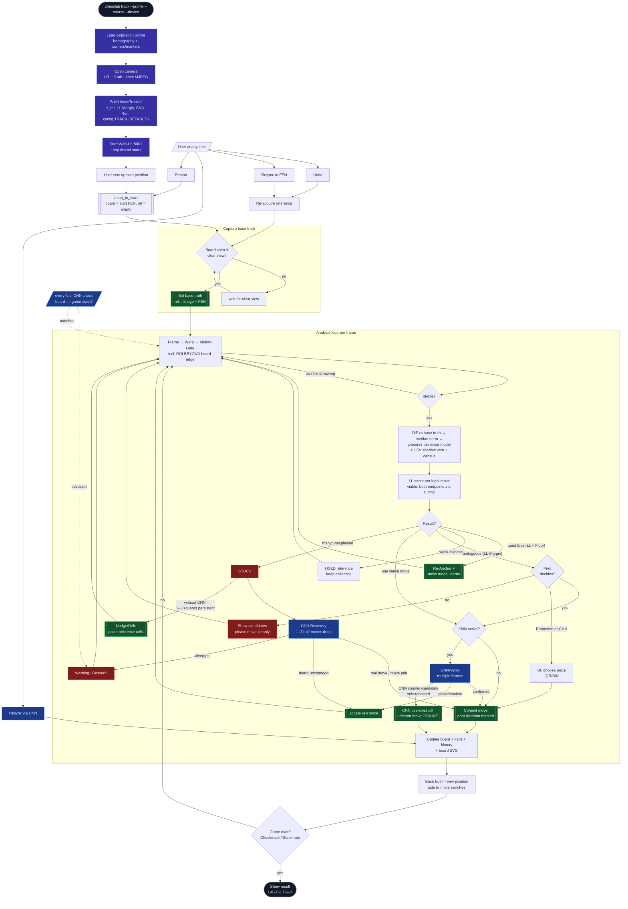

# Move-Tracker — Detection Flow (v2, Spec 10)

Based on `specs/rework/10-move-detection-v2.md`: probabilistic LL-scoring
(z-scores against per-square noise model), prior tie-break, 2-ply recovery,
nudge/drift re-anchor without CNN, CNN counter-candidate, promotion dialog.

## Key Decisions (Quick Reference)

| Mechanism | Where | Core |
|---|---|---|
| Noise model | `tracker.SquareNoise` | EMA mean/std per square, updated only at rest, std-floor 1.5 |
| Move score | `tracker.loglik_scores` | Σ k·(z − z_thr) over touched squares, clamped ±12 |
| Viability | `_try_detect` | both endpoints z ≥ z_thr/2 (replaces −1000 penalty) |
| Re-Anchor | `_try_detect` | only when nothing above z_thr AND best-LL < `reanchor_ll_floor` |
| Prior | `tracker.move_prior` | capture +0.5, check +0.3, forward +0.2, cap 1.0; commit marks it |
| Nudge/Drift | `_maybe_patch_anomaly` | without CNN: 1–4 squares persistent → cell patch (occupied 5 s, empty 30 s) |
| Geometry invalidation | `_corners_jumped` | warp corner > 6 px since reference capture → re-acquire base truth |
| 2-Ply | `cnn_recovery.derive_moves_identity` | single move preferred; pair only with margin against pair AND single move |
| Counter candidate | `_verify_tick` | CNN alternative committed when identifiably substantiated |
| Promotion | `_promo_pending` / `/api/promote` | without CNN: UI choice; with CNN: target-square label decides |

All thresholds: `config.TRACK_DEFAULTS`, overridable via `chesslab track` flags.
