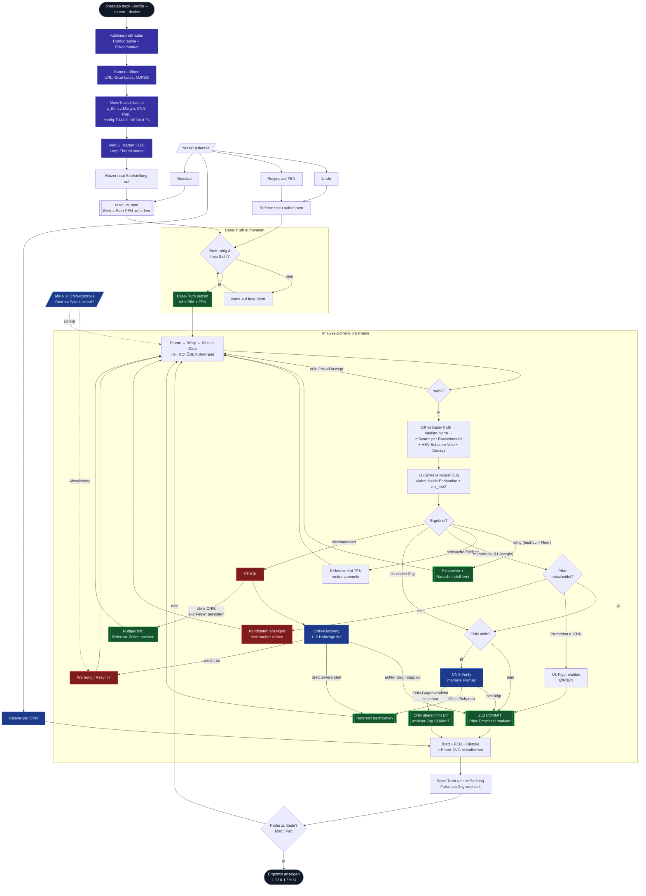

# Move-Tracker — Erkennungs-Flow (v2, Spec 10)

Stand nach `specs/rework/10-move-detection-v2.md`: probabilistisches LL-Scoring
(z-Scores gegen per-Feld-Rauschmodell), Prior-Tie-Break, 2-Ply-Recovery,
Nudge-/Drift-Re-Anchor ohne CNN, CNN-Gegenkandidat, Promotion-Dialog.

## Kernentscheidungen (Kurzreferenz)

| Mechanik | Wo | Kern |
|---|---|---|
| Rauschmodell | `tracker.SquareNoise` | EMA mean/std je Feld, nur in Ruhe geupdatet, std-Floor 1.5 |
| Zug-Score | `tracker.loglik_scores` | Σ k·(z − z_thr) über berührte Felder, geklippt ±12 |
| Viabilität | `_try_detect` | beide Endpunkte z ≥ z_thr/2 (ersetzt −1000-Strafe) |
| Re-Anchor | `_try_detect` | nur wenn nichts über z_thr UND best-LL < `reanchor_ll_floor` |
| Prior | `tracker.move_prior` | Schlag +0.5, Schach +0.3, vorwärts +0.2, Kappe 1.0; Commit markiert |
| Nudge/Drift | `_maybe_patch_anomaly` | ohne CNN: 1–4 Felder persistent → Zellen-Patch (belegt 5 s, leer 30 s) |
| Geometrie-Invalidierung | `_corners_jumped` | Warp-Ecke > 6 px seit Referenzaufnahme → Base-Truth neu aufnehmen |
| 2-Ply | `cnn_recovery.derive_moves_identity` | Einzelzug bevorzugt; Paar nur mit Margin gegen Paar UND Einzelzug |
| Gegenkandidat | `_verify_tick` | CNN-Alternative committet, wenn identitäts-belastbar bestätigt |
| Promotion | `_promo_pending` / `/api/promote` | ohne CNN: UI-Wahl; mit CNN: Zielfeld-Label entscheidet |

Alle Schwellen: `config.TRACK_DEFAULTS`, überschreibbar via `chesslab track`-Flags.
