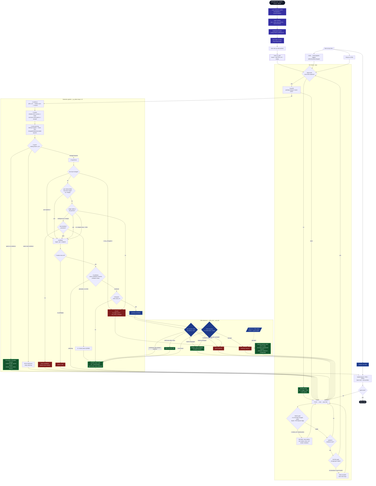

# Move-Tracker — Detection Flow (v3, streamlined pipeline)

`tracker._try_detect` is an ordered pipeline of numbered steps (the method names in
`tracker.py` match the node labels below). Every candidate — single move, fast-play
pair, low-contrast endpoint — flows through the SAME motion gate, confirmer and
dispatch; there is exactly one commit gate (`_dispatch`).

## Key Decisions (Quick Reference)

| Mechanism | Where | Core |
|---|---|---|
| Motion gate | `tracker.motion_score` | % of pixels with delta > `motion_px_thr` (20) — desk wobble/jitter shifts everything sub-threshold (score ~0), a hand is a compact strong region; threshold `motion_thr` 0.25 % (slow hands only move a thin edge band between frames) |
| Noise model | `tracker.SquareNoise` | EMA mean/std per square, std-floor 3.0; learns every stable frame but never from changed/shadow-vetoed/occluded squares |
| Move score | `tracker.loglik_scores` | Σ k·(z − z_thr) over touched squares, clamped ±12 |
| Viability | `_try_detect` step 5 | both endpoints z ≥ z_thr/2 (replaces −1000 penalty) |
| Pair preference | `_pair_candidate` | pair must beat best single AND second pair by `ambiguity_margin_ll` — catches the reply landing in the same window (a net-positive single would silently swallow it) |
| One commit gate | `_dispatch` | every candidate (single/pair/endpoint) passes motion gate + confirmer + CNN verify; pairs are verified against the post-pair position (`_verify_pair_tick`) |
| Re-anchor | `_try_detect` step 5 | only when nothing above z_thr AND best-LL < `reanchor_ll_floor`; this clean moment also rebuilds the color gamut and takes the deferred session photo |
| Gamut hygiene | `_set_ref(from_commit=True)` | commit frames may contain hand residue → occlusion gamut is NOT rebuilt from them (a poisoned gamut blinds the hand veto) |
| Session photo | `_queue/_flush_session_capture` | deferred to the next clean stable view; skipped if the next move comes first; dropped on undo |
| Structural evidence | `_compute_evidence` | census change vs reference, own noise model (floor 2.0); fused z_eff = max(z_gray, `census_z_weight`·z_census) — census is illumination-invariant structure, lifts dark-on-dark moves the gray mean-diff dilutes (weight 1.0 default, 0 = off) |
| Shadow veto | `hsv_shadow_squares` + census | HSV per Cucchiara, census < `census_thr` (160, live-tuned) confirms "no structure"; vetoed squares keep their z (vacate evidence) |
| Occlusion vs shadow | `_baseline_occlusion_and_shadow` | strong absdiff is classified: census > `occl_census_thr` (24) → occluded; chroma outlier vs gamut → occluded (flat hand); flat + darker + chroma-consistent → cast shadow (no occlusion latch, no stall); `occl_census_thr` 0 = old brightness-only behavior |
| Occlusion veto | `occlusion_color_squares` | NEAREST-NEIGHBOR Mahalanobis vs all 64 reference square features (Lab a*/b* + saturation), thr 1.5σ (live-tuned); z zeroed. NN, not global mean: a dark piece on a light square matches some dark-piece square; skin matches none |
| Occlusion latch | `_tainted` in `_try_detect` | a once-occluded square stays hard-blocked until occlusion-free for `motion_cooldown` frames (the hand leaving must not be forgotten one frame later); latched+occluded squares still COUNT toward the max_changed gate; no re-anchor while latched; persistent taints are WHITELISTED per square (never gamut re-learn from a live frame — a resting hand would blind the veto) after `drift_window_s` (≤2 squares: `nudge_timeout_s`), cleared at the next clean re-anchor; a latched quiet-hold marks `stuck` so CNN recovery resolves the standoff in ~2 s |
| Grid-line gate | `_grid_line_coverage` | < 0.5 of interior grid lines visible → large opaque occluder, skip detection |
| Prior | `tracker.move_prior` | capture +0.5, check +0.3, forward +0.2, cap 1.0; commit marks it |
| Nudge/Drift patcher | `_maybe_patch_anomaly` | runs also WITH CNN: persistent unexplained squares → cell patch (occupied 5 s, empty 30 s), regions include `overhang` |
| Geometry invalidation | `_corners_jumped` | warp corner > 6 px since reference capture → re-acquire base truth |
| Camera reattach | `reattach_camera` | feed dropout → capture rebuilt, base truth KEPT (fast resume; a move made during the gap is detected against the kept reference; geometry changes caught by `_corners_jumped`) |
| 2-Ply recovery | `cnn_recovery.derive_moves_identity` | stuck state: CNN searches 1–2 half-moves, multi-frame voting |
| Promotion | `_promo_pending` / `/api/promote` | without CNN: UI choice; with CNN: target-square label decides |

All thresholds: `config.TRACK_DEFAULTS`, overridable via `chesslab track` flags.
