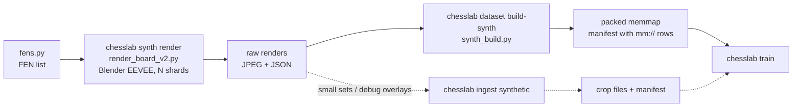
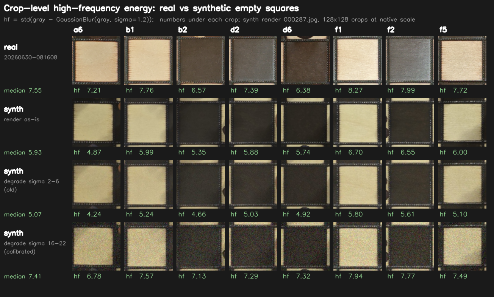

# Synthetic Render Pipeline — Usage Guide

Scanned 3D pieces rendered in Blender EEVEE on a photo-textured board, perfectly labelled. Big
runs go through `chesslab dataset build-synth` straight into a packed memmap; the classic
`chesslab ingest synthetic` chain remains for small sets and visual label checks. The real-camera
half: `docs/data-pipeline.md`.



## Prerequisites

- **12 scanned pieces** in `synth_pieces/<class>/v1.obj` (+ `v1.png`, `v1.mtl`), decimated to
  ~35k triangles (50k+ crashes Blender on this machine). Ground truth without backup — never
  regenerate or move; new scans go through `chesslab synth prepare` + `scripts/decimate_pieces.py`.
- **Board texture** `synth_pieces/board_texture.png`, from a rectified photo:
  `uv run chesslab synth board-texture --image scans/board/IMG_20260702_221301.jpg`
- **Blender 5.1** at `C:\Program Files\Blender Foundation\Blender 5.1` (or `CHESSLAB_BLENDER`).
  Renders run only on this machine.

## Step-by-Step Workflow

### 1. Generate FENs

Use a diverse list — the start position alone gives no class balance.

```bash
uv run python -c "
from synth.fens import random_fens
with open('data/synth_fens.txt', 'w') as f:
    for fen in random_fens(2000, seed=42):
        f.write(fen + '\n')
"
uv run python synth/fens.py data/fens_bleed.txt --mode bleed --n 3000 --seed 7
```

`--mode bleed` stripes tall pieces with empty lines between, so every empty square gets tall
neighbours whose lean bleeds into its crop — hard negatives for "empty dark square read as a
piece". Per-view piece-material jitter (`randomize_piece_materials`) widens black pieces' VALUE
range (0.55–1.5) so bright-crown bQ→wQ cases train with the correct label; smoke-render 8 frames
before a big run.

### 2. Render

```bash
uv run chesslab synth render --out data/synth_train --n 2000 --seed 42 \
    --res 1300 --max-obliqueness 0.10 --fens data/synth_fens.txt --shards 4
```

Per sample: `000000.jpg` (JPEG q90, closer to real compressed frames) and `000000.json`
(`{"fen": "<placement>", "corners": [[x,y]×4]}`, corners `[a8, h8, h1, a1]`, exact by
construction).

- **Match the real camera** (measured 2026-07-29 against three rectified clips): real px/square
  p50 **97**, perspective ratio p95 **1.041**. Old defaults (`--res 1024`, obliqueness 0.20) gave
  76 px/square and poses twice as oblique; **`--res 1300 --max-obliqueness 0.10`** gives 95 and
  1.048. Do not go below 0.10 — at 0.05 the synthetic spread is narrower than the real one.
- **`--static-camera`** (a flag of the Blender script, `synth/render_args.py`, not of
  `chesslab synth render`): pose drawn once per scene, views differ only in lighting — the structure
  of a real session. A camera flight dilutes an already wide pose distribution.
- px/square is below the `--res × --frame-frac / 8` ceiling because `frame_board()` fills the
  frame with the board's axis-aligned bounding box while the board is randomly rotated in-plane.
- **`--shards N`**: N Blender processes (1 leaves the GPU at ~20 %, 4 reach ~90 %), each in
  `<out>/shard-<k>/` with a disjoint seed and an **interleaved** split of `--fens`; stdout in
  `shard-<k>/render.log`.

### 3. Verify Labels (Mandatory)

An incorrect corner mapping silently flips all labels. The classic ingest materializes overlay
images to eyeball:

```bash
uv run chesslab ingest synthetic data/synth_train --tag synth-check --limit 32 --debug-overlay 8 --no-build
```

Do the piece letters on each square match the rendered pieces? Five minutes here saves a run.

### 3b. Camera-look degradation (`synth/degrade.py`) — optional, destructive

EEVEE renders are sharper, cooler and flatter-grained than a webcam frame. `degrade.py` rewrites
the board renders **in place** with a mild contrast/warm/defocus/noise/JPEG pass:

```bash
uv run python synth/degrade.py data/synth_raw/shard-0     # IN PLACE, not idempotent
```

It is not part of `synth render`; `occ-synth` was built from **undegraded** renders. Running it
twice double-degrades — park a copy first.

**The noise floor (measured 2026-07-28).** `synth/measure_noise.py` reports
`std(gray − GaussianBlur(gray, σ=1.2))` of `empty` crops — sensor grain, not lens signal:

| crop-level HF energy (128×128, `empty`) | p10 | p50 | p90 |
|---|---:|---:|---:|
| real (`occ-real3`) | 5.62 | 7.44 | 9.16 |
| synth as shipped (`occ-synth`, not degraded) | 3.72 | 5.90 | 7.88 |
| calibrated σ 16–22 | 6.06 | 7.12 | 8.24 |
| held-out sample, calibrated σ 16–22 | 5.74 | 7.00 | 8.50 |

- **The gap is the p10 tail, not the median:** the cleanest tenth of synth crops is smoother than
  anything the real camera produces — a free separator. σ 16–22 lifts that floor and lands p50
  slightly **below** real on purpose.
- **The old σ 2–6 made crops cleaner** (p10 4.06 → 3.33): contrast, defocus and JPEG remove more
  than it added.
- **Only ~0.26 of the σ injected at board resolution survives to the crop.** The range is
  calibrated for `--res 1600`, `--frame-frac 0.80`, `warp_board_size` 1100; re-measure with
  `measure_noise.py` if any of them changes.



The probe shows the same eight squares as real crops, raw renders, old range and calibrated range.
The numbers match; the character does not — real energy is directional **wood grain**, the
injected one per-channel speckle. A finer board texture or luminance-only noise would be the next
lever. Nothing has been re-rendered.

### 4. Build the Fused Dataset

```bash
uv run chesslab dataset build-synth pretrain-synth --renders data/synth_train \
    --cap 8 --val-frac 0.05 --test-frac 0.05
```

Renders → packed memmap in **one pixel pass**: each selected frame loaded once, warped once (at
`--board-size` 1100), its crops written straight into `packed_images.u8`. No crop files, no phash
(synth scenes have no near-duplicates). Rows carry virtual `mm://` paths; every consumer reads the
memmap. The build prints **per-class train counts** — the number that decides whether the run was
big enough.

- **`--cap`** (default 4) caps crops per `(session, square, piece)`. With `--views-per-scene 4`
  one scene fills the default cap — use **`--cap 8`** for large balanced runs.
- **`--val-frac` / `--test-frac`**: the synth holdout is uncapped; 0.05 keeps the memmap small.
- **`--rotate`** (off): records 90° rotation, applied on the fly at train time. **Flips are
  forbidden** (they break square colour and geometry).
- Shard subdirs become distinct pseudo-sessions; a frame-stem collision across shards hard-fails.

The classic chain (`ingest synthetic` → crops → `dataset build` → `dataset pack`) remains for
small sets and anything needing real crop files; `dataset pack` refuses fused datasets.

### 5. Train

```bash
uv run chesslab train --dataset pretrain-synth ...
uv run chesslab train --dataset <real-sessions> --resume <pretrain-run>
```

## Occluders: three outcomes, not two

`occluder_footprint_image` sorts touched squares: ≥ 70 % covered is `occluded`, ≤ 10 % keeps its
real label, everything between is **ambiguous** and dropped by both build paths
(`ambiguous_squares`). Over 10 occluder frames, 19.6 % of touched squares sit at 30–59 % — one
threshold would label a half-arm, half-rook square as one or the other. A `pieces13` build then
drops the `occluded` rows too (`docs/data-pipeline.md` §5.12); coverage from composites is the
current occlusion target (`docs/occluder-plates.md`).

## The one gap this pipeline does not close

Real black pieces read p90 208–212 in the clips; no render configuration got past 90. It is not
the material (source size and roughness change nothing, as a real specular would), and lamp
power, source size, sun angle, key/fill, on-axis source, specular, clearcoat, grain bump and mesh
smoothing are ruled out — the board always blows out first. Next step: a **Cycles** control
render (highlight there → an EEVEE setting; not → scene or material). Until then, treat weakness
on dark pieces over dark squares as a suspected domain gap, not an architecture problem.
