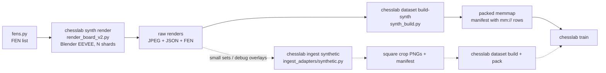

# Synthetic Render Pipeline — Usage Guide

Generate a synthetic chessboard image dataset from scanned 3D pieces, rendered in Blender
EEVEE with a photo-textured board. For big runs the renders flow through
`chesslab dataset build-synth` straight into a packed memmap (no crop PNGs); the classic
`chesslab ingest synthetic` chain remains the tool for small sets and visual label checks.
Either way you can pretrain or augment your per-square classifier with unlimited,
perfectly labeled positions.

## Pipeline Overview



## Prerequisites

- **12 scanned pieces** in `synth_pieces/<class>/v1.obj` (+ `v1.png` texture, `v1.mtl`).
  Already present — do not regenerate unless you have new scans.
- **Board texture** in `synth_pieces/board_texture.png`. Generate from a rectified board photo:
  ```bash
  uv run chesslab synth board-texture --image scans/board/IMG_20260702_221301.jpg
  ```
- **Blender 5.1** at `C:\Program Files\Blender Foundation\Blender 5.1` (or override via
  `CHESSLAB_BLENDER` env var).

## Step-by-Step Workflow

### 1. Generate FENs

Create a list of diverse chess positions. The `fens.py` module can generate random positions;
alternatively, sample FENs from real PGNs.

```bash
# Generate 2000 random FENs
uv run python -c "
from synth.fens import random_fens, sample_fens_from_pgn
fens = random_fens(2000, seed=42)
with open('data/synth_fens.txt', 'w') as f:
    for fen in fens:
        f.write(fen + '\n')
"

# Targeted neighbour-bleed positions (2026-07-21): tall pieces (queens 2x) in
# stripes with guaranteed empty lines between them — every empty square gets
# 1-2 tall orthogonal neighbours whose 3D lean bleeds into its crop. This is
# the hard-negative material for the "empty dark square read as a piece" gap.
uv run python synth/fens.py data/fens_bleed.txt --mode bleed --n 3000 --seed 7
```

> **Per-view piece-material jitter** (`randomize_piece_materials`, 2026-07-21):
> every scanned piece material carries a neutral `PieceJitter` HSV node that the
> render loop perturbs per view — black pieces get a wide VALUE range (0.55-1.5)
> so the bright-crown outliers where a real bQ looks like a wQ enter training
> with the correct label (the bQ→wQ color-flip class). Smoke-render 8 frames and
> eyeball them before any big run.

> Use a diverse position list — basic position only gives you no class balance variety.

### 2. Render

```bash
uv run chesslab synth render --out data/synth_train --n 2000 --seed 42 \
    --res 1024 --fens data/synth_fens.txt --shards 4
```

Output per sample (in `data/synth_train/` or, with `--shards`, in `shard-<k>/` subdirs):
```
000000.jpg       # Top-down render, JPEG q90 (--res pixels, slightly randomized camera)
000000.json      # {"fen": "<placement>", "corners": [[x,y]×4]}
```

Renders are **JPEG quality 90**, not PNG — ~5× smaller and closer to the real webcam's
JPEG-compressed frames. The board is framed to fill the image (`--frame-frac`, default
0.80) — much better than the old unframed ~51 px/square, but **far short of the ~200 px/square
the real camera delivers**:

| | px per square at `--res 1024` |
|---|---|
| documented (wrong, was here until 2026-07-26) | ~134 |
| arithmetic ceiling `1024 × 0.80 / 8` | 102.4 |
| **measured** (mean over a 24-frame probe) | **79** (min 71, max 100) |

134 px/square is arithmetically impossible: it needs a board 8 × 134 = 1072 px wide inside a
1024 px image. Even 102.4 is only the ceiling, reached when the board sits axis-aligned:
`frame_board()` scales the lens until the board's **axis-aligned bounding box** fills
`--frame-frac` of the frame, and the board is randomly rotated in-plane, so the board's *side*
is shorter than that box by up to √2 → 72 px/square at 45°, 102 px/square at 0°, ~79 on average.
Note the consequence for the build path below: warping synth at `--board-size 1100`
(137.5 px/square) **upscales** these renders. Raise `--res` (~1600 gives ~123 px/square,
~2048 gives ~158) if synth is to match the real camera's px/square.

`--shards N` spawns N parallel Blender processes: one process leaves the GPU at ~20%,
4 shards reach ~90% (~4× wall-clock). Each shard writes to `<out>/shard-<k>/` with a
disjoint seed and an **interleaved** split of `--fens` (shard k gets lines k, k+N, …),
so every shard sees the same position mix and no FEN is rendered twice. Shard stdout goes
to `shard-<k>/render.log`.

`corners` are the projected board corners in order `[a8, h8, h1, a1]` (exact by construction).
`fen` is the piece placement field only (no turn/castling/en-passant info).

### 3. Verify Labels (Mandatory)

Before building the full dataset, run a visual check to confirm that the FEN labels match
the rendered pieces. An incorrect corner mapping silently flips all labels. The **classic
ingest** is the tool for this — it materializes real overlay PNGs you can eyeball:

```bash
uv run chesslab ingest synthetic data/synth_train --tag pretrain-synth \
    --limit 32 --debug-overlay 8 --no-build
```

Inspect the overlay PNGs: do the piece letters on each square match the rendered pieces?

### 3b. Camera-look degradation (`synth/degrade.py`) — optional, destructive

The EEVEE render is sharper, cooler and flatter-grained than a webcam frame. `degrade.py`
rewrites the board renders **in place** with a mild contrast/warm/defocus/noise/JPEG pass:

```bash
uv run python synth/degrade.py data/synth_raw/shard-0     # IN PLACE, not idempotent
```

It is **not** part of `chesslab synth render` and never runs itself — `data/synth_occ_v1`
(and therefore `occ-synth`) was built from **undegraded** renders. Running it twice
double-degrades; park a copy first if in doubt.

#### What the noise floor is for (measured 2026-07-28)

`synth/measure_noise.py` reports the high-frequency energy of `empty` crops —
`std(gray − GaussianBlur(gray, σ=1.2))`, the energy above the optics cutoff, i.e. sensor
grain rather than lens signal:

```bash
uv run python synth/measure_noise.py data/datasets/occ-synth \
    data/datasets/occ-real3 --label empty --n 400
uv run python synth/measure_noise.py data/datasets/occ-real3 --sessions 20260630,20260722
```

| crop-level HF energy (128×128, `empty` only)              |  p10 |  p50 |  p90 |
|---|---:|---:|---:|
| real reference (`occ-real3`, sessions 20260630 / 20260722)| 5.62 | 7.44 | 9.16 |
| synth as shipped (`occ-synth`, renders **not** degraded)  | 3.72 | 5.90 | 7.88 |
| 24-render sample, re-cut as-is                            | 4.06 | 5.84 | 7.72 |
| the same sample, old range σ 2–6                          | 3.33 | 5.21 | 6.76 |
| the same sample, calibrated σ 16–22                       | 6.06 | 7.12 | 8.24 |
| held-out sample (shard-2), calibrated σ 16–22             | 5.74 | 7.00 | 8.50 |

**The median was never the gap.** The pack that commissioned this measured synth and real as
equal at p50 (7.09 vs 7.29); this re-measurement puts synth ~20 % *below* real (5.90 vs 7.44).
In neither reading is "raise the median" the goal, and the calibrated range deliberately lands
p50 **below** real (−4 % / −6 % on two disjoint samples) rather than above it. What both
readings agree on is the **p10 tail**: the cleanest tenth of synthetic crops (3.72) sits far
under anything the real camera produces (5.62) — smoothness a classifier can separate on for
free. σ 16–22 is calibrated to lift exactly that floor.

Two corrections the measurement forced:

1. **The old σ 2–6 made crops cleaner, not noisier** (4.06 → 3.33 at p10). Steps 1–3 and 5
   (contrast, defocus, JPEG) remove more HF than σ 2–6 adds, and the render's own EEVEE grain
   (~7.2 at board level) already dwarfs it.
2. **σ is injected at board resolution and mostly does not survive the crop.** The warp maps
   1280 framed render px onto an 1100 px board and `crop_square` letterboxes a 165 px box into
   128 px; only ~0.26 of the injected σ arrives. The range is therefore calibrated **for the
   current scale** (`--res 1600`, `--frame-frac 0.80`, `warp_board_size` 1100) and must be
   re-measured with `measure_noise.py` if either changes.


The probe (`docs/synth-pipeline-noise.png`) shows the same eight squares as real crops, as
synth renders straight from Blender, degraded with the old range, and degraded with the
calibrated one. Read it for what it does **not** show as much as for what it does: the numbers
now match, but the real crops' energy is directional **wood grain**, while the injected energy
is per-channel speckle. Matching the scalar does not match the character — a finer board
texture at render scale, or luminance-only noise, would be the next lever, and neither is in
this pass. Nothing has been re-rendered: `occ-synth` is unchanged, and whether to spend a
re-render on this is a separate decision.

### 4. Build the Fused Dataset

```bash
uv run chesslab dataset build-synth pretrain-synth --renders data/synth_train \
    --cap 8 --val-frac 0.05 --test-frac 0.05
```

`build-synth` (`src/chesslab/synth_build.py`) goes **renders → packed memmap in one pixel
pass**: each selected frame is loaded once, warped once (at `--board-size` 1100 px,
~137 px/square — matching the framed renders), and its crops are written straight into
`data/datasets/<name>/packed_images.u8`. No crop PNGs are materialized and no phash dedup
runs (synth scenes have no near-duplicates) — on a 100k-per-class set that skips a ~60 GB
middle copy of millions of small files. Manifest rows carry virtual `mm://` paths; all
consumers (train/evaluate/experiment/serving/gradcam/reliance) read the memmap.

Notes on the flags:

- `--cap` (default 4) caps crops per `(session, square, piece)`. With
  `synth render --views-per-scene 4` one scene's 4 views already fill the default cap
  and keep only ~68% of the focus classes — use **`--cap 8`** for large balanced runs.
- `--val-frac` / `--test-frac`: the synth holdout is **uncapped**; 0.05 shrinks the memmap
  considerably vs the defaults on big runs.
- `--rotate` (OFF by default): records 90° rotation augmentation in `dataset.yaml`; it is
  applied **on the fly at train time**, nothing is materialized.
- Shard subdirs are found recursively and become distinct pseudo-sessions (the shard path
  is part of the session group) — a frame-stem collision across shards hard-fails instead
  of silently serving one shard's labels with another's pixels.

The build ends by printing the **per-class train counts** — the number that decides
whether the render run was big enough for your class targets.

The classic chain (`ingest synthetic` → crop PNGs → `dataset build` → `dataset pack`)
still exists and remains the right tool for **small sets**, `--debug-overlay` checks, and
anything that needs real crop files. `dataset pack` refuses fused datasets (already packed).

### 5. Train

Pretrain on synthetic data, then fine-tune on real sessions:

```bash
# Pretrain
uv run chesslab train --dataset pretrain-synth --backbone mobilenet_v3_small \
    --head twostage --epochs 30 --batch-size 32

# Fine-tune (replace <pretrain-run> with the actual run name)
uv run chesslab train --dataset <real-sessions> --resume <pretrain-run>
```

Training on a fused dataset always reads the packed memmap; `--bg-p` background
randomization needs crop files and is ignored there (with a notice).

## Important Notes

- **Assets are pre-built.** The `synth_pieces/` directory contains finished, decimated
  meshes (~35k triangles each). Do not regenerate unless you have new scans. If you need
  to: `chesslab synth prepare`, then `scripts/decimate_pieces.py` to get stable Blender
  meshes (50k+ triangles crashes the native Blender on this machine).
- **No flips; 90° rotation is opt-in and train-time only.** Flips stay forbidden
  (they would break square-color/geometry). 90/180/270° rotation is available as an
  **optional on-the-fly train-time augmentation** (`--rotate` on `dataset build` /
  `dataset build-synth`, applied by `_RandomRot90` in `training/torch_data.py`) — off by
  default because it contradicts the fixed-camera assumption and diverse renders already
  carry the variance. Builds never materialize rotated files.
- **Photometry parity.** The `--photometry` flag during ingest (default: `none`) must match
  the fine-tune dataset's photometry setting.
- **Batch size.** Each render takes ~seconds; batch size is limited by Blender memory and
  GPU VRAM.

## Fallstricke (from real experience — do not skip)

1. **`--debug-overlay` is not optional.** A silent label flip ruins the entire training run.
   Five minutes of visual inspection saves hours.
2. **Blender renders run only on this machine** (Blender 5.1 at the standard install path).
3. **Camera variety is limited** — `--seed` varies pose/lighting marginally. The augment
   pipeline handles the rest.
