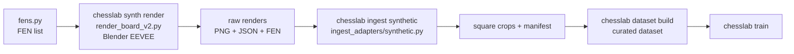

# Synthetic Render Pipeline — Usage Guide

Generate a synthetic chessboard image dataset from scanned 3D pieces, rendered in Blender
EEVEE with a photo-textured board. The output flows through `chesslab ingest synthetic` into
the standard labeling/slice pipeline, so you can pretrain or augment your per-square classifier
with unlimited, perfectly labeled positions.

## Pipeline Overview



## Prerequisites

- **12 scanned pieces** in `synth_pieces/<class>/v1.obj` (+ `v1.png` texture, `v1.mtl`).
  Already present — do not regenerate unless you have new scans.
- **Board texture** in `synth_pieces/board_texture.png`. Generate from a rectified board photo:
  ```bash
  uv run chesslab synth board-texture --image scans/board/IMG_20260702_221301.jpg
  ```
- **Blender 5.1** at `C:\Program Files\Blender Foundation\Blender 5.1` (or override via
  `CHESSLAB_BLENDER` env var).

## Step-by-Step Workflow

### 1. Generate FENs

Create a list of diverse chess positions. The `fens.py` module can generate random positions;
alternatively, sample FENs from real PGNs.

```bash
# Generate 2000 random FENs
uv run python -c "
from synth.fens import random_fens, sample_fens_from_pgn
fens = random_fens(2000, seed=42)
with open('data/synth_fens.txt', 'w') as f:
    for fen in fens:
        f.write(fen + '\n')
"
```

> Use a diverse position list — basic position only gives you no class balance variety.

### 2. Render

```bash
uv run chesslab synth render --out data/synth_train --n 2000 --seed 42 \
    --res 1024 --fens data/synth_fens.txt
```

Output per sample in `data/synth_train/`:
```
000000.png       # Top-down render (--res pixels, slightly randomized camera)
000000.json      # {"fen": "<placement>", "corners": [[x,y]×4]}
```

`corners` are the projected board corners in order `[a8, h8, h1, a1]` (exact by construction).
`fen` is the piece placement field only (no turn/castling/en-passant info).

### 3. Verify Labels (Mandatory)

Before ingesting the full dataset, run a visual check to confirm that the FEN labels match
the rendered pieces. An incorrect corner mapping silently flips all labels.

```bash
uv run chesslab ingest synthetic data/synth_train --tag pretrain-synth \
    --limit 32 --debug-overlay 8 --no-build
```

Inspect the overlay PNGs: do the piece letters on each square match the rendered pieces?

### 4. Full Ingest

```bash
uv run chesslab ingest synthetic data/synth_train --tag pretrain-synth
```

The `synthetic` adapter groups samples into pseudo-sessions of 500 (`synth-000`,
`synth-001`, …) — the session-based split (mandatory against data leakage) works
unchanged.

### 5. Build Dataset

```bash
uv run chesslab dataset build pretrain-synth --sessions data/datasets/pretrain-synth
```

Or use the Web UI Datasets tab to build curated datasets with dedup and optional
rotation augmentation.

### 6. Train

Pretrain on synthetic data, then fine-tune on real sessions:

```bash
# Pretrain
uv run chesslab train --dataset pretrain-synth --backbone mobilenet_v3_small \
    --head twostage --epochs 30 --batch-size 32

# Fine-tune (replace <pretrain-run> with the actual run name)
uv run chesslab train --dataset <real-sessions> --resume <pretrain-run>
```

## Important Notes

- **Assets are pre-built.** The `synth_pieces/` directory contains finished, decimated
  meshes (~35k triangles each). Do not regenerate unless you have new scans. If you need
  to: `chesslab synth prepare`, then `scripts/decimate_pieces.py` to get stable Blender
  meshes (50k+ triangles crashes the native Blender on this machine).
- **No flips or 90° rotations.** The fixed-camera assumption forbids these; the augment
  pipeline only applies brightness/blur, not geometry transforms.
- **Photometry parity.** The `--photometry` flag during ingest (default: `none`) must match
  the fine-tune dataset's photometry setting.
- **Batch size.** Each render takes ~seconds; batch size is limited by Blender memory and
  GPU VRAM.

## Fallstricke (from real experience — do not skip)

1. **`--debug-overlay` is not optional.** A silent label flip ruins the entire training run.
   Five minutes of visual inspection saves hours.
2. **Blender renders run only on this machine** (Blender 5.1 at the standard install path).
3. **Camera variety is limited** — `--seed` varies pose/lighting marginally. The augment
   pipeline handles the rest.
