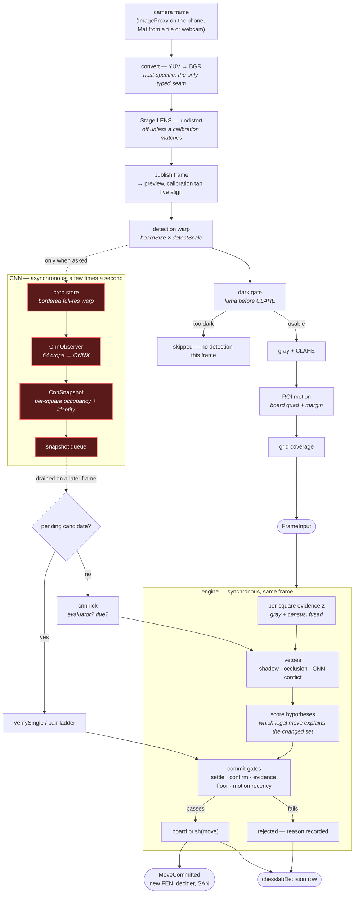

# From camera frame to committed move

The tracker runs on the phone and, through `:desktop`, on a PC — the same modules either way.
This is the shape of one frame's journey, at the level where you can point at a stage and ask
"did it happen". For the numbers each stage costs, see `chesslabPerf`; for what it decided, the
`chesslabDecision` row.

Two paths leave the pipeline and only one of them is per-frame. The **diff path** is synchronous:
every frame goes through it and a move can be committed inside that call. The **CNN path** is
asynchronous and sparse: it is asked for a reading a few times a second at most, off the frame
thread, and its answer arrives later as a snapshot the engine drains on some subsequent frame.



## Where it is currently broken

The red band is measured, not suspected. On `rec-20260807-135238.mp4`, 8,820 frames, with the
classifier attached and verified (`CNN EP verified: CPU, classes=13`):

```
cnn=run  cnnAgree=0.000  cnnReads=0/0  cnnSnaps=0/0/0/0
```

`cnnSnaps` counts snapshots as they arrive and splits them by where they go — to the verify
ladder, to a missing evaluator, to a closed schedule gate. All four are zero, so **no snapshot
ever reached the engine**. Neither engine-side gate closed; nothing got that far.

That places the break in the dotted edge from the detection warp to the crop store, or in the
observer behind it — not in the engine, which is where six earlier rounds looked.

## What the diff path does without it

Everything, minus arbitration. With no snapshot the occlusion filter falls through to a
">2 changed squares = a hand" heuristic instead of asking the model per square, and the pair
ladder has nothing to verify against. On the same footage the engine reads the first move
perfectly — `changed=[e2, e4]`, `best=e2e4`, no stuck reason — and the position never advances.

## Reading a run

```bash
./gradlew :desktop:run --args="replay <video> quiet lens"        # numbers only
./gradlew :desktop:run --args="replay <video> dump=10 lens"      # + annotated board PNGs
./gradlew :desktop:run --args="replay <video> nocnn"             # the diff path alone
```

Without `quiet` or `dump` a window opens showing the rectified board with each square tinted by
what the engine did with it, and it STOPS when the engine gets stuck.
