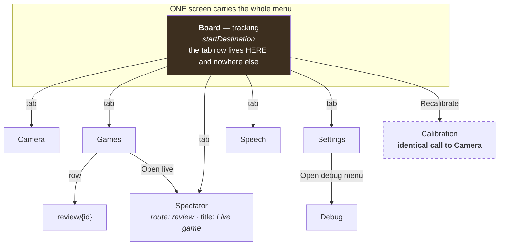
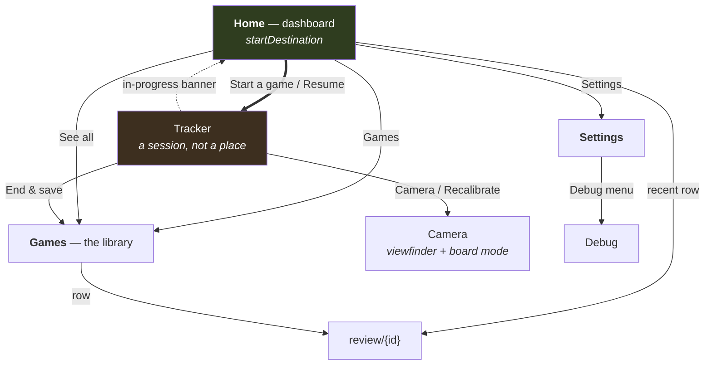

# 47 — One interface: the app as it is, and the app it should be

**Nothing in this document has been implemented.** No `.kt` file was touched. This is the sketch the
pack asks for, and it is here to be argued with. Everything under "Measured" was read off the running
app on an emulator on 2026-08-03; everything under "Proposed" is a suggestion with a reason attached.

Screenshots live beside this file under `screenshots/light/` and `screenshots/dark/` — **every screen
in both themes**, which has not existed before. Filenames are referenced inline.

---

## 0. How this was measured

| | |
|---|---|
| Device | `Chesslab_Agent2`, headful x86_64 API 35 AVD, ADB serial `emulator-5556` |
| Screen | `wm size` 1440x3200, `wm density` 560 — 411 dp wide |
| Build | `:app:assembleEmulator`, application id `com.chesslab.tracker.emulator` |
| Camera | `tests/data/testclips/blender-castle.mp4` as the CameraX back camera |
| Stored game | `2026-08-02_2159` — the recovered 83-ply game, rebuilt into `StoredGame` shape from `data/_device/20260802-2159-recovered-from-diagnostics/` and pushed into `filesDir/games/`. Result 1-0, ends `42. Ra6#`. Analysed on device by the bundled Stockfish: **60/83 moves graded, White 73 %, Black 64 %, 24 moments** |
| Themes | both, via `adb shell cmd uimode night yes\|no` |

The reference phone (Poco F7 Pro) is ~7 % denser at ~600 dpi / ~384 dp wide. **Layout verdicts below
hold; nothing here is decided on a few dp.** No physical device was attached and none was needed.

---

## 1. The interface as it is

### 1.1 Navigation, as the code actually wires it



**9 registered destinations, 8 distinct screens, 7 distinct implementations.**
`ROUTE_CALIBRATION` and `ROUTE_CAMERA` are byte-for-byte the same call:

```kotlin
composable(ROUTE_CALIBRATION) { CameraRoute(onBack = { navController.popBackStack() }) }
composable(ROUTE_CAMERA)      { CameraRoute(onBack = { navController.popBackStack() }) }
```

The KDoc says the route survives "because the tracking screen's *Recalibrate* is a different entry
point with a different intent" — but nothing is passed that could express an intent. It is an alias.

**The tab row is not a tab bar.** `TopNav` is composed inside the `ROUTE_TRACKING` block. Once you
are on Games, Camera, Settings, Speech or Spectator, the row is gone and the only way to another
top-level destination is Back. This is not a subtlety: while capturing screenshots I tapped where
"Spectator" sits, from the Games screen, and nothing happened — the app looked broken for a second.
The row also declares `selected = 0` unconditionally, i.e. "you are on Board" is hard-coded.

### 1.2 The screens

| # | Screen | Route | What it is for | Shares with |
|---|---|---|---|---|
| 1 | **Board** | `tracking` | The live tracker: state word, fps, board, move list, action bar, start/stop | `MoveList` (Review), `BoardCanvas` (Review), `EvalBarSlot` (Review) |
| 2 | **Camera** | `camera` | Viewfinder with sensor controls; second mode = board geometry | — the only screen that is **not** `ChesslabScaffold` and **not** theme-following |
| 3 | **Calibration** | `calibration` | *nothing of its own* | 100 % of Camera |
| 4 | **Games** | `games` | Live-game row + **recording settings** + game library | `Card` (Settings) |
| 5 | **Spectator** | `review` | The review screen with the live game + a Wi-Fi switch | 100 % of Review, minus the grade |
| 6 | **Review** | `review/{id}` | Rating, board, verdict, nav, Moments, Moves, details | board/list/eval-bar with Board |
| 7 | **Speech** | `speech` | 4 settings for spoken moves | `Card`, `SectionButton` (Settings) |
| 8 | **Settings** | `settings` | 7 knob groups + Analysis + App + Debug + export | — |
| 9 | **Debug** | `debug` | 6 diagnostic panels | — |

### 1.3 What is duplicated

**Four surfaces write to settings state:**

| Surface | Reached by | Content |
|---|---|---|
| Settings screen | tab | 37 tracker knobs in 7 groups, App section, Analysis section, Debug |
| Speech screen | tab | 4 speech settings |
| Analysis sheet | **long-press on the 40 dp eval bar** | the same `AnalysisControls` as the Settings screen |
| Recording panel | inside the Games list | 3 recording settings |

`AnalysisControls` is deliberately written once and rendered twice — good. But the *reason* the eval
bar cannot shrink is documented in `EvalBar.kt` as "this is still the ONLY way into the analysis
settings sheet", and that has been false since the Settings screen gained an Analysis section. A
40 dp column beside the board is being held open by a gesture nobody can discover.

**Two surfaces show a live game:** the Board tab and the Spectator tab. Same `GameView`, same
`BoardCanvas`, same `MoveList`. The Spectator tab's entire unique content is `SpectatorShareCard` —
one switch, one URL, one QR toggle (`screenshots/dark/05-spectator-live.png`: board, one switch,
"No moves yet", and 40 % of the screen empty).

---

## 2. What is wrong, measured

### 2.1 The landing screen is a tracker that is not tracking

`screenshots/light/01a-board-not-tracking.png`, `screenshots/dark/01a-board-not-tracking.png` — a
cold start, which is what a user sees:

```
NOT TRACKING                                    camera off
No camera is running. Start tracking to detect moves —
Games and Review need none.
[ a start-position board that is not on any table ]
[ "No moves yet" — an empty box, ~30 % of the screen ]
[ Start tracking ]
```

The board is a **fiction**: it is `ui.fen` seeded to the start position, rendered at full width, of a
board the app is not looking at. The empty move list under it is another 30 % of the screen. The one
real thing — the button — is at the bottom. Since specs/43 the app launches with no camera, so this
is the normal first screen, not an edge case.

### 2.2 The same quantity is shown in three units in one app

`entry.md` reported two. There are three, and one pair sits in the *same visual slot*:

| Place | Reads | Source |
|---|---|---|
| Eval bar beside the **live** board | `+0.3`, `-M3` — **pawns** | `EvalBar.evalLabel`, `cp / CP_PER_PAWN` |
| Eval bar beside the **review** board | `61 %` — **per cent** | `ReviewEvalBar`, `grade.winWhite` |
| Moves tab, "Position" column | `White +1.2` — **pawns** | `MoveList.positionLeadLabel` → `pawnScore` |
| Moves tab, cost under a SAN | `−10 %` — **per cent** | `moveImpactLabel` |
| Analysis panel (eval-bar tap) | `+0.30` — **pawns** | `AnalysisPanel` |

`screenshots/light/04d-review-tab-moves.png` shows the worst of it in one row:
`Nf6 · ? −10%` beside `White +1.2`. The move's cost is a percentage, the position it produced is a
pawn count, and the coloured background behind that pawn count is drawn from the *percentage*.
specs/44 removed centipawns from the review because they need to be taught; they are alive in three
places.

### 2.3 "What decided the game" leads with a move that decided nothing

`screenshots/light/04c-review-tab-moments.png`:

```
What decided the game  ⓘ
White · forced mate
White · 32. Rxc6+ · missed mate in 6        98% → 98%
Black · 14... b4 · Blunder                  48% → 13%
Black · 23... f4 · Blunder                  41% → 9%
```

`GameGrade.findings()` sorts `compareByDescending { it.missedMate }.thenByDescending { swing }` —
**every** missed mate outranks **every** real swing, by construction. A missed mate from 98 % that
stays at 98 % is a curiosity; a 35-point swing is the turning point the heading promises. The
mate story is already told in full by the card directly above ("White missed 1 mating chance").

### 2.4 The "⚙: move" card, and the two positions in one row

`screenshots/light/04f-review-ply6-context-chip.png`:

```
┌───────────────────────┐  ┌───────────────────────┐
│ Nf6   Mistake         │  │                       │
│ Win 49% → 39%         │  │      ⚙: exd4          │
│                       │  │                       │
└───────────────────────┘  └───────────────────────┘
```

Two equal-width boxes, one full and one holding three glyphs, in a fixed 68 dp row, with different
vertical alignment (`Arrangement.spacedBy(2.dp)` top-aligned on the left, `Alignment.Center` on the
right). The gear is `Icons.Filled.Settings` — the settings glyph — standing for "engine".

**And they are two different positions.** The board draws `suggestedUci = fromHere?.bestUci` (the
engine's move *from the position on screen*, White's 4th here). The chip prints
`ply?.bestSan ?: fromHere?.bestSan`, and `ply.bestSan` is the engine's move in the position *before*
the ply — Black's better 3rd move, `exd4`. The KDoc of `GameReviewScreen` warns about exactly this
mistake for the arrow; the chip does it. Whatever else changes here, this row needs one position.

### 2.5 A tab label carries a live counter

`Moments · 24` and `Moves · 83`. The count is inside the same `Text` as the label, so the
accessible name of the tab changes while the analysis streams — `tap-text "Moments"` fails, which is
the `CLAUDE.md` rule met in the wild. Watched live: `Moments · 2` → `· 11` → `· 20` → `· 24` over
about three minutes.

### 2.6 "Analysis details" reads as a heading

`screenshots/light/04e-review-analysis-details.png` — it *does* open, and it holds the decider, the
grading method, Share/Copy PGN and "Analyse again". The defect is that a bare `TextButton` in
`OnSurfaceMuted`, sitting under a nav row on an otherwise empty background, is visually identical to
the section headings above it. No chevron, no surface, no affordance. `entry.md` recorded it as
"a heading with nothing under it"; the truth is "content nobody will find".

### 2.7 The light theme — reviewed, and it is fine

This was the open question and it is now answered. The theme is not missing: `Theme.kt` branches on
`isSystemInDarkTheme()` between a full **`PaperPalette`** (18 tokens) and **`InkPalette`**, there are
`values-night` XML themes and colours, and the 18 `ui.theme` colour names are `@ReadOnlyComposable`
getters over a `CompositionLocal` — so all 106 import sites follow the system automatically. No
dynamic colour. Typography is consistent: 178 `MaterialTheme.typography` reads, exactly **one**
hard-coded `fontSize` in the app (`PromotionDialog.kt:67`, the piece glyphs).

Reviewed side by side, paper reads as a considered, warm, coherent identity — not an afterthought.
Two real findings, both narrow:

1. **The camera screen is the one screen that does not follow the theme** (`Chrome = InkPalette`,
   deliberate, documented). In light mode over the pale letterbox of a portrait clip the board-mode
   note is grey-on-cream and effectively unreadable — `screenshots/light/02-camera.png`, bottom
   line. `ChromeBanner` carries a scrim for exactly this reason; `CameraNote` does not.
2. **`PieceWhite` and `PieceBlack` are identical hexes in both palettes.** All board contrast is
   carried by `BoardLight`/`BoardDark`, which *do* differ. That works, but it is worth stating as a
   decision rather than leaving it as a coincidence.

### 2.8 Spacing: 26 values, 195 uses, zero tokens

`entry.md` recorded 18 distinct `dp` literals. **Re-measured 2026-08-03 with the same command over
the same paths: 26 distinct values, 195 occurrences.** (The old list contains `88.dp`, which no
longer exists, and misses `5, 9, 20, 24, 40, 44, 68, 200, 320`. The review overhaul `a5cdfd1` landed
in between.)

| dp | 8 | 12 | 6 | 4 | 2 | 10 | 1 | 3 | 52 | 16 | 14 | 48 | 34 | 18 | 0 | rest |
|---|---|---|---|---|---|---|---|---|---|---|---|---|---|---|---|---|
| uses | 39 | 25 | 24 | 24 | 17 | 17 | 10 | 6 | 5 | 4 | 4 | 3 | 2 | 2 | 2 | 1 each: 5, 9, 20, 24, 40, 44, 68, 76, 94, 200, 320 |

By role: **77 padding, 74 gaps, 23 fixed sizes, 10 corner radii, 10 strokes**. Seven named `Dp`
constants exist, scattered across five files; six more are raw `Int`s with `.dp` applied at the use
site (`PANEL_CORNER = 14`, `TILE_MIN = 56`, `DECK_GAP = 8`, …), which no grep for `.dp` will find.
`ScreenPadding` in `Chrome.kt` is the one shared value and it has **one** call site.

Two concrete symptoms rather than a general complaint: the horizontal screen margin is **12 dp** on
Games/Settings/Speech/Debug, **14 dp** on Board, and **0** on Camera; the minimum touch height is
**44 dp** on the tracking chips, **48 dp** on two alarm buttons and **52 dp** on the action buttons
and the tab row — Material's floor is 48.

### 2.9 Smaller things worth listing

- **The Games screen buries the library.** `screenshots/light/03-games.png`: the tallest element by
  far is "Record training frames" — a developer data-capture setting with a five-line explanation,
  four size chips and a second toggle — and the single stored game is the third card, below the
  fold on a shorter phone.
- **Every game row is four lines tall** because `Rename` and `Delete` are permanent buttons on it.
- **`? vs ?`** on every row. `StoredGame.white`/`black` exist, `GameStore.rename` writes them,
  nothing captures them.
- **The tab label and the destination title disagree**: tab "Spectator" → screen "Live game".
- **`Moves · 83` for a game with 42 moves.** The counter is plies; the column header says "White /
  Black" and the rows are numbered 1..42. Two meanings of "move" on one screen.
- **12 raw colour literals outside `ui/theme/`**, of which 8 are the debug timing chart (fine) and
  4 are camera chrome (documented). No stray palette.

---

## 3. Proposed

### 3.1 The navigation after



**Top-level destinations 6 → 3. Registered routes 9 → 7. And NO persistent bar** — decided
2026-08-03, see §3.1a. Home is the hub; Games and Settings are pushed from it and come back with
the system Back.

### 3.1a No bar — and how a running game is reached

**Decided 2026-08-03. The bottom bar is dropped.** Three reasons, the first two the user's:

1. **The bottom already belongs to Android.** The reference phone runs MIUI's three-button
   navigation. An app bar would stack a second band directly above the system one, and the tracker
   and the review are precisely the screens that need the height back.
2. **A bar that changes is not a bar.** This also settles the old Q2: a fourth item existing only
   while a game runs would change the bar's composition, which is exactly what was ruled out.
3. Three destinations do not need persistent chrome. Home is the hub, Games and Settings are pushed
   from it, and the system Back is the way out — one behaviour, no invented one.

**That leaves the bar's real job unsolved, so it is solved here rather than as a footnote:**
*how does the user get back to a running game?*

A tracked game is an ongoing activity, and it is reached the way Android reaches ongoing
activities. **All three of these, because they cover three different places the user can be:**

| Where the user is | The way back |
|---|---|
| Outside the app | **The foreground notification.** It already exists and specs/43 already made *stopping* reachable from it; returning is the same surface and costs a `contentIntent`. |
| On Home | **The first row.** "Start a game" becomes **"Resume · 14 moves · White to move"** while a session runs. No new surface, and it makes the running game the most prominent thing on the screen where it should be. |
| Anywhere else in the app | **A slim in-progress banner**, one row, directly under the app bar — the shape a call or a navigation app uses. Tapping it returns to the tracker. |

Three rules bind all three:

- **A running game is never more than one deliberate tap away, from anywhere.**
- **None of these affordances exists when no game is running.** The banner is absent, not empty;
  the Home row reads "Start a game" again. Nothing here is a permanent widget showing a null state.
- **The UI must make specs/43's guarantee legible, not merely true.** A game already survives tab
  switches, leaving the app and the shade — it ends only on an explicit stop. Today nothing on
  screen says so, and a user who navigates away has no reason to believe the game is still being
  tracked. The banner IS that statement.

Note the banner is the only new persistent-ish chrome in this proposal, and it is strictly better
than the bar it replaces: it appears only when there is something to return to, it carries state
worth reading ("14 moves"), and it costs one row instead of one row on every screen forever.

### 3.2 What goes, and why

| Deleted | Why | Where its content goes |
|---|---|---|
| `ROUTE_CALIBRATION` | An alias. Same composable, same arguments, no distinguishing parameter. | nothing to move |
| **Spectator tab + `ROUTE_REVIEW` (live)** | Its board and move list are the Board screen's, from the same `GameView`. Its only unique content is one switch. | `SpectatorShareCard` → the tracker's overflow menu, as **Share on Wi-Fi** |
| **Speech tab + `ROUTE_SPEECH`** | Four settings do not earn a sixth of the app's top-level surface. It is already built out of Settings' own `Card`/`SectionButton`. | a Settings group, **Spoken moves**, exactly like the other groups |
| **Camera tab** (the route stays) | It cannot function without the tracker — its unbound state is literally *"No camera is running. Start tracking on the Board tab"* (`screenshots/dark/02-camera.png`: an app bar and one sentence on an empty screen). It is the tracker's viewfinder. | reached from the tracker: **Camera view** / **Recalibrate** |
| **`AnalysisSettingsSheet` + the eval-bar long-press** | Duplicates the Settings › Analysis section behind an undiscoverable gesture, and is the stated reason a 40 dp column cannot shrink. | Settings › Analysis (already there) |
| **`RecordingPanel` on the Games screen** | It is a setting, not a game. It is the tallest thing on the screen that holds the library. | Settings › **Recording** |
| **The `⚙: move` card** | Redundant when the played move was best; wrong position when it was not; least legible element on the screen. | one full-width verdict card that ends "Better: exd4 →" |
| **`pawnScore` / `CP_PER_PAWN` in the UI** | Third unit for one quantity. | everything reads win expectancy in per cent |
| **Per-row `Rename` / `Delete` buttons** | Two permanent buttons per row for acts taken once. | a per-row `⋯` overflow |

That is a net deletion, in the shape specs/35 and specs/36 used. **Nothing on this list is a wrapper
around what it replaces.**

### 3.3 Home — the dashboard

Only numbers the app already measured. Each card states its own denominator, the way the review
screen's accuracy row already does.

**Populated:**

```
┌────────────────────────────────────────────┐
│  Welcome back                              │
│                                            │
│ ┌────────────────────────────────────────┐ │
│ │  ▶   Start a game                      │ │  ← primary; the ONLY control
│ │      turns the camera on               │ │    that needs the camera
│ └────────────────────────────────────────┘ │
│                                            │
│  Recent games                    See all › │
│ ┌────────────────────────────────────────┐ │
│ │ 2 Aug · 1-0 · 83 moves                 │ │
│ │ You 73 %  ·  Anna 64 %                 │ │
│ ├────────────────────────────────────────┤ │
│ │ 29 Jul · ½-½ · 41 moves                │ │
│ │ not reviewed yet                       │ │
│ ├────────────────────────────────────────┤ │
│ │ 27 Jul · 0-1 · 55 moves                │ │
│ │ You 58 %  ·  rebuilt 2×                │ │
│ └────────────────────────────────────────┘ │
│                                            │
│  Your play                                 │
│ ┌──────────────────┬─────────────────────┐ │
│ │ Games            │ Accuracy            │ │
│ │      12          │      68 %           │ │
│ │ 623 moves        │ over 7 reviewed     │ │
│ ├──────────────────┼─────────────────────┤ │
│ │ Clean records    │ Most played opening │ │
│ │    9 of 12       │   Ruy Lopez         │ │
│ │ 3 rebuilt        │   4 games        ›  │ │
│ └──────────────────┴─────────────────────┘ │
│                                            │
├────────────────────────────────────────────┤
│   ● Home        Games          Settings    │
└────────────────────────────────────────────┘
```

**With a game running**, the first row changes and nothing else does:

```
│ ┌────────────────────────────────────────┐ │
│ │  ●  Game in progress — 12 moves        │ │
│ │     Resume                    End & save│ │
│ └────────────────────────────────────────┘ │
```

**Empty — a fresh install:**

```
┌────────────────────────────────────────────┐
│  Welcome                                   │
│                                            │
│  chesslab watches a real board through the │
│  camera and writes the game down.          │
│                                            │
│ ┌────────────────────────────────────────┐ │
│ │  ▶   Start your first game             │ │
│ └────────────────────────────────────────┘ │
│                                            │
│  Your games and statistics appear here     │
│  once you have played one.                 │
│                                            │
├────────────────────────────────────────────┤
│   ● Home        Games          Settings    │
└────────────────────────────────────────────┘
```

No stat cards, no zeroes, no placeholder chart. One sentence and one button.

**Where every number comes from:**

| Card | Source | Cost |
|---|---|---|
| Recent games (3) | `GameStore.list()` — `id`, `result`, `moveCount`, `seams`, `white`, `black` | free |
| per-game accuracy | `ReviewStore` cached `GameGrade.white/black.accuracy`; **"not reviewed yet"** when absent | free |
| Games / total moves | `list().size`, `sum(moveCount)` | free |
| Accuracy, "over N reviewed" | mean of cached grades; the denominator is on the card | free |
| Clean records "9 of 12" | `GameSummary.seams == 0` — a quality metric the app already stores and already shows per row | free |
| Most played opening | **needs the opening book** — see 3.4. Card does not exist until it does. | new |

The tile marked `›` is the only one that navigates. **Nothing on this dashboard is invented.**
"Accuracy over time" as a sparkline was considered and dropped: with 7 reviewed games it is a line
through noise, and the honest version of it is the number with its denominator.

### 3.4 The two additions the pack sanctions

**Who played.** Ask at the **end**, inside the dialog that already interrupts. `EndGameDialog`
already stops the user with "End this game? — 83 moves are recorded". Two optional fields go there,
pre-filled with the last game's names:

```
┌──────────────────────────────────────┐
│  End this game?                      │
│  83 moves are recorded. Saving keeps │
│  them in Games …                     │
│                                      │
│  White  [ Marius            ]        │
│  Black  [ Anna              ]        │
│         leave blank to skip          │
│                                      │
│         Discard      Save & new game │
└──────────────────────────────────────┘
```

Nothing is asked before the first move — the user's own constraint. `GameStore.rename` already does
the write; the Games screen's rename dialog stays as the correction path.

**The opening book.** `lichess-org/chess-openings`, CC0, keyed by EPD — the same normalisation
specs/46 specifies for its position cache, so **one function serves both packs and they should share
it.** One correction to `entry.md`: `MoveQuality.BOOK` is not merely unreachable, it has been
**deleted** — `MoveQuality.kt` says so in its KDoc ("`BOOK` was here and is gone"). So the book
brings back a band rather than filling an empty slot. That does not change the recommendation; it
changes the size of the change. *"mit Tutorial"* stays out: link, or drop.

### 3.5 The tracker

Unchanged in substance — it is the screen this project has spent the most time getting right. Three
edits:

```
┌────────────────────────────────────────────┐
│  ←   Tracking                         ⋯    │  ← was: the six-tab row
│                                            │     ⋯ = Camera view · Recalibrate ·
│  TRACKING                    camera 30 fps │         Share on Wi-Fi · Torch
│  waiting for a move                        │
│                                            │
│  61 %│  [ B O A R D ]                      │  ← per cent, not +0.3
│      │                                     │
│                                            │
│  ┌──────────────────────────────────────┐  │
│  │ 1. e4  e5   2. Nf3  Nc6              │  │
│  └──────────────────────────────────────┘  │
│                                            │
│  [   Undo   ] [ End game ] [ Recalibrate ] │
│  [        Stop tracking                  ] │
└────────────────────────────────────────────┘
```

1. The tab row becomes a title bar with a `⋯` overflow, which is where "Show camera view", "Light",
   "Share on Wi-Fi" and "Recalibrate" go. That reclaims one full row of chips.
2. The eval bar reads **per cent**, matching the review bar it shares a drawing with.
3. Long-press on the bar does nothing; a tap still opens the top-3 panel.

### 3.6 Review — the two rows that change

```
│  Review        Moments  24      Moves  83  │  ← label and count are separate
│                                    Text nodes; the tab's accessible name is
│                                    "Moments", always
│ ┌────────────────────────────────────────┐ │
│ │ White wins                          ⓘ  │ │
│ │  You 73 % (30/42)  ·  Anna 64 % (30/41)│ │
│ │  60/83 moves graded                    │ │
│ └────────────────────────────────────────┘ │
│  61 %│   [ B O A R D  with the arrow ]     │
│ ┌────────────────────────────────────────┐ │
│ │ Nf6   Mistake                          │ │  ← ONE card, full width
│ │ Winning chances 49 % → 39 %            │ │
│ │ Better: exd4                        →  │ │  ← words; same position as
│ └────────────────────────────────────────┘ │     the arrow; no gear
│    |<     <     ply 6 / 83     >     >|    │
│ ┌────────────────────────────────────────┐ │
│ │ Analysis details                    ›  │ │  ← same disclosure row as
│ └────────────────────────────────────────┘ │     Settings' GroupCard
```

When the played move *was* the best one, the card reads `e4 · Best move` and there is no "Better"
line — nothing else appears, and the row does not reserve space for it.

**Moments**, re-ranked by what the heading promises:

```
│  What decided the game                  ⓘ  │
│  Black · 14... b4 · Blunder     48% → 13%  │  ← sorted by swing
│  Black · 23... f4 · Blunder     41% →  9%  │
│  White · 21. Bxa4 · Mistake     88% → 71%  │
│                                            │
│  Missed chances                            │
│  White · 32. Rxc6+ · mate in 6  98% → 98%  │  ← its own section, where a
│                                            │     98→98 move is not a lie
```

**Moves**, one unit:

```
│  #    White          Black         Position│
│  3.   d4             Nf6            61 %   │
│       −2 %           ? −10 %       ▓▓▓░░   │
│  4.   Bg5            exd4           46 %   │
│       ? −15 %        best 0 %      ▓▓░░░   │
```

The number is White's win expectancy — the same quantity the bar behind it already draws, and the
same quantity the `−10 %` beside it is a delta of. "Mate in 6" and "Checkmate" keep their words.

### 3.7 Games and Settings

```
┌────────────────────────────────────────────┐   ┌────────────────────────────────────────────┐
│  ←   Games                                 │   │  ←   Settings                              │
│                                            │   │  [ Search settings … ]                     │
│ ┌────────────────────────────────────────┐ │   │  Modified              3 changed        ›  │
│ │ ● Game in progress — 12 moves          │ │   │                                            │
│ │              Resume       End & save   │ │   │  TRACKING                                  │
│ └────────────────────────────────────────┘ │   │  Motion                7 settings       ›  │
│ ┌────────────────────────────────────────┐ │   │  Evidence              5 settings       ›  │
│ │ 2 Aug 2026 · 1-0                    ⋯  │ │   │  Vetoes · Scoring · CNN · Camera        ›  │
│ │ 83 moves · Marius vs Anna              │ │   │                                            │
│ │ 73 % / 64 %                            │ │   │  APP                                       │
│ └────────────────────────────────────────┘ │   │  Spoken moves          4 settings       ›  │ ← was a tab
│ ┌────────────────────────────────────────┐ │   │  Analysis (Stockfish)  6 settings       ›  │ ← was a gesture
│ │ 29 Jul 2026 · ½-½                   ⋯  │ │   │  Recording             3 settings       ›  │ ← was on Games
│ │ 41 moves · Marius vs ?                 │ │   │  Camera & board        5 settings       ›  │
│ │ not reviewed yet · rebuilt 2×          │ │   │                                            │
│ └────────────────────────────────────────┘ │   │  DIAGNOSTICS                               │
│                                            │   │  Debug menu                    off      ›  │
├────────────────────────────────────────────┤   │  Export settings as JSON                   │
│   Home        ● Games         Settings     │   │  Reset all to Python defaults              │
└────────────────────────────────────────────┘   └────────────────────────────────────────────┘
```

Three lines per row instead of four; `⋯` carries Rename and Delete. The recording panel is gone from
here. Settings gains three headed sections so that a group list of eleven items is not a flat wall,
and every one of them is the same `GroupCard` row — one disclosure pattern for the whole app, the
same one the review screen's "Analysis details" adopts.

---

## 4. The spacing scale

**Proposed location: `android/app/src/main/kotlin/com/chesslab/tracker/ui/theme/Dimens.kt`** — beside
`Color.kt`, `Theme.kt`, `Type.kt`.

**Plain objects, not a `CompositionLocal`.** Colour is a local because it changes with the theme.
Spacing does not change with anything, and a local costs a composition read at every one of 195 call
sites for a value that is constant.

```kotlin
/** Gaps and padding. One 4 dp grid, with a 2 dp half-step for optical pairs inside one text block. */
object Space {
    val hair = 2.dp   // title ↔ subtitle in the same block; nothing else
    val xs   = 4.dp   // icon ↔ label, chips in a row
    val sm   = 8.dp   // siblings inside a card
    val md   = 12.dp  // screen side margin, card inner padding
    val lg   = 16.dp  // between sections
    val xl   = 24.dp  // above a new block on a long page
}

/** Corner radii. Three, and they are a function of the element's size. */
object Radius {
    val sm = 8.dp    // chips, inline blocks
    val md = 12.dp   // cards, panels
    val lg = 16.dp   // sheets, dialogs
}

/** Line weights. These are NOT spacing and must not be drawn from Space. */
object Stroke {
    val hairline = 1.dp
    val thick    = 3.dp
}

/** The one size that is a rule rather than a layout choice: Material's minimum touch target. */
object Touch {
    val min = 48.dp
}
```

**How today's 26 values land:**

| Today | → | Note |
|---|---|---|
| 2 (17×) | `Space.hair` | |
| 4 (24×), 5 (1×) | `Space.xs` | |
| 6 (24×), 8 (39×), 9 (1×) | `Space.sm` | **6 → 8 is the single biggest visual change in this proposal**: 24 gaps grow by 2 dp |
| 10 (17×), 12 (25×), 14 (4× as padding) | `Space.md` | 10 → 12 on 17 sites |
| 16 (4×), 18, 20 | `Space.lg` | |
| 24 (1×) | `Space.xl` | |
| 8, 12, 14 as radii (10 sites + 3 `Int` consts) | `Radius.sm` / `md` | 14 → 12 |
| 1 (4×), 3 (5×) as strokes | `Stroke` | |
| 44, 48, 52 as `heightIn(min=)` | `Touch.min` = 48 | 44 is below Material's floor |
| 0 (2×) | literal `0.dp` | `edgePadding = 0.dp` is not a token |
| **18, 34, 40, 52, 56, 68, 76, 94, 200, 320** | **stay where they are** | Component sizes, not spacing — a bar width, a column width, a QR side. Keep them as named local `Dp` constants in the file that draws them. A token file that swallows `POSITION_COLUMN_WIDTH` becomes a dumping ground. |

**Result: 26 values → 6 space + 3 radius + 2 stroke + 1 touch = 12 tokens, plus ~10 named component
sizes that stay local.** 80 % of today's uses collapse into `Space`.

Two rules to state in `CLAUDE.md` alongside it:

- A `.dp` literal in a `ui/` file is either a component *size* with a name, or it is a bug.
- `ScreenPadding` (today 12 dp / 10 dp, one call site) becomes `Space.md` on both axes and is applied
  by `ChesslabScaffold` itself, so no screen sets its own side margin. Board's 14 dp and Camera's 0
  both go — Camera because it stops being a scaffolded screen at all.

**Optional guard, if you want one:** a JVM unit test that walks `ui/` and asserts the number of raw
`.dp` literals does not exceed the count of declared component sizes. Cheap, no baseline file, and it
fails loudly the first time someone types `13.dp`. Say the word and it goes in the implementation
task; it is not needed for the design to hold.

**Not proposed:** touching `Type.kt`. The type scale is already one file, already consistent, and
already has a stated rule ("nothing below 14sp") that the app keeps in 178 of 179 places.

---

## 5. What I deliberately left alone

| | Why |
|---|---|
| **The colour palettes** | Both are complete, both are coherent, both survive a side-by-side read. The identity problem is structural, not chromatic. |
| **`Type.kt`** | One file, 8 roles, 178 consistent call sites, one escape. Nothing to consolidate. |
| **The Debug screen** | It is behind Settings behind a switch, its payload is not even assembled while closed, and its audience is this project. Correct as it is. |
| **The Camera screen's design** | The viewfinder-with-controls-on-it is right, and its refusal to follow the theme is argued in its own KDoc. Only the *tab* goes; the screen stays. |
| **`BoardCanvas`, `MoveList`, `EvalFill`** | Already shared by every surface that needs them. This is what consolidation looks like when it has already happened. |
| **The review screen's copy** | The plain-language verdicts, the ⓘ dialogs and the denominators are the best-written text in the app. Only the units and the ranking change. |
| **Board geometry, `alignment`, `:core-geometry`, the analysis cache (specs/46)** | Out of scope by instruction; other work is live there. |
| **The `⚙`/arrow position disagreement (2.4)** | Reported, not designed away. It is an analysis-correctness bug that happens to live in a layout I propose deleting; whoever implements should fix the position, not just the box. |

---

## 6. What this costs, roughly

Not an estimate of hours — an estimate of *shape*, so the review can weigh it.

| Change | Shape |
|---|---|
| Delete `ROUTE_CALIBRATION` | 2 lines |
| Delete Spectator route + tab, move the share card | −1 route, `SpectatorShareCard` gains a caller and loses one |
| Delete Speech route + tab → Settings group | the screen body becomes a settings subpage; `SpeechSettingsScreen` shrinks to its `Body` |
| Delete the analysis sheet + long-press | −29 lines + a `detectTapGestures` branch |
| Move `RecordingPanel` to Settings | move, not rewrite |
| One unit everywhere | delete `pawnScore`; `evalLabel` and `AnalysisPanel` read `winWhite` |
| Re-rank findings + split "Missed chances" | one comparator, one section |
| Verdict row → one card | net deletion in `GameReviewScreen` |
| Tab label / count split | 3 lines + a test |
| `Dimens.kt` + apply | 1 new file, ~150 mechanical edits, zero behaviour |
| **Home / dashboard** | **the only genuinely new screen in this proposal** |
| Names at end of game | 2 fields in an existing dialog + a remembered default |
| Opening book | a CC0 asset, an EPD index, a shared normaliser with specs/46, and `MoveQuality.BOOK` back |

Everything above the dashboard line is subtraction.

---

## 7. Decisions taken 2026-08-03 — the review is closed

The user answered three, objected to one, and delegated the rest: *"triff eine entscheidung und pack
das."* Nothing below is open.

| # | Question | Decision |
|---|---|---|
| 1 | Bottom bar of three, or none? | **No bar.** Home is the hub. See §3.1a for the three grounds and for how a running game is reached instead. |
| 2 | Does the tracker keep a bar seat while a game runs? | **Moot, and would have been refused anyway** — the user's *"sollte sich die leiste so oft verändern?"* rules out a bar that changes composition. |
| 3 | 6 dp → 8 dp? | **Yes.** 24 gaps move. `Space.sm` is 8. |
| 4 | Opening book now? | **Not now.** It stays out of scope; the dashboard is designed without it and the note that it is the one dependency-shaped item stands for later. `MoveQuality.BOOK` stays deleted. |
| 5 | A `.dp` guard test? | **Yes.** Design and ship it with the scale, so the 26 values cannot quietly become 27. |

**One thing the implementer must not read into this.** The proposal was reviewed as a document, on
an emulator, at 560 dpi. Nothing in it has been seen on the reference phone — none was attached, and
installing on it destroys its data (`CLAUDE.md`). Layout verdicts survive that; anything decided on
a few dp does not.
